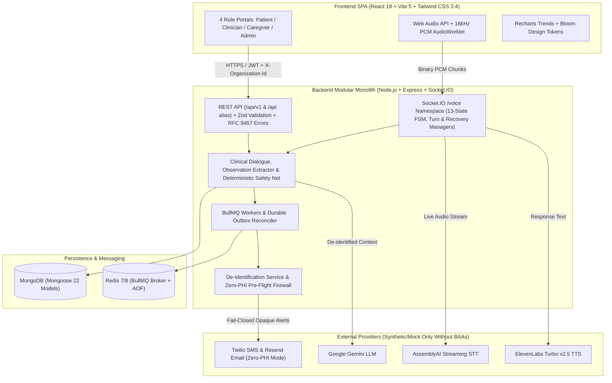

# Companio — Voice-First Healthcare & Wellness Check-In Platform (Adults 55+)

**Document Purpose:** Primary entry point and engineering overview for the Companio repository.  
**Owner Category:** Engineering & Product  
**Status:** Prototype / Pilot-Safe Synthetic Validation Complete (`SYNTHETIC DATA MODE ONLY`)  
**Last Verified:** 2026-11-12  

> [!CAUTION]
> **MANDATORY SAFETY, CLINICAL & PRODUCTION READINESS NOTICE**
> - Companio is an AI-assisted **clinician-support** and remote wellness check-in prototype. It **NEVER** diagnoses medical conditions, prescribes medications, alters treatment plans, or replaces professional clinical judgment. It is **NOT** an emergency dispatch service (e.g., 911/112/999).
> - **Deployment Restriction:** Live human recruitment and clinical production deployment are **NOT AUTHORIZED**. Third-party HIPAA Business Associate Agreements (BAAs), independent penetration testing, Clinical Advisory Board sign-off, and IRB written approval remain **OPEN / BLOCKED**. Companio **MUST** remain strictly in **synthetic-data mode** until formal executive authorization is obtained.

---

## 1. Product Overview

Companio is an AI-powered, voice-first healthcare and wellness support platform engineered specifically for adults aged 55+ and post-discharge monitoring. Rather than forcing older adults through dense menus and form-heavy portals, Companio enables structured daily and weekly wellness check-ins via natural spoken conversation, captures standardized clinical observations (mapped to LOINC codes), evaluates clinical safety flags deterministically, and produces evidence-linked retrospective reports for clinicians.

### Problem Solved
- **High friction for older adults:** Conventional remote patient monitoring (RPM) interfaces rely on small touch targets, tiny fonts, and manual data entry, causing high abandonment among adults 55+.
- **Clinician alert fatigue & unverified AI claims:** Raw conversational transcripts overwhelm physicians, while unconstrained LLM summaries risk arithmetic errors, omissions, or clinical hallucinations.
- **Opaque family caregiver boundaries:** Informal family caregivers often lack explicit, patient-revokable permission boundaries and auditable concern channels.

### Target Users
1. **Patients (55+):** Mobile-first accessible portal (`PatientLayout`), 16-state reactive `VoiceOrb` check-in interface, plain-language read-back summaries, longitudinal history, medication schedules, labs, appointments, consent center, and caregiver access management.
2. **Clinicians & Care Coordinators:** Triage-sorted dashboard (`ClinicianLayout`), unacknowledged RED-flag strips, structured observation drawers, deterministic/attested weekly reports with PDF export, voice transcript audit logs, and team/appointment views.
3. **Authorized Caregivers:** Scoped caregiver portal (`CaregiverLayout`) strictly bounded by patient-granted consent scopes (`CaregiverAccessGrant`), concern reporting (`CAREGIVER_REPORTED`), assisted voice check-in metadata, and immutable access audits.
4. **Organization Administrators:** Multi-tenant clinic governance console (`OrganizationAdminLayout`) for member invitations, team management, RBAC role visibility, operational queue/alert monitoring, and explicitly surfacing governance gaps.

---

## 2. Core Capabilities

| Capability Domain | Implementation Summary | Status | Authoritative Documentation |
| :--- | :--- | :--- | :--- |
| **Voice Check-In Pipeline** | Browser 16kHz PCM `AudioWorklet` -> Socket.IO `/voice` (13-state FSM, barge-in, resume tokens) -> AssemblyAI STT -> Gemini LLM -> ElevenLabs TTS | **IMPLEMENTED / TESTED** | [`docs/06_AI_AND_VOICE/`](docs/06_AI_AND_VOICE/AI_SYSTEM_OVERVIEW.md) |
| **Structured Clinical Dialogue** | Daily & weekly check-in templates, missing-data categorization (never coerced to zero), read-back confirmation, LOINC observations | **IMPLEMENTED / TESTED** | [`docs/06_AI_AND_VOICE/CLINICAL_DIALOGUE.md`](docs/06_AI_AND_VOICE/CLINICAL_DIALOGUE.md) |
| **Clinical Safety & Escalation** | Dual-layer detection (LLM tool calling + deterministic `KeywordSafetyNet` with 13 RED / 10 YELLOW categories), SLA escalation dispatcher & outbox | **IMPLEMENTED / TESTED** | [`docs/07_CLINICAL_SAFETY/`](docs/07_CLINICAL_SAFETY/CLINICAL_SAFETY_OVERVIEW.md) |
| **Deterministic Reporting & Attestation** | Plain-JS metric aggregation, data completeness evaluation, SHA-256 content hashing, immutable clinician attestation, non-destructive versioning, PDF export | **IMPLEMENTED / TESTED** | [`docs/07_CLINICAL_SAFETY/CLINICAL_REPORTING.md`](docs/07_CLINICAL_SAFETY/CLINICAL_REPORTING.md) |
| **Caregiver & Family Portal** | SHA-256 single-use invitations, granular 7-scope grants, instant revocation, assisted check-ins, `CaregiverConcern` routing, immutable audit log | **IMPLEMENTED / TESTED** | [`docs/08_CAREGIVER_PORTAL/`](docs/08_CAREGIVER_PORTAL/CAREGIVER_OVERVIEW.md) |
| **Multi-Tenancy & RBAC** | `Organization`, `Membership` (7 roles), `Team`, `Invitation`, strict tenant isolation via `tenantContext` middleware | **IMPLEMENTED / TESTED** | [`docs/03_ARCHITECTURE/MULTI_TENANCY_ARCHITECTURE.md`](docs/03_ARCHITECTURE/MULTI_TENANCY_ARCHITECTURE.md) |
| **Privacy, Consent & De-Identification** | Append-only `ConsentRecord` ledger (5 consent purposes), heuristic 18-category Safe Harbor scrubber, Zero-PHI SMS/Email pre-flight firewall | **IMPLEMENTED / TESTED** *(Synthetic Only)* | [`docs/09_SECURITY_AND_PRIVACY/`](docs/09_SECURITY_AND_PRIVACY/SECURITY.md) |
| **Distributed Background Jobs** | 7 BullMQ queues backed by Redis (with `InMemoryQueue` dev fallback), durable outbox reconciler, Monday 02:00 weekly cron | **IMPLEMENTED / TESTED** | [`docs/03_ARCHITECTURE/BACKGROUND_JOB_ARCHITECTURE.md`](docs/03_ARCHITECTURE/BACKGROUND_JOB_ARCHITECTURE.md) |
| **Bloom Accessibility Design System** | Day/Night contrast themes (20 WCAG AA/AAA verified pairs), 100%–150% text scaling, `prefers-reduced-motion`, React `lazy()` code splitting | **IMPLEMENTED / VERIFIED** | [`docs/02_DESIGN/DESIGN_SYSTEM.md`](docs/02_DESIGN/DESIGN_SYSTEM.md) |
| **External Governance & Clinical Pilot** | Vendor BAAs, external penetration test, Clinical Advisory Board approval, IRB written approval | **BLOCKED / PENDING** | [`docs/13_GOVERNANCE_AND_COMPLIANCE/`](docs/13_GOVERNANCE_AND_COMPLIANCE/PRODUCTION_READINESS.md) |

---

## 3. High-Level Architecture



---

## 4. Verified Technology Stack

Verified directly against [`package.json`](package.json), [`client/package.json`](client/package.json), and [`server/package.json`](server/package.json):

- **Frontend:** React `18.3.1`, Vite `5.2.11`, Tailwind CSS `3.4.3`, React Router DOM `7.18.3`, Recharts `3.10.1`, Socket.IO Client `4.7.5`, Axios `1.20.0`, Lucide React `0.383.0`, Web Audio API + custom `AudioWorklet` (`client/public/audio-processor.js`).
- **Backend:** Node.js `v20+` (ESM), Express `4.19.2`, Socket.IO `4.7.5`, Mongoose `8.4.1` (MongoDB `6.0+`), Zod `4.6.7`, JSON Web Token (`jsonwebtoken` `9.0.3`), `bcryptjs` `3.0.3`, Helmet `8.3.0`, Express Rate Limit `8.7.3`, PDFKit `0.20.2`, Node-Cron `4.6.0`.
- **Distributed Queues:** Redis (`ioredis` `5.11.1`, `ioredis-mock` `8.13.1`), BullMQ `6.6.0`.
- **External AI & Communications:** AssemblyAI SDK (`assemblyai` `4.41.2`), Google Generative AI (`@google/generative-ai` `0.24.1`), ElevenLabs (`elevenlabs` `1.59.0`), Twilio (`twilio` `6.1.1`), Resend (`resend` `6.28.1`).
- **Infrastructure & Observability:** Docker (`node:20-alpine`, `nginx:alpine`), Docker Compose, OpenMetrics/Prometheus `/metrics` endpoint, Kubernetes probes (`/api/v1/health/{live,ready,startup}`), zero-dependency structured `Logger` with deep PHI/secret redaction.

---

## 5. Repository Structure

```text
Companio/
├── client/                     # React 18 + Vite 5 + Tailwind SPA
│   ├── public/                 # Static assets & AudioWorklet processor (audio-processor.js)
│   └── src/
│       ├── components/         # Role layouts, UI atoms, admin/clinician/report/voice modules
│       ├── context/            # AuthContext & ThemeContext (Day/Night, 100-150% text scale)
│       ├── hooks/              # Audio capture, playback, barge-in, recovery, network hooks
│       ├── pages/              # Route-level lazy-loaded Patient, Clinician, Caregiver & Admin views
│       ├── services/           # Axios client (api.js) & Socket.IO /voice wrapper (socket.js)
│       └── tests/              # Mathematical WCAG 2.1 contrast audit (testColorContrast.js)
├── server/                     # Express + Socket.IO + BullMQ modular monolith
│   └── src/
│       ├── config/             # DB connection & Zod startup envValidator
│       ├── constants/          # RBAC permissions catalog (permissions.js)
│       ├── controllers/        # Auth, Consent, Organization & Team controllers
│       ├── errors/             # RFC 9457 AppError hierarchy
│       ├── jobs/               # Redis connection, BullMQ queues, 7 workers, cron & fallback
│       ├── middleware/         # JWT auth, tenantContext, RBAC, Zod validate, rateLimiter
│       ├── migrations/         # Phase 2 & 3 data migration scripts
│       ├── models/             # 22 Mongoose domain models
│       ├── routes/             # 16 Express v1/legacy REST routers + metrics
│       ├── services/           # AI dialogue, safety net, reporting, caregivers, privacy, telemetry
│       ├── sockets/            # /voice namespace auth & session gateway
│       ├── tests/              # Domain & Phase verification suites
│       ├── utils/              # Structured Logger (PHI redaction), pagination, correlation, response
│       └── validators/         # Zod validation schemas per resource
├── docs/                       # Structured 15-section engineering knowledge base
├── UI/                         # Design source kit & Lottie assets
├── .env.example                # Development environment variable template
├── .env.production.example     # Production template (Redis TLS, strict secrets)
├── docker-compose.yml          # Multi-container orchestration (MongoDB, Redis, Server, Worker, Client)
├── Dockerfile.client           # Multi-stage Nginx SPA image
├── Dockerfile.server           # Non-root Node 20 Alpine server/worker image
├── package.json                # Root monorepo scripts and test commands
├── AI_AGENTS.md                # Permanent engineering & safety guardrails for AI coding agents
├── CONTRIBUTING.md             # Contribution, branch, testing & documentation rules
├── SECURITY.md                 # Security boundaries, reporting & production restrictions
└── CHANGELOG.md                # Historical release & milestone summary
```

---

## 6. Quick Start & Prerequisites

### Prerequisites
- **Node.js:** `v20.x` recommended (`v18+` minimum; Docker uses `node:20-alpine`)
- **MongoDB:** `6.0+` (local `mongodb://localhost:27017/companio` or Atlas URI)
- **Redis (optional for local dev, required for live queue tests):** `6.2+` / `7+` (local dev falls back automatically to `InMemoryQueue` unless `ALLOW_IN_MEMORY_FALLBACK=false` in production)
- **Docker & Docker Compose (optional):** For containerized stack execution

### Setup Instructions

1. **Install all dependencies (root, server, and client):**
   ```bash
   npm run install:all
   ```
2. **Configure environment variables:**
   Copy `.env.example` to `.env` (and `.env` inside `server/` if running server standalone) and configure placeholders. Do **not** commit `.env`.
   - Note: `AUDIO_RETENTION_MODE` must remain `disabled` (enforced by Zod in `server/src/config/envValidator.js`).
3. **Seed synthetic demo data (optional, synthetic data only):**
   ```bash
   npm run seed
   ```
   Seeded synthetic demo accounts from `server/src/seed.js` (password: `password123`):
   - **Clinician:** `sjenkins@healthclinic.org` (Dr. Sarah Jenkins, MD)
   - **Patients:** `robert.miller@example.com`, `eleanor.vance@example.com`, `arthur.p@example.com`
4. **Launch development servers (Express `:5000` + Vite `:5173`):**
   ```bash
   npm run dev
   ```
   Or launch via Docker Compose:
   ```bash
   docker-compose up --build -d
   ```

For comprehensive installation and Docker configuration details, see [`docs/11_INFRASTRUCTURE_AND_OPERATIONS/SETUP.md`](docs/11_INFRASTRUCTURE_AND_OPERATIONS/SETUP.md).

---

## 7. Development & Verification Commands

All commands below are verified directly against [`package.json`](package.json) and [`client/package.json`](client/package.json):

| Command | Purpose |
| :--- | :--- |
| `npm run dev` | Start backend Express/Socket.IO server (`:5000`) and Vite React client (`:5173`) concurrently |
| `npm run dev:server` | Start backend server with Nodemon hot reload |
| `npm run dev:client` | Start Vite frontend development server |
| `npm run seed` | Reset and populate MongoDB with synthetic demo patients, clinicians, check-ins, flags, labs & appointments |
| `npm run build:client` | Build production React bundle (`client/dist/`) |
| `npm run check:contrast` | Run mathematical WCAG 2.1 Day/Night contrast verification across 20 token pairs |
| `npm run test:voice` | Voice gateway integration suite (13-state FSM, audio chunks, barge-in, recovery, consent revocation) |
| `npm run test:safety` | Clinical safety engine, keyword safety net, risk normalization, and escalation outbox tests |
| `npm run test:dialogue` | Structured clinical dialogue workflows, question planner, and observation quality tests |
| `npm run test:reporting` | Deterministic clinical metrics, report versioning, SHA-256 provenance, attestation, and PDF export tests |
| `npm run test:caregivers` | Caregiver invitations, scoped grants, immediate revocation, concerns, and access audit tests |
| `npm run test:jobs` | BullMQ 7-worker architecture, deduplication, retry backoff, and queue admin APIs |
| `npm run test:redis` | Live Redis connectivity, multi-worker isolation, and failure injection (requires running Redis) |
| `npm run test:operations` | Phase 10 Release Gates A–E (health probes, Prometheus metrics, alert engine, outbox reconciler) |
| `npm run test:drill` | Real MongoDB backup and restore SHA-256 bit-parity verification drill |
| `npm run test:recovery` | Password recovery token hashing, single-use burn, enumeration defense, and JWT invalidation |
| `npm run test:pilot` | 11-stage controlled synthetic end-to-end patient lifecycle suite |
| `npm run test:deid` | Pilot-safe de-identification & zero-PHI SMS/Email payload verification (12 assertions) |
| `npm run test:deid:audit` | Phase 12.2.1 adversarial de-identification & 18 Safe Harbor categories audit (30 assertions) |

> **Known Script Discrepancy:** `client/package.json` defines `"lint": "eslint ."`, but `eslint` is not currently installed in `client/package.json` `devDependencies` (captured in [`docs/14_DEVELOPMENT_AND_RELEASE/KNOWN_ISSUES.md`](docs/14_DEVELOPMENT_AND_RELEASE/KNOWN_ISSUES.md)).

---

## 8. Documentation Navigation

Start at [`docs/README.md`](docs/README.md) or browse by engineering domain:

- **Overview & Index:** [`docs/DOCUMENTATION_INDEX.md`](docs/DOCUMENTATION_INDEX.md) | [`docs/PROJECT_OVERVIEW.md`](docs/PROJECT_OVERVIEW.md) | [`docs/PROJECT_STATUS.md`](docs/PROJECT_STATUS.md) | [`docs/GLOSSARY.md`](docs/GLOSSARY.md)
- **Product & UX:** [`docs/01_PRODUCT/PRD.md`](docs/01_PRODUCT/PRD.md) | [`docs/02_DESIGN/DESIGN_SYSTEM.md`](docs/02_DESIGN/DESIGN_SYSTEM.md)
- **Architecture, Data & APIs:** [`docs/03_ARCHITECTURE/ARCHITECTURE.md`](docs/03_ARCHITECTURE/ARCHITECTURE.md) | [`docs/04_DATABASE/DATABASE.md`](docs/04_DATABASE/DATABASE.md) | [`docs/05_API/API_CONTRACT.md`](docs/05_API/API_CONTRACT.md)
- **AI, Voice & Clinical Safety:** [`docs/06_AI_AND_VOICE/AI_AGENT_RULES.md`](docs/06_AI_AND_VOICE/AI_AGENT_RULES.md) | [`docs/07_CLINICAL_SAFETY/CLINICAL_SAFETY_OVERVIEW.md`](docs/07_CLINICAL_SAFETY/CLINICAL_SAFETY_OVERVIEW.md) | [`docs/08_CAREGIVER_PORTAL/CAREGIVER_OVERVIEW.md`](docs/08_CAREGIVER_PORTAL/CAREGIVER_OVERVIEW.md)
- **Security, Integrations & Ops:** [`docs/09_SECURITY_AND_PRIVACY/SECURITY.md`](docs/09_SECURITY_AND_PRIVACY/SECURITY.md) | [`docs/10_INTEGRATIONS/INTEGRATIONS.md`](docs/10_INTEGRATIONS/INTEGRATIONS.md) | [`docs/11_INFRASTRUCTURE_AND_OPERATIONS/SETUP.md`](docs/11_INFRASTRUCTURE_AND_OPERATIONS/SETUP.md)
- **Testing, Governance & Release:** [`docs/12_TESTING_AND_QUALITY/TESTING_PLAN.md`](docs/12_TESTING_AND_QUALITY/TESTING_PLAN.md) | [`docs/13_GOVERNANCE_AND_COMPLIANCE/PRODUCTION_READINESS.md`](docs/13_GOVERNANCE_AND_COMPLIANCE/PRODUCTION_READINESS.md) | [`docs/14_DEVELOPMENT_AND_RELEASE/IMPLEMENTATION_PLAN.md`](docs/14_DEVELOPMENT_AND_RELEASE/IMPLEMENTATION_PLAN.md)
- **Historical Phase Records:** [`docs/15_PHASE_REPORTS/`](docs/15_PHASE_REPORTS/)
