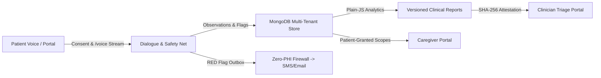

# Companio — Product Requirements Document (PRD)

**Document Purpose:** Authoritative product specification defining problem scope, target personas, implemented capabilities, non-goals, clinical boundaries, and success criteria for Companio.  
**Scope:** End-to-end Companio platform across Patient (55+), Clinician, Caregiver, and Organization Admin portals.  
**Status:** `IMPLEMENTED (SYNTHETIC DATA MODE) / EXTERNAL PILOT BLOCKED`  
**Owner Category:** Product  
**Last Verified Date:** 2026-11-12  
**Relevant Source Files:** [`client/src/App.jsx`](../../client/src/App.jsx), [`server/src/routes/index.js`](../../server/src/routes/index.js), [`server/src/models/index.js`](../../server/src/models/index.js)

> [!IMPORTANT]
> Companio is a **clinician-support** wellness platform for older adults (55+). It **NEVER** autonomously diagnoses conditions, prescribes treatments, alters medication regimens, or serves as an emergency dispatch system.

---

## 1. Executive Summary & Value Proposition

Companio replaces form-heavy, menu-driven remote patient monitoring (RPM) interfaces with natural spoken dialogue tailored for older adults (55+), paired with deterministic safety checks, structured observations, scoped caregiver collaboration, and attested clinical reports.

> **Core Loop:** Patient Voice Conversation ➔ Structured LOINC Observations & Deterministic Safety Net ➔ Verified Clinician Triage & Attested Retrospective Report

---

## 2. Target Users & Roles

Verified directly against [`server/src/constants/permissions.js`](../../server/src/constants/permissions.js):

| Role | Portal Route Prefix | Core Product Needs |
| :--- | :--- | :--- |
| **Patient (`PATIENT`, 55+)** | `/patient/*` | Zero-friction voice check-ins, clear read-back confirmation, plain-language history, transparent consent controls, explicit caregiver delegation |
| **Clinician (`CLINICIAN`)** | `/clinician/*` | Calm triage queue surfacing unacknowledged RED flags first, observation provenance, non-auto-closing flag workflows, versioned attested reports |
| **Care Coordinator (`CARE_COORDINATOR`)** | `/clinician/*` | Patient overview, check-ins, read-only flags/reports, appointment scheduling coordination |
| **Caregiver (`CAREGIVER`)** | `/caregiver/*` | Scoped visibility into a loved one's approved wellness/appointments, `CAREGIVER_REPORTED` concern submission, assisted voice check-ins |
| **Org Owner / Admin (`ORG_OWNER`, `ORG_ADMIN`)** | `/admin/*` | Multi-tenant clinic provisioning, staff invitations, role/team management, queue/alert operational monitoring without unrestricted clinical browsing |
| **Auditor (`AUDITOR`)** | `/admin/*` | Read-only access to audit trails, clinical reports, conversation logs, and membership structures |

*(Detailed persona profiles live in [`USER_PERSONAS.md`](USER_PERSONAS.md) and [`TARGET_USERS.md`](TARGET_USERS.md).)*

---

## 3. Core Implemented Capabilities

### 3.1 Patient Experience (55+ Accessibility-First)
- **Onboarding & Granular Consent:** Five distinct consent scopes (`MICROPHONE`, `LIVE_TRANSCRIPTION`, `AI_PROCESSING`, `AUDIO_RETENTION`, `CLINICIAN_SHARING`) stored in an append-only ledger with withdrawal confirmation dialogs ([`PatientSettings.jsx`](../../client/src/pages/PatientSettings.jsx)).
- **Voice Check-In & 16-State `VoiceOrb`:** Live streaming 16kHz PCM capture, real-time captions, pause/repeat controls, slow-speech cadence support, barge-in interruption, and disconnect recovery ([`VoiceCheckIn.jsx`](../../client/src/pages/VoiceCheckIn.jsx)).
- **Structured Daily & Weekly Dialogue:** Covers medication adherence, side effects, symptoms, sleep, hydration, nutrition, activity, mood/wellbeing, open concerns, mobility, falls, and social isolation ([`Checkin.js`](../../server/src/models/Checkin.js), [`Observation.js`](../../server/src/models/Observation.js)).
- **Read-Back Confirmation (`CheckInComplete`):** Displays confirmed vs. declined/clarification items and distinct three-stage routing indicators (`Recorded for your care team`, `Notification sent` with delivery evidence, `Reviewed by your care team` with acknowledgement evidence) ([`CheckInComplete.jsx`](../../client/src/pages/CheckInComplete.jsx)).
- **Longitudinal Health Views:** Wellness history timeline + Recharts trends (unknowns never shown as `0`), Pathology/Labs with neutral framing, separated Prescribed vs. Patient-Reported Medications, Appointments, My Care Team, and Caregiver Access Management.

### 3.2 Clinician Experience
- **Triage Dashboard:** Red-alert banner rendered **only** when unacknowledged RED flags exist; urgency-sorted queue with filters (`RED`, `YELLOW`, `Stable`, `Unacknowledged`, `Assigned to me`, `Stale`) ([`ClinicianDashboard.jsx`](../../client/src/pages/ClinicianDashboard.jsx)).
- **Patient Chart (`PatientDetail.jsx`):** Tabbed chart (`Overview`, `Trends`, `Check-ins`, `Medications`, `Flags`, `Reports`, `Appointments`, `Labs`, `Voice Logs`, `Audit`), observation provenance drawer, and Flag lifecycle dialog (`acknowledge`, `assign`, `note`, `escalate`, `resolve with rationale`). Flags never auto-close.
- **Clinical Reports & Attestation (`ClinicianReports.jsx`):** Plain-JS computed metrics, data completeness markers, AI/template narration indicator, version history timeline, approve + SHA-256 attestation, reject, non-destructive amend, publish, and PDF export.

### 3.3 Clinical Safety & Escalation Engine
- **Dual-Layer Detection:** LLM structured function calls paired with an independent deterministic `KeywordSafetyNet` covering **13 RED** and **10 YELLOW** categories with negation/contextual disambiguation (`SafetyRule.js`).
- **Durable Escalation & Zero-PHI Notifications:** MongoDB `EscalationEvent` outbox dispatched via BullMQ/Redis to Twilio SMS and Resend Email using opaque alert tokens (`ALERT_REF_...`) and a fail-closed privacy firewall.

### 3.4 Caregiver & Family Portal
- Patient-controlled single-use SHA-256 invitations, time-bounded and scope-limited grants (`CaregiverAccessGrant`), immediate patient revocation, `CAREGIVER_REPORTED` concerns routed into the clinical safety net, assisted voice check-in metadata (`assistedByCaregiver`), and immutable `CaregiverAccessEvent` auditing.

### 3.5 Multi-Tenancy & Enterprise Operations
- Strict `organizationId` scoping via `tenantContext`, organization switching, team management, Prometheus `/metrics`, Kubernetes health probes, BullMQ queue monitoring, and Zod startup validation.

---

## 4. Non-Goals & Strict Out-of-Scope Boundaries

1. **No Medical Diagnosis or Prescribing:** The AI agent and reporting engine must never diagnose disease, adjust dosages, or contradict a physician care plan.
2. **No Emergency Dispatch Integration:** Companio is not a 911/112 ambulance dispatch service; emergency notices are read from organization settings with documented fallbacks.
3. **No Silent Audio Storage:** Raw patient audio retention is forced to `'disabled'` at runtime validation (`envValidator.js`).
4. **No Live Clinical Deployment Yet:** External pilot and commercial launch remain blocked pending vendor BAAs, penetration testing, Clinical Advisory Board approval, and IRB authorization.

---

## 5. Architecture & Acceptance Overview

---

## 6. Related Documentation

- [Technical Requirements (TRD)](TRD.md)
- [Product Vision](PRODUCT_VISION.md)
- [Functional Requirements](FUNCTIONAL_REQUIREMENTS.md)
- [Non-Functional Requirements](NON_FUNCTIONAL_REQUIREMENTS.md)
- [Product Scope & Limitations](PRODUCT_SCOPE_AND_LIMITATIONS.md)
- [Project Status & Readiness](../PROJECT_STATUS.md)
