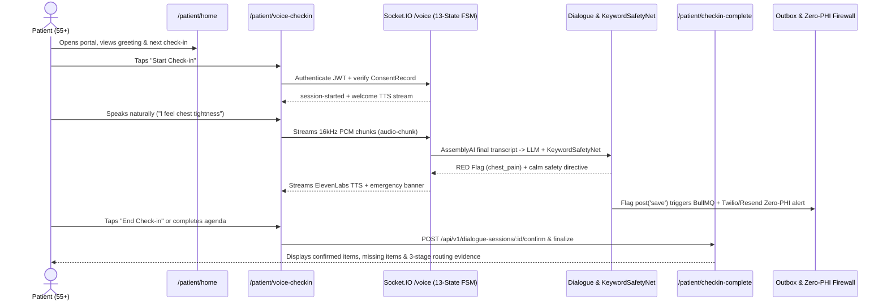
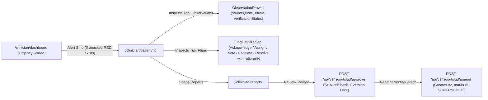

# Companio — End-to-End User Journeys

**Document Purpose:** Map the multi-step operational journeys across Patient, Clinician, Caregiver, and Admin workflows using verifiable UI routes and API states.  
**Scope:** Core end-to-end journeys across the Companio application.  
**Status:** `IMPLEMENTED / VERIFIED`  
**Owner Category:** Product & Design  
**Last Verified Date:** 2026-11-12  
**Relevant Source Files:** [`client/src/App.jsx`](../../client/src/App.jsx), [`server/src/sockets/voiceSession.js`](../../server/src/sockets/voiceSession.js), [`server/src/routes/`](../../server/src/routes/index.js)

---

## 1. Patient Voice Check-In & Safety Escalation Journey

---

## 2. Clinician Triage, Evidence Inspection & Report Attestation Journey

---

## 3. Patient-Controlled Caregiver Delegation & Concern Journey

1. Patient visits `/patient/caregivers` (`PatientCaregiverAccess.jsx`) and creates an invitation via `POST /api/v1/patients/:patientId/caregivers/invitations`.
2. Caregiver accepts the SHA-256 single-use invitation (`POST /api/v1/caregivers/invitations/:id/accept`).
3. Patient grants explicit scopes (`CaregiverAccessGrant` via `POST /api/v1/patients/:patientId/caregiver-access`) with optional expiry date.
4. Caregiver logs into `/caregiver/dashboard`, selects the linked patient, and views permitted check-ins/appointments. Every read logs an immutable `CaregiverAccessEvent`.
5. Caregiver submits an observation via `/caregiver/concerns` (`POST /api/v1/caregiver/patients/:patientId/concerns`), stored with `sourceType: 'CAREGIVER_REPORTED'` and evaluated by Phase 5 safety rules.
6. Patient revokes access at any time (`POST /api/v1/caregiver-access/:grantId/revoke`), taking immediate effect on subsequent requests and suppressing notifications.

---

## 4. Organization Admin Governance Journey

1. Admin logs in, selects active clinic via `OrganizationSwitcher`, and opens `/admin/dashboard`.
2. Invites clinicians/coordinators (`POST /api/v1/organizations/:id/invitations`), manages teams (`/admin/teams`), and updates organization emergency contact settings (`PATCH /api/v1/organizations/:id`) with explicit confirmation dialogs (`ConfirmPolicyChangeDialog`, `ConfirmSuspensionDialog`, `ConfirmRoleChangeDialog`).
3. Monitors BullMQ queue backlogs (`/admin/audit-logs`) and evaluates alerting rules (`/api/v1/admin/alerts/evaluate`).

---

## 5. Related Documentation

- [Screen Specifications](../02_DESIGN/SCREEN_SPECIFICATIONS.md)
- [Information Architecture](../02_DESIGN/INFORMATION_ARCHITECTURE.md)
- [Voice Session Lifecycle](../06_AI_AND_VOICE/VOICE_SESSION_LIFECYCLE.md)
