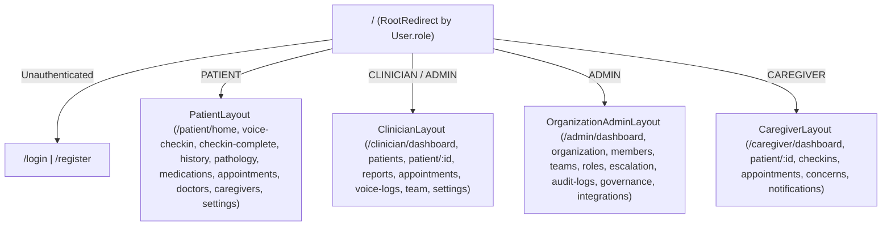

# Companio — UI/UX Specification

**Document Purpose:** Unified functional UI/UX specification connecting Companio's Bloom Design System, role-based layouts, patient safety interactions, and clinical workflows.  
**Scope:** React 18 SPA across Patient, Clinician, Caregiver, Organization Admin, and Auth flows.  
**Status:** `IMPLEMENTED / BUILD VERIFIED`  
**Owner Category:** Design & Frontend Engineering  
**Last Verified Date:** 2026-11-12  
**Relevant Source Files:** [`client/src/App.jsx`](../../client/src/App.jsx), [`client/src/components/layout/`](../../client/src/components/layout/AppLayout.jsx), [`client/src/pages/`](../../client/src/pages/PatientHome.jsx)

---

## 1. Portal Layout Separation

| Layout Component | Portal Routes | Navigation Model | Primary Design Goal |
| :--- | :--- | :--- | :--- |
| [`PatientLayout`](../../client/src/components/layout/PatientLayout.jsx) | `/patient/*` | Mobile-first sticky bottom nav (`Home`, `Check-in`, `History`, `Appointments`, `More`) + top header | Zero cognitive clutter; 64px primary CTA; clear escape hatches |
| [`ClinicianLayout`](../../client/src/components/layout/ClinicianLayout.jsx) | `/clinician/*` | Collapsible desktop sidebar + top bar + `OrganizationSwitcher` | Calm triage density; rapid patient switching; clinical provenance |
| [`CaregiverLayout`](../../client/src/components/layout/CaregiverLayout.jsx) | `/caregiver/*` | Linked-patient switcher + scoped nav (`Overview`, `Check-ins`, `Appointments`, `Concerns`, `Notifications`) | Transparent permission bounds + organization emergency callout |
| [`OrganizationAdminLayout`](../../client/src/components/layout/OrganizationAdminLayout.jsx) | `/admin/*` | Administrative sidebar (`Overview`, `Members`, `Teams`, `Roles`, `Escalation`, `Audit & Alerts`, `Governance`, `Integrations`) | Minimum Necessary tenant governance with explicit confirmation modals |

---

## 2. Core UX Behavioral Contracts

1. **Calm Triage Principle (`ClinicianDashboard.jsx`):** No fake urgency chrome. Red-alert strip renders **only** when active unacknowledged RED flags exist in the live API payload.
2. **Honest Empty, Partial & Unknown States:** Every data view renders dedicated loading skeletons, empty states (`EmptyState`), offline banners (`NetworkStatusToast`), and unauthorized states. Missing observations render explicit `Missing` / `Declined` statuses (`StatusBadge`), **never `0`**.
3. **Immutable Report Presentation (`ClinicianReports.jsx`):** Approved/Published versions render read-only with unmistakable `VersionHeader` (version, status, attestor, SHA-256 hash). Amendments create a new version.
4. **Non-Auto-Closing Flags (`FlagDetailDialog.jsx`):** Flags expose separate delivery, acknowledgement, and resolution stages and never silently self-close.
5. **No Hardcoded Clinical Data or Raw Hex:** All pages bind strictly to `/api/v1/*` live responses and Bloom CSS variables (`rgb(var(--color-*))`).

---

## 3. Navigation Topology

---

## 4. Security & Privacy UX Controls

- **Withdrawal Confirmation Modals:** Withdrawing any of the 5 consents in [`PatientSettings.jsx`](../../client/src/pages/PatientSettings.jsx) triggers an explicit consequence dialog prior to persisting to `ConsentRecord`.
- **Destructive Admin Confirmations:** Suspending members, changing roles, or modifying org escalation policy requires explicit confirmation (`ConfirmSuspensionDialog`, `ConfirmRoleChangeDialog`, `ConfirmPolicyChangeDialog`).

## 5. Limitations & Unresolved Questions

- Dev design showcase route `/design-system` remains mounted for internal inspection of all 16 `VoiceOrb` states (`DesignSystemShowcase.jsx`).

## 6. Related Documentation

- [Design System ("Bloom")](DESIGN_SYSTEM.md)
- [Information Architecture](INFORMATION_ARCHITECTURE.md)
- [Screen Specifications](SCREEN_SPECIFICATIONS.md)
- [UI/UX Implementation Report (Historical)](../15_PHASE_REPORTS/UI_UX_IMPLEMENTATION_REPORT.md)
