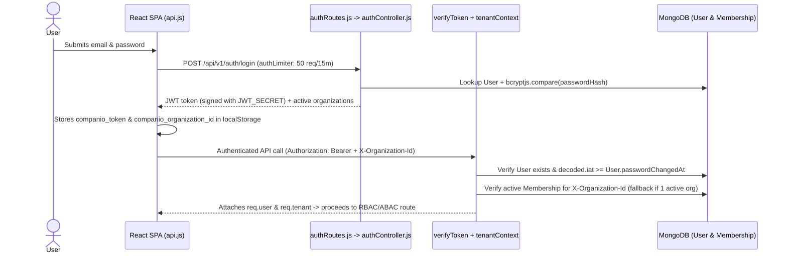

# Companio — Authentication, Session & Tenant Resolution Flow

**Document Purpose:** Document JWT issuance, password recovery, immediate session invalidation, Socket.IO handshake auth, and multi-tenant context binding.  
**Scope:** HTTP REST API (`/api/v1/*`) and Socket.IO `/voice` namespace.  
**Status:** `IMPLEMENTED / TESTED (npm run test:recovery)`  
**Owner Category:** Architecture & Security  
**Last Verified Date:** 2026-11-12  
**Relevant Source Files:** [`server/src/controllers/authController.js`](../../server/src/controllers/authController.js), [`server/src/middleware/auth.js`](../../server/src/middleware/auth.js), [`server/src/middleware/tenantContext.js`](../../server/src/middleware/tenantContext.js), [`server/src/sockets/socketAuth.js`](../../server/src/sockets/socketAuth.js), [`client/src/services/api.js`](../../client/src/services/api.js)

---

## 1. HTTP Login & Tenant Context Flow

---

## 2. Cryptographic Password Recovery & Immediate Session Revocation

1. Client calls `POST /api/v1/auth/forgot-password` with `{ email }`. Server returns uniform HTTP `200` regardless of account existence (user enumeration defense).
2. Server generates a 32-byte cryptographic hex token, persists its **SHA-256 digest** (`passwordResetTokenHash`) and 1-hour expiry (`passwordResetExpiresAt`), never storing the raw token.
3. On `POST /api/v1/auth/reset-password`, server validates the token hash + expiry, updates `passwordHash` (`bcryptjs`), burns the reset token (`null`), and stamps `User.passwordChangedAt = new Date()`.
4. All subsequent requests with older JWTs (`decoded.iat < Math.floor(passwordChangedAt / 1000)`) are rejected with `401 AuthenticationError` in [`auth.js`](../../server/src/middleware/auth.js).

---

## 3. Socket.IO `/voice` Authentication

[`socketAuthMiddleware`](../../server/src/sockets/socketAuth.js) validates `socket.handshake.auth.token` before connection upgrade, loads the user, verifies active organization membership, and isolates sockets into `org:${orgId}:patient:${patientId}` rooms.

---

## 4. Security & Privacy Considerations

- **Client Storage:** JWT and active `organizationId` are persisted in `localStorage` (`companio_token`, `companio_organization_id`), requiring strict XSS hygiene and future evaluation of `HttpOnly` cookies prior to commercial launch.
- **Rate Limiter Discrepancy:** `authRoutes.js` configures `50 req / 15m` inline, whereas `rateLimiter.js` defines `15 req / 15m`. See [`KNOWN_ISSUES.md`](../14_DEVELOPMENT_AND_RELEASE/KNOWN_ISSUES.md).

## 5. Related Documentation
- [Authentication & Authorization Controls](../09_SECURITY_AND_PRIVACY/AUTHENTICATION_AND_AUTHORIZATION.md)
- [Multi-Tenancy Architecture](MULTI_TENANCY_ARCHITECTURE.md)
- [Authorization Matrix](../05_API/AUTHORIZATION_MATRIX.md)
