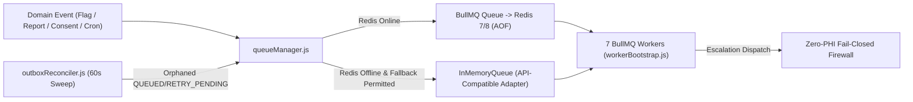

# Companio — Background Job & Distributed Worker Architecture

**Document Purpose:** Document Companio's 7-queue BullMQ architecture, Redis connection/fallback design, worker fleet, cron schedulers, and outbox reconciler.  
**Scope:** `server/src/jobs/` and `docker-compose.yml` `worker` service.  
**Status:** `IMPLEMENTED / TESTED (npm run test:jobs, test:redis)`  
**Owner Category:** Architecture & Infrastructure  
**Last Verified Date:** 2026-11-12  
**Relevant Source Files:** [`server/src/jobs/queueConfig.js`](../../server/src/jobs/queueConfig.js), [`server/src/jobs/queueManager.js`](../../server/src/jobs/queueManager.js), [`server/src/jobs/redisConnection.js`](../../server/src/jobs/redisConnection.js), [`server/src/jobs/inMemoryQueue.js`](../../server/src/jobs/inMemoryQueue.js), [`server/src/jobs/workerBootstrap.js`](../../server/src/jobs/workerBootstrap.js), [`server/src/jobs/weeklyReportWorker.js`](../../server/src/jobs/weeklyReportWorker.js), [`server/src/services/escalation/outboxReconciler.js`](../../server/src/services/escalation/outboxReconciler.js)

---

## 1. Queue Topology & Configuration (`queueConfig.js`)

| Queue Name (`QUEUE_NAMES`) | Priority | Concurrency | Max Attempts | Backoff | Worker File |
| :--- | :---: | :---: | :---: | :--- | :--- |
| `clinical-escalation` | `1` (Highest) | `5` | `5` | Exponential `1000ms` | `workers/clinicalEscalationWorker.js` |
| `sms-notification` | `2` | `5` | `3` | Exponential `2000ms` | `workers/smsNotificationWorker.js` |
| `email-notification` | `3` | `5` | `3` | Exponential `2000ms` | `workers/emailNotificationWorker.js` |
| `caregiver-notification` | `3` | `5` | `3` | Exponential `2000ms` | `workers/caregiverNotificationWorker.js` |
| `checkin-reminder` | `4` | `3` | `2` | Exponential `5000ms` | `workers/checkinReminderWorker.js` |
| `report-generation` | `5` | `2` (Throttled) | `3` | Exponential `5000ms` | `workers/reportGenerationWorker.js` |
| `maintenance` | `6` | `1` | `1` | Exponential `10000ms` | `workers/maintenanceWorker.js` |

All queues specify `removeOnFail: false` so dead-letter jobs remain inspectable via `/api/v1/admin/queues/:name/failed`.

---

## 2. Execution & Failover Architecture

---

## 3. Chronological Schedulers & Reconcilers
- **Weekly Report Cron (`weeklyReportWorker.js`):** Runs via `node-cron` (`0 2 * * 1`, Mondays 02:00) partitioned by active `Organization` in batches of 50 patients, emitting `PENDING_REVIEW` drafts only.
- **Escalation Monitor (`escalationMonitorWorker.js`) & Outbox Reconciler (`outboxReconciler.js`):** Re-enqueues stale outbox dispatches and escalates unacknowledged RED flags past SLA thresholds without ever closing or downgrading flags.

---

## 4. Security & Operational Considerations
- **Zero PHI in Redis:** Job payloads carry database IDs and opaque references, never patient names, diagnoses, or transcript prose.
- **Production Safety:** Set `ALLOW_IN_MEMORY_FALLBACK=false` and `REDIS_FALLBACK=false` in production (`.env.production.example`) to prevent silent volatile job loss.

## 5. Related Documentation
- [Queue Operations](../11_INFRASTRUCTURE_AND_OPERATIONS/QUEUE_OPERATIONS.md)
- [Background Workers](../11_INFRASTRUCTURE_AND_OPERATIONS/BACKGROUND_WORKERS.md)
- [Redis Integration](../10_INTEGRATIONS/REDIS.md)
