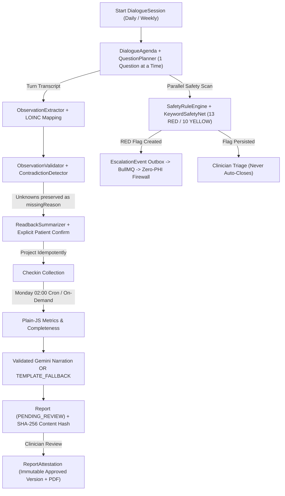

# Companio — Clinical Workflow Architecture

**Document Purpose:** Connect Companio's dialogue, observation extraction, deterministic safety net, escalation outbox, and clinician reporting workflows into a unified clinical execution model.  
**Scope:** Dialogue check-ins through attested clinical reports and flag closure.  
**Status:** `IMPLEMENTED / TESTED (SYNTHETIC MODE — CLINICAL ADVISORY SIGN-OFF PENDING)`  
**Owner Category:** Architecture & Clinical Safety  
**Last Verified Date:** 2026-11-12  
**Relevant Source Files:** [`server/src/services/dialogue/clinicalDialogueManager.js`](../../server/src/services/dialogue/clinicalDialogueManager.js), [`server/src/services/observations/observationQualityEngine.js`](../../server/src/services/observations/observationQualityEngine.js), [`server/src/services/safety/safetyRuleEngine.js`](../../server/src/services/safety/safetyRuleEngine.js), [`server/src/services/reporting/reportVersionService.js`](../../server/src/services/reporting/reportVersionService.js)

---

## 1. Unified Clinical Pipeline

---

## 2. Clinical Integrity Invariants

1. **Missing Data Never Zeroed:** Declined, unknown, or unasked answers carry explicit `missingReason` enum values (`NOT_ASKED`, `DECLINED`, `UNKNOWN`, `UNABLE_TO_ASSESS`) and never pull down adherence denominators or physiological means.
2. **Non-Destructive Retraction:** Contradictory clarifications mark earlier `Observation` documents `RETRACTED` and link replacement observations via `supersedesObservationId`.
3. **Flags Never Auto-Close:** Notification delivery failure or clinician view never closes a `Flag`. Explicit rationale is required for resolution (`POST /api/v1/flags/:flagId/resolve`).
4. **Immutable Attested Reports:** Once `APPROVED`, a `Report` cannot be edited in place; changes spawn `v2+` via `POST /api/v1/reports/:reportId/amend` marking prior versions `SUPERSEDED`.

---

## 3. Related Documentation
- [Clinical Dialogue Architecture](../06_AI_AND_VOICE/CLINICAL_DIALOGUE.md)
- [Clinical Safety Overview](../07_CLINICAL_SAFETY/CLINICAL_SAFETY_OVERVIEW.md)
- [Deterministic Clinical Reporting](../07_CLINICAL_SAFETY/CLINICAL_REPORTING.md)
