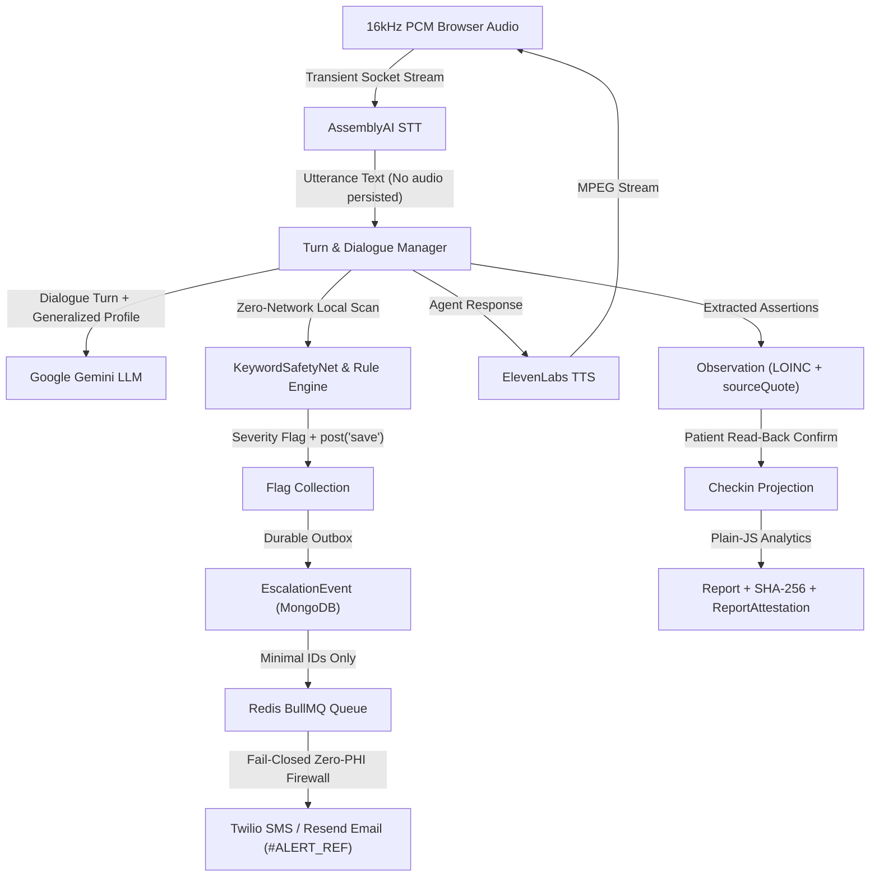

# Companio — End-to-End Data Flow Architecture

**Document Purpose:** Trace how clinical, conversational, biometric audio, escalation, and telemetry data flow across Companio's storage and external trust boundaries.  
**Scope:** Audio streams, transcripts, observations, flags, escalations, reports, and telemetry.  
**Status:** `IMPLEMENTED / VERIFIED (SYNTHETIC MODE)`  
**Owner Category:** Architecture & Security  
**Last Verified Date:** 2026-11-12  
**Relevant Source Files:** [`server/src/sockets/voiceSession.js`](../../server/src/sockets/voiceSession.js), [`server/src/services/observations/observationQualityEngine.js`](../../server/src/services/observations/observationQualityEngine.js), [`server/src/services/escalation/escalationDispatcher.js`](../../server/src/services/escalation/escalationDispatcher.js)

---

## 1. Master Data Flow Diagram

---

## 2. Boundary Minimization Invariants

1. **Biometric Audio (`AUDIO_RETENTION_MODE=disabled`):** Audio chunks exist strictly in memory during WebSocket transit to AssemblyAI; never written to MongoDB, Redis, or disk.
2. **LLM Prompt Context:** `deidentifyPatientProfile()` strips direct identifiers and maps ages $\ge 90$ strictly to `[AGE_90_OR_OLDER]`.
3. **Redis Queue Payloads:** Contain internal identifiers and opaque tokens only; never store patient names, clinical notes, or transcripts.
4. **Outbound Telecom Payloads:** Contain only tier notice, HMAC-SHA256 `ALERT_REF_...`, and generic portal link (`https://app.companio.health/clinician/triage`). Any residual identifier triggers an immediate abort (`auditOutboundPayload()`).
5. **Prometheus Metrics (`/metrics`):** Expose aggregate operational counters/gauges only, with zero patient or tenant PHI labels.

---

## 3. Related Documentation
- [Data Privacy Map](../09_SECURITY_AND_PRIVACY/DATA_PRIVACY_MAP.md)
- [Outbound Data Flow Audit (Phase 12.2.1)](../15_PHASE_REPORTS/PHASE_12_2_1_OUTBOUND_DATA_FLOW_AUDIT.md)
- [Voice Architecture](VOICE_ARCHITECTURE.md)
