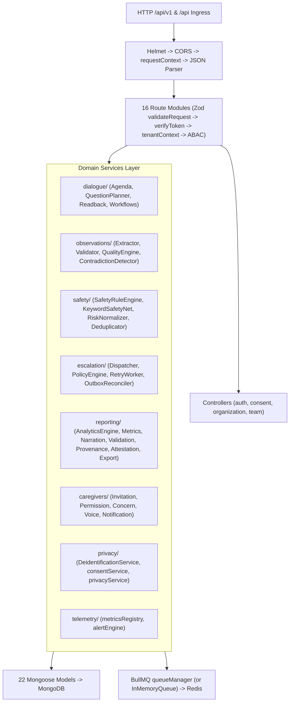

# Companio — C4 Container & Component Architecture

**Document Purpose:** Map Companio's deployable containers (`docker-compose.yml`) and internal modular software components (`client/`, `server/`).  
**Scope:** Runtime containers, backend Express modules, workers, and frontend SPA architecture.  
**Status:** `IMPLEMENTED / VERIFIED`  
**Owner Category:** Architecture & Infrastructure  
**Last Verified Date:** 2026-11-12  
**Relevant Source Files:** [`docker-compose.yml`](../../docker-compose.yml), [`server/src/server.js`](../../server/src/server.js), [`server/src/jobs/workerBootstrap.js`](../../server/src/jobs/workerBootstrap.js), [`client/src/App.jsx`](../../client/src/App.jsx)

---

## 1. Container Topology (`docker-compose.yml`)

| Service Container | Base Image / Tech | Port | Responsibilities |
| :--- | :--- | :--- | :--- |
| **`client`** | `nginx:alpine` (built via `Dockerfile.client`) | `5173 -> 80` | Serves Vite React SPA static assets + reverse-proxies `/api` and `/socket.io` to `server:5000` |
| **`server`** | `node:20-alpine` (non-root `USER node`) | `5000` | Express REST API (`/api/v1`, `/api`), Socket.IO `/voice` gateway, `/metrics`, Monday `02:00` cron scheduler |
| **`worker`** | `node:20-alpine` (`Dockerfile.server`) | None | Runs `initBackgroundWorkers()` executing all 7 BullMQ queue processors independently |
| **`mongodb`** | `mongo:6.0` | `27017` | Primary persistence across 22 Mongoose collections (`mongo-data` volume) |
| **`redis`** | `redis:7-alpine` (`--appendonly yes`) | `6379` | BullMQ message broker, retry scheduler, and job state (`redis-data` volume) |

---

## 2. Backend Component Architecture (`server/src/`)

---

## 3. Frontend Component Architecture (`client/src/`)

- **Context Providers:** `AuthContext` (JWT + `companio_organization_id` + active membership), `ThemeContext` (`Day/Night/Auto`, `100%/125%/150%` root scaling, `reducedMotion`).
- **Role Layouts (`components/layout/`):** `PatientLayout`, `ClinicianLayout`, `CaregiverLayout`, `OrganizationAdminLayout`, wrapping lazy-loaded route pages.
- **Audio & Socket Hooks (`hooks/`):** `useRawPCM` (bridging `client/public/audio-processor.js` AudioWorklet), `useMicCapture`, `useAudioPlayback`, `useBargeIn`, `useVoiceRecovery`, `useNetworkStatus`.
- **Service Adapters (`services/`):** `api.js` (Axios `/api/v1`, attaches `Authorization`, `X-Organization-Id`, `X-Request-Id`, handles 401 redirect + RFC 9457 error normalization), `socket.js` (Socket.IO `/voice` namespace client).

---

## 4. Security & Operational Notes

- Running `worker` alongside `server` avoids competing CPU loads for report generation; note that `server.js` also initializes `initBackgroundWorkers()` and `initWeeklyReportCron()` on startup unless partitioned in production orchestration.
- See [`KNOWN_ISSUES.md`](../14_DEVELOPMENT_AND_RELEASE/KNOWN_ISSUES.md) regarding `Dockerfile.server` `companio-monorepo` `file:..` workspace resolution check.

## 5. Related Documentation
- [System Architecture](ARCHITECTURE.md)
- [Data Flow](DATA_FLOW.md)
- [Docker Deployment Guide](../11_INFRASTRUCTURE_AND_OPERATIONS/DOCKER.md)
