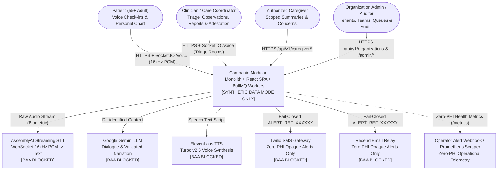

# Companio — C4 System Context Diagram & Boundary Map

**Document Purpose:** Provide a C4 Level-1 System Context view illustrating human actors, trust boundaries, internal systems, and external third-party providers.  
**Scope:** External actors, internal platform, and contractual provider boundaries.  
**Status:** `IMPLEMENTED (EXTERNAL PROVIDERS BLOCKED FOR LIVE PHI WITHOUT BAAs)`  
**Owner Category:** Architecture  
**Last Verified Date:** 2026-11-12  
**Relevant Source Files:** [`server/src/server.js`](../../server/src/server.js), [`docker-compose.yml`](../../docker-compose.yml), [`docs/13_GOVERNANCE_AND_COMPLIANCE/PROVIDER_CONTRACT_REGISTER.md`](../13_GOVERNANCE_AND_COMPLIANCE/PROVIDER_CONTRACT_REGISTER.md)

---

## 1. C4 System Context Diagram

---

## 2. Trust Boundaries & Governance Status

| Boundary Crossing | Protocol & Payload | Governance Constraint |
| :--- | :--- | :--- |
| **Client <-> Server** | HTTPS REST (`/api/v1`) + Socket.IO (`/voice`) with JWT & `X-Organization-Id` | Enforce TLS termination at reverse proxy/load balancer in deployment |
| **Server <-> AssemblyAI** | WSS binary 16kHz PCM audio | Biometric voice data under HIPAA; requires signed BAA prior to live human use |
| **Server <-> Google Gemini** | HTTPS REST JSON dialogue turns & analytics summary | Patient profiles generalized (`safeHarborAgeCategory`); zero-retention enterprise BAA required |
| **Server <-> ElevenLabs** | HTTPS streaming TTS JSON text | Only system-phrased speech strings sent; `AbortSignal` interrupts stream on barge-in |
| **Server <-> Twilio & Resend** | HTTPS REST Zero-PHI tokenized payloads | Fail-closed `auditOutboundPayload` blocks any residual PHI or raw ObjectId |

## 3. Related Documentation
- [System Architecture](ARCHITECTURE.md)
- [System Components](SYSTEM_COMPONENTS.md)
- [Provider Contract Register](../13_GOVERNANCE_AND_COMPLIANCE/PROVIDER_CONTRACT_REGISTER.md)
