# Companio — Real-Time Voice Architecture

**Document Purpose:** Specify the end-to-end audio capture, WebSocket protocol, 13-state FSM, barge-in cancellation, session recovery, and live consent revocation architecture.  
**Scope:** Browser Web Audio/AudioWorklet, Socket.IO `/voice`, AssemblyAI STT, Gemini LLM, ElevenLabs TTS.  
**Status:** `IMPLEMENTED / TESTED (npm run test:voice — 40/40)`  
**Owner Category:** AI & Voice Engineering  
**Last Verified Date:** 2026-11-12  
**Relevant Source Files:** [`client/public/audio-processor.js`](../../client/public/audio-processor.js), [`client/src/hooks/useRawPCM.js`](../../client/src/hooks/useRawPCM.js), [`server/src/sockets/voiceSession.js`](../../server/src/sockets/voiceSession.js), [`server/src/services/voice/session/voiceSessionStateMachine.js`](../../server/src/services/voice/session/voiceSessionStateMachine.js)

---

## 1. Real-Time Pipeline Diagram

```mermaid
flowchart LR
    Mic["Browser Mic"] --> AW["audio-processor.js (AudioWorklet 16kHz Int16 PCM)"]
    AW --> ChunkMgr["useRawPCM -> Socket.IO /voice (audio-chunk + seq)"]
    ChunkMgr -->|"Resource Limiter (1/user, 25/org, <=8KB)"| FSM["VoiceSessionStateMachine (13 States)"]
    FSM -->|"Consent Check (LIVE_TRANSCRIPTION & AI_PROCESSING)"| STT["AssemblyAI Streaming STT (900ms silence)"]
    STT -->|"Partial/Final Transcript"| Turn["TurnManager (AbortController)"]
    Turn -->|"Parallel"| Safety["KeywordSafetyNet"]
    Turn -->|"Sanitized Context"| LLM["Google Gemini Agent"]
    LLM -->|"Response Text"| TTS["ElevenLabs Streaming TTS (eleven_turbo_v2_5)"]
    TTS -->|"MPEG Audio Chunks"| Player["useAudioPlayback + useBargeIn"]
```

---

## 2. Core Protocol Controls

1. **AudioWorklet Capture (`audio-processor.js`):** Dedicated audio thread resamples microphone input to 16kHz 16-bit mono linear PCM without blocking main React UI rendering.
2. **Sequenced Chunk ACK & Backpressure (`audioChunkManager.js`):** Tracks monotonic chunk sequence numbers, detects duplicates, resolves contiguous acknowledgements, and drops excess frames above backpressure caps.
3. **Dual-Layer Barge-In (`turnManager.js`, `useBargeIn.js`):** Patient voice activity immediately stops browser Web Audio playback and triggers server-side `AbortSignal` to cancel active LLM inference and ElevenLabs TTS streaming, discarding stale turn outputs.
4. **Session Recovery (`sessionRecoveryManager.js`):** Issues cryptographically random single-use 32-byte resume tokens (`5-min` recovery window) bound to tenant and patient identity (`orgId` + `patientId`).
5. **Live Consent Revocation (`consentEvents`):** Withdrawing `LIVE_TRANSCRIPTION` or `AI_PROCESSING` mid-session transitions the FSM immediately into terminal `ABORTED` and disconnects the stream (`testConsentRevocation.js`).
6. **Zero Audio Persistence:** `AUDIO_RETENTION_MODE` is strictly `disabled`; transient frame buffers purge on session termination.

---

## 3. Limitations & Security Notes

- In local development/CI without API keys, AssemblyAI (`assemblyAISTT.js`) and ElevenLabs (`elevenLabsTTS.js`) cleanly switch to in-memory fallback adapters.
- Live external AssemblyAI/Gemini/ElevenLabs processing requires signed BAAs before real patient voice use.

## 4. Related Documentation
- [Voice Session Lifecycle (13-State FSM)](../06_AI_AND_VOICE/VOICE_SESSION_LIFECYCLE.md)
- [Audio Chunk Protocol](../06_AI_AND_VOICE/AUDIO_CHUNK_PROTOCOL.md)
- [Voice Recovery Protocol](../06_AI_AND_VOICE/VOICE_RECOVERY_PROTOCOL.md)
