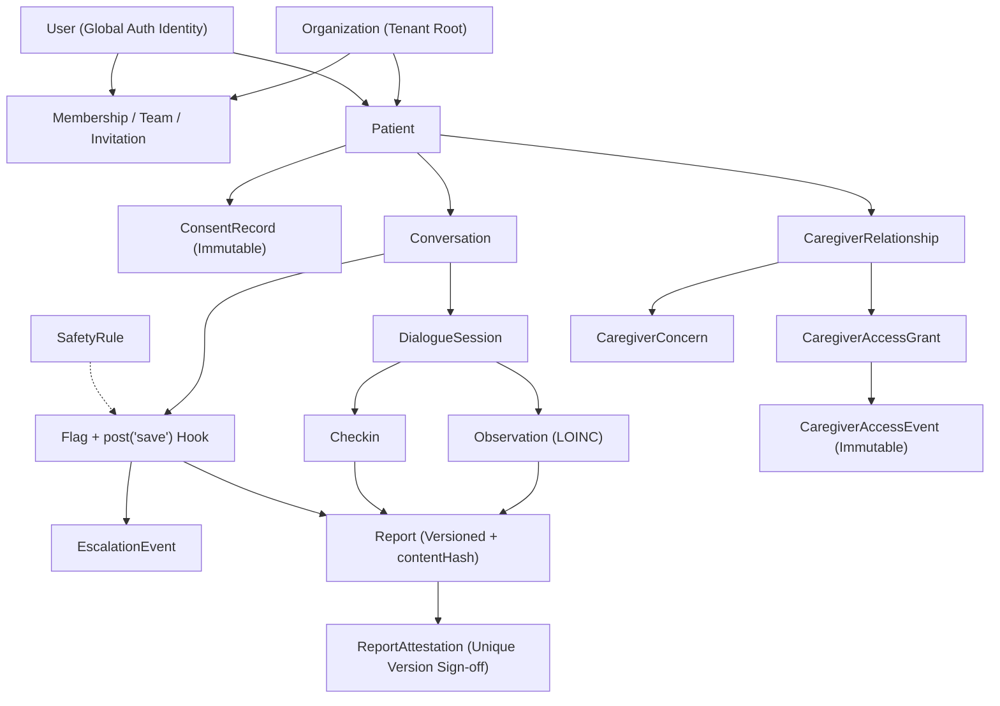

# Companio Database Architecture Overview

## Document Purpose
Provides the authoritative architecture overview of Companio's persistence layer across MongoDB (clinical, identity, tenant, and audit records) and Redis (asynchronous job queues, retry state, and telemetry caches).

## Scope
Covers database engine choices, multi-tenant collection partitioning, immutability guarantees, Mongoose schema inventory across all 22 models, seeding, and operational persistence boundaries.

## Status
- **Implementation Status:** `IMPLEMENTED` (22 Mongoose models active in `server/src/models/`)
- **Schema Governance:** `VERIFIED` (inspected directly against `server/src/models/*.js` on `2026-11-12`)
- **Automated Purge Scheduler:** `NOT VERIFIED` (`Organization.settings.retentionDays` defaults to `365`, without a destructive auto-delete cron worker)

## Last Verified Date
`2026-11-12`

## Relevant Source Files
- [server/src/models/index.js](../../server/src/models/index.js)
- [server/src/config/db.js](../../server/src/config/db.js)
- [server/src/seed.js](../../server/src/seed.js)
- [server/src/services/privacyService.js](../../server/src/services/privacyService.js)
- [docker-compose.yml](../../docker-compose.yml)

---

## 1. Persistence Technologies

| Store | Engine / Version | Driver / Client | Primary Responsibility |
| :--- | :--- | :--- | :--- |
| Primary Document Store | MongoDB `6.0` (Docker) | Mongoose `8.4.1` (`server/package.json`) | Multi-tenant clinical, identity, consent, dialogue, safety, reporting, and caregiver records |
| Queue & Transient Store | Redis `7-alpine` (`--appendonly yes`) | `ioredis` `5.11.1` / BullMQ `6.6.0` | Asynchronous notification queues, escalation retry scheduling, worker coordination, in-memory mock fallback for local dev/tests |
| Local Audio Persistence | None (`disabled`) | `envValidator.js` (`z.literal('disabled')`) | **Zero-audio retention** in runtime configuration; raw microphone chunks are processed transiently in memory |

---

## 2. Complete Inventory of the 22 Mongoose Models

| Domain | Model | Collection | Tenant Scoped (`organizationId`) | Key Lifecycle Role |
| :--- | :--- | :--- | :--- | :--- |
| **Tenant & Identity** | `Organization` | `organizations` | Root (`_id`) | Clinic/hospital tenant configuration, escalation policy, retention days |
| | `User` | `users` | Global account (`email` unique) | Authentication credentials, UI/notification preferences, password reset tokens |
| | `Membership` | `memberships` | Required | Role binding (`ORG_OWNER`..`AUDITOR`) and default permission derivation |
| | `Team` | `teams` | Required | Departmental grouping of clinicians (`clinicianMembershipIds`) |
| | `Invitation` | `invitations` | Required | Hashed organization onboarding tokens with expiry and revocation |
| **Patient & Clinical Record** | `Patient` | `patients` | Optional on legacy schema (`ObjectId`) | Demographics, medications, emergency contact, anonymization flags |
| | `ConsentRecord` | `consentrecords` | Required | Immutable append-only consent ledger (5 explicit purposes) |
| | `Appointment` | `appointments` | Field present | Scheduled clinic/telehealth visits |
| | `LabResult` | `labresults` | Field present | Pathology lab panels, markers, reference ranges, impressions |
| **Voice & Structured Clinical** | `Conversation` | `conversations` | Field present | Voice/text check-in transcript summary, turns, agenda state, confirmation status |
| | `DialogueSession` | `dialoguesessions` | Required | Section-by-section clinical interview state machine (`DAILY` / `WEEKLY`) |
| | `Observation` | `observations` | Required | Atomic health assertions mapped to LOINC (`59556-1`, `93832-4`, etc.) |
| | `Checkin` | `checkins` | Field present | Summarized wellness check-in projection (adherence, sleep, hydration, falls, mobility) |
| **Safety & Escalation** | `SafetyRule` | `safetyrules` | Nullable (`null` = platform baseline) | Versioned deterministic RED/YELLOW pattern definitions |
| | `Flag` | `flags` | Field present | Clinical risk flags with SLA tracking, dedup links, status history, `post('save')` escalation hook |
| | `EscalationEvent` | `escalationevents` | Field present | Notification delivery attempts across `EMAIL`, `SMS`, `WEBHOOK` |
| **Reporting & Attestation** | `Report` | `reports` | Field present | Versioned clinical reports, completeness metrics, `sourceSnapshot`, `contentHash` |
| | `ReportAttestation` | `reportattestations` | Required | Unique `(reportId, reportVersion)` clinician sign-off ledger |
| **Caregiver Delegation** | `CaregiverRelationship` | `caregiverrelationships` | Required | Caregiver invite/activation/revocation and legal authority metadata |
| | `CaregiverAccessGrant` | `caregiveraccessgrants` | Required | Scoped, time-bounded delegation permissions (`13` granular scopes) |
| | `CaregiverConcern` | `caregiverconcerns` | Required | Structured `CAREGIVER_REPORTED` concerns linked to clinical triage |
| | `CaregiverAccessEvent` | `caregiveraccessevents` | Required | Immutable append-only access & denial audit log |

---

## 3. Architectural Diagram

---

## 4. Database Invariants & Hooks

1. **Append-Only Ledger Enforcement:**
   - `ConsentRecord` blocks `updateOne`, `updateMany`, `findOneAndUpdate`, `replaceOne`, `deleteOne`, `deleteMany`, and `findOneAndDelete` via Mongoose `pre` middleware.
   - `CaregiverAccessEvent` blocks `updateOne`, `updateMany`, and `findOneAndUpdate` via Mongoose `pre` middleware.
2. **Automatic Escalation Trigger:**
   - `Flag` defines a `post('save')` hook to enqueue notification/escalation evaluation automatically upon persistence.
3. **Default Permission Derivation:**
   - `Membership` defines a `pre('save')` hook that populates baseline permission grants from `server/src/constants/permissions.js` when creating/updating a role binding.
4. **Unique Composite Integrity:**
   - One membership per `(organizationId, userId)`.
   - One attestation record per `(reportId, reportVersion)`.
   - One rule version per `(organizationId, ruleId, ruleVersion)`.
   - Unique team name per `(organizationId, name)`.

---

## 5. Schema Examples (Seeded Development Fixture)

Synthetic pilot data is seeded via `npm run seed` (`server/src/seed.js`), creating deterministic accounts (`admin@companio.health`, `clinician@companio.health`, `patient@companio.health`, `patient2@companio.health`, `caregiver@companio.health`) bound to an active `Organization`, sample `LabResult`, `Appointment`, `Conversation`, `Checkin`, `Flag`, `ConsentRecord`, and `Observation` documents. Zero real patient data is seeded.

---

## 6. Security & Privacy Considerations

- **Multi-Tenant Query Discipline:** Application services and middleware (`requireActiveOrganization`, patient assignment checks, and caregiver grant checks) filter queries explicitly by `organizationId`. Legacy models where `organizationId` is nullable in Mongoose (`Patient`, `Checkin`, `Conversation`, `Flag`, `Report`, `Appointment`, `LabResult`, `EscalationEvent`) rely on service-layer enforcement and migration backfills rather than strict schema-level `required: true`.
- **Token & Credential Hashing:** Passwords (`User.passwordHash`, bcryptjs), password reset tokens (`User.passwordResetTokenHash`), organization invitations (`Invitation.tokenHash`), and caregiver invitations (`CaregiverRelationship.invitationTokenHash`) are hashed before storage.
- **No Audio Blobs:** MongoDB and GridFS store **zero raw audio recordings** in the verified configuration (`AUDIO_RETENTION_MODE=disabled`).

---

## 7. Known Limitations & Discrepancies

- **DSAR Sort Field Mismatch (`privacyService.js`):** Lines `42–43` of `server/src/services/privacyService.js` sort `Appointment` by `scheduledDate` and `LabResult` by `orderedAt`, whereas `Appointment.js` defines `dateTime` and `LabResult.js` defines `collectionDate` / `reportDate`.
- **Documentation Historical Lag:** Older Phase 1/2 notes documented only 7 core models; this database documentation set covers all 22 verified Mongoose models.
- **No MongoDB Schema Migration Framework:** Companio does not currently use `migrate-mongo`; schema evolution relies on additive Mongoose defaults and phase-specific migration scripts where required.

---

## 8. Related Documentation
- [DATA_DICTIONARY.md](./DATA_DICTIONARY.md)
- [ENTITY_RELATIONSHIPS.md](./ENTITY_RELATIONSHIPS.md)
- [DATABASE_INDEXES.md](./DATABASE_INDEXES.md)
- [DATA_LIFECYCLE.md](./DATA_LIFECYCLE.md)
- [DATA_RETENTION.md](./DATA_RETENTION.md)
- [DATA_CLASSIFICATION.md](./DATA_CLASSIFICATION.md)
- [OBSERVATION_DATA_MODEL.md](./OBSERVATION_DATA_MODEL.md)
