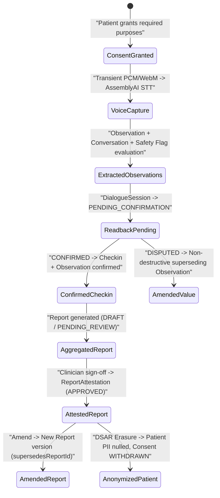

# Companio Data Lifecycle Specification

## Document Purpose
Documents end-to-end data creation, transformation, confirmation, clinical aggregation, export (DSAR), and erasure/anonymization workflows across Companio's collections.

## Scope
Covers clinical check-in capture, structured observation extraction, flag generation, report generation/amendment, consent audit logging, and patient privacy lifecycle endpoints.

## Status
- **Implementation Status:** `IMPLEMENTED`
- **Verification Status:** `VERIFIED` against `privacyService.js`, `consentService.js`, and dialogue/reporting pipelines on `2026-11-12`

## Last Verified Date
`2026-11-12`

## Relevant Source Files
- [server/src/services/privacyService.js](../../server/src/services/privacyService.js)
- [server/src/services/consentService.js](../../server/src/services/consentService.js)
- [server/src/routes/patients.js](../../server/src/routes/patients.js)
- [server/src/services/reporting/reportVersionService.js](../../server/src/services/reporting/reportVersionService.js)

---

## 1. End-to-End Clinical Data Lifecycle

---

## 2. Lifecycle Stages

1. **Onboarding & Consent:**
   - Creating a patient or onboarding records immutable `ConsentRecord` entries per purpose (`MICROPHONE`, `LIVE_TRANSCRIPTION`, `AI_PROCESSING`, `AUDIO_RETENTION`, `CLINICIAN_SHARING`).
2. **Capture & Transient Audio Discard:**
   - Audio chunks stream over `/voice` Socket.IO in memory (`AUDIO_RETENTION_MODE=disabled`). Transcript turns append to `Conversation.turns`.
3. **Structured Extraction & Non-Destructive Amendment:**
   - `Observation` records begin as `confirmationStatus: 'PROPOSED'`, `verificationStatus: 'UNVERIFIED'`.
   - Patient read-back transitions records to `CONFIRMED` or creates a replacement record linked via `supersedesObservationId`.
   - Finalized sessions materialize a summarized `Checkin` document (`confirmedByPatient: true`).
4. **Safety Detection & Escalation:**
   - Deterministic `keywordSafetyNet` / `safetyRuleEngine` and LLM tool calls persist `Flag` documents; `Flag.post('save')` triggers policy evaluation and `EscalationEvent` queueing.
5. **Report Snapshotting & Attestation:**
   - `Report` freezes source IDs (`sourceSnapshot`), deterministic calculations, `contentHash`, and `narrationMode`. Approved reports are read-only; edits require creating an incremented version (`supersedesReportId`) and marking prior versions `SUPERSEDED`.
6. **DSAR Export (`GET /api/v1/patients/:patientId/export`):**
   - `exportPatientData(organizationId, patientId)` bundles `Patient`, `effectiveConsent`, `Checkin`, `Conversation`, `Flag`, `Report`, `Appointment`, `LabResult`, and full `ConsentRecord` audit history.
7. **Right to Erasure / Anonymization (`POST /api/v1/patients/:patientId/anonymize`):**
   - `anonymizePatient` replaces `Patient.name` with `"Anonymized Patient (XXXX)"`, nulls `contact.{phone,email}` and `emergencyContact.{name,relationship,phone}`, sets `isAnonymized: true` + `anonymizedAt`, and appends `WITHDRAWN` `ConsentRecord` entries for all purposes (`withdrawAllConsent`). Retrospective clinical check-ins/flags remain de-linked from direct contact PII.

---

## 3. Code vs. Documentation Discrepancies Observed

- **DSAR Sort Key Mismatch (`server/src/services/privacyService.js`):**
  - Line `42` executes `Appointment.find(...).sort({ scheduledDate: -1 })`, whereas `Appointment.js` defines `dateTime`.
  - Line `43` executes `LabResult.find(...).sort({ orderedAt: -1 })`, whereas `LabResult.js` defines `collectionDate`.
  - Impact: Queries still execute in MongoDB, but sort keys resolve to missing fields instead of chronological visit/collection order. Tracked in [KNOWN_ISSUES.md](../14_DEVELOPMENT_AND_RELEASE/KNOWN_ISSUES.md).

---

## 4. Related Documentation
- [DATA_RETENTION.md](./DATA_RETENTION.md)
- [DATA_CLASSIFICATION.md](./DATA_CLASSIFICATION.md)
- [PHI_HANDLING.md](../09_SECURITY_AND_PRIVACY/PHI_HANDLING.md)
