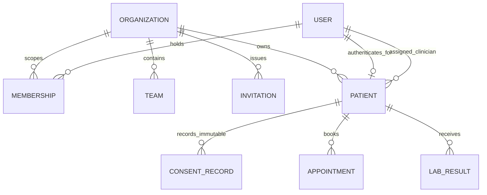
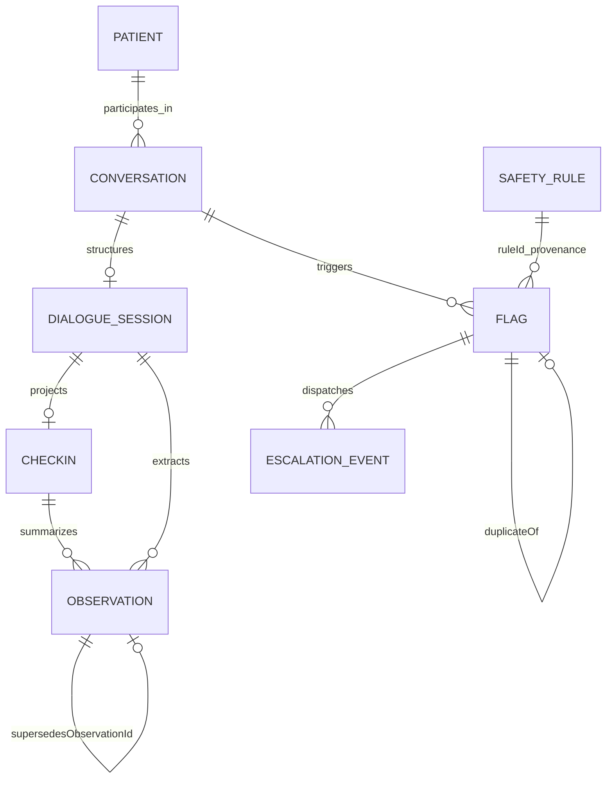
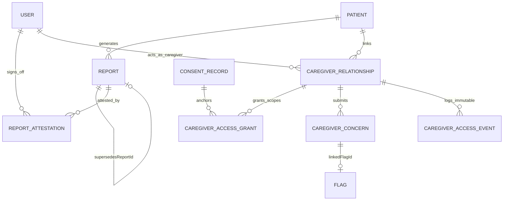

# Companio Entity Relationships (ER Diagrams)

## Document Purpose
Visualizes relational references and cardinalities across all 22 Mongoose collections in Companio.

## Scope
Covers cross-collection `ObjectId` references across Multi-Tenancy, Clinical Care, Voice/Observations, Safety Escalation, Versioned Reporting, and Caregiver Delegation.

## Status
- **Implementation Status:** `IMPLEMENTED`
- **Verification Status:** `VERIFIED` (derived directly from `ref:` fields in `server/src/models/*.js` on `2026-11-12`)

## Last Verified Date
`2026-11-12`

## Relevant Source Files
- [server/src/models/index.js](../../server/src/models/index.js)
- [DATA_DICTIONARY.md](./DATA_DICTIONARY.md)

---

## 1. Multi-Tenancy, Identity & Patient Consent ER Diagram

---

## 2. Clinical Voice, Structured Dialogue & Safety ER Diagram

---

## 3. Clinical Reporting, Attestation & Caregiver Delegation ER Diagram

---

## 4. Cardinality & Reference Notes

- **Multi-Organization Users:** A single `User` may hold `Membership` documents in multiple `Organization` records (`unique` on `(organizationId, userId)`).
- **Non-Destructive Lineage:** Both `Observation` (`supersedesObservationId`) and `Report` (`rootReportId`, `supersedesReportId`, `supersededByReportId`) and `CaregiverAccessGrant` (`previousGrantId`) preserve immutable version chains rather than mutating historical clinical records.
- **Cross-Linkage Examples:** A `CaregiverConcern` submitted via `/api/v1/caregiver/patients/:patientId/concerns` can be promoted to a triaged clinical `Flag` via `linkedFlagId`.

---

## 5. Related Documentation
- [DATABASE.md](./DATABASE.md)
- [DATA_DICTIONARY.md](./DATA_DICTIONARY.md)
- [DATABASE_INDEXES.md](./DATABASE_INDEXES.md)
