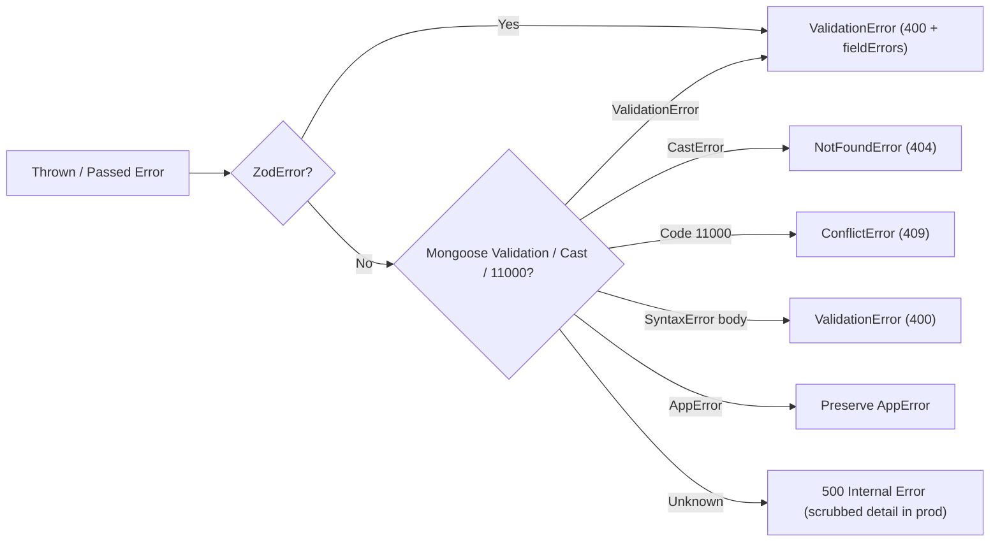

# Companio API Error Handling & RFC 9457 Specification

## Document Purpose
Documents every structured exception class, validation error format, HTTP status mapping, and problem-details payload returned by Companio's backend API.

## Scope
Covers `server/src/errors/AppError.js`, `server/src/middleware/validate.js`, and `server/src/middleware/errorHandler.js`.

## Status
- **Implementation Status:** `IMPLEMENTED`
- **Verification Status:** `VERIFIED` against source files on `2026-11-12`

## Last Verified Date
`2026-11-12`

## Relevant Source Files
- [server/src/errors/AppError.js](../../server/src/errors/AppError.js)
- [server/src/middleware/errorHandler.js](../../server/src/middleware/errorHandler.js)
- [server/src/middleware/validate.js](../../server/src/middleware/validate.js)

---

## 1. Registered `AppError` Classes

| Error Class | HTTP Status | `code` | `type` URI Suffix |
| :--- | :--- | :--- | :--- |
| `ValidationError` / `BadRequestError` | `400` | `VALIDATION_ERROR` | `/problems/validation-error` |
| `AuthenticationError` | `401` | `AUTHENTICATION_REQUIRED` | `/problems/unauthenticated` |
| `AuthorizationError` / `ForbiddenError` | `403` | `FORBIDDEN_ACCESS` | `/problems/forbidden` |
| `NotFoundError` | `404` | `RESOURCE_NOT_FOUND` | `/problems/not-found` |
| `ConflictError` | `409` | `RESOURCE_CONFLICT` | `/problems/conflict` |
| `RateLimitError` | `429` | `RATE_LIMIT_EXCEEDED` | `/problems/rate-limited` |
| `ExternalServiceError` | `502` | `EXTERNAL_SERVICE_ERROR` | `/problems/external-service-error` |
| Unhandled fallback | `500` | `INTERNAL_ERROR` | `/problems/internal-server-error` |

*(Base URI prefix: `https://companio.app/problems/...`)*

---

## 2. Error Normalization Flow

---

## 3. Security & Privacy Considerations

- **Production Detail Scrubbing:** When `NODE_ENV=production`, unhandled `500` errors conceal `err.message` and stack traces behind `'An unexpected error occurred. Please contact clinical support.'`.
- **Safe Logging:** Operational vs non-operational exceptions log `requestId`, `statusCode`, `method`, and `url` through `Logger` (`server/src/utils/logger.js`).

---

## 4. Related Documentation
- [API_CONTRACT.md](./API_CONTRACT.md)
- [LOGGING.md](../11_INFRASTRUCTURE_AND_OPERATIONS/LOGGING.md)
