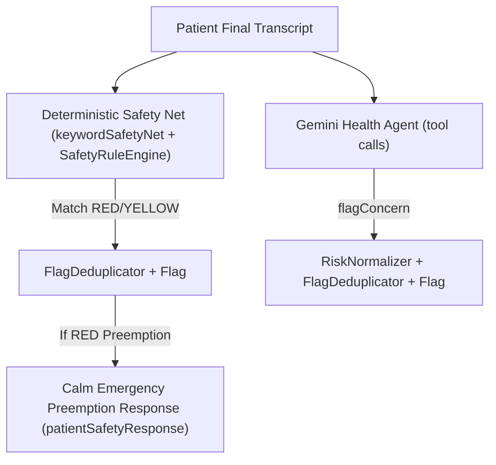

# Companio AI Agent Behavioral Rules & Prompt Contract

## Document Purpose
Documents the runtime behavioral rules, prompt boundaries, permitted function-calling tools, and non-diagnostic invariants governing Companio's LLM health companion and narrative synthesis agents (Orvanta Blueprint Prompt 06).

## Scope
Covers `HEALTH_AGENT_SYSTEM_PROMPT` (`healthConversationAgent.js`), Gemini tool declarations, retrospective report narration rules (`reportNarrationService.js`), and mandatory human-in-the-loop constraints.

## Status
- **Implementation Status:** `IMPLEMENTED`
- **Safety Test Coverage:** `TESTED` via `npm run test:safety` and `npm run test:dialogue` (deterministic assertions + mockable LLM paths)

## Last Verified Date
`2026-11-12`

## Relevant Source Files
- [server/src/services/voice/llm/healthConversationAgent.js](../../server/src/services/voice/llm/healthConversationAgent.js)
- [server/src/services/reporting/reportNarrationService.js](../../server/src/services/reporting/reportNarrationService.js)
- [server/src/services/safety/patientSafetyResponse.js](../../server/src/services/safety/patientSafetyResponse.js)
- [server/src/services/safety/keywordSafetyNet.js](../../server/src/services/safety/keywordSafetyNet.js)

---

## 1. Strict Clinical & Non-Diagnostic Boundaries

Every check-in prompt in `HEALTH_AGENT_SYSTEM_PROMPT` enforces four non-negotiable boundaries:

1. **No Medical Diagnosis:** Never diagnose conditions or diseases.
2. **No Medication Prescribing or Dosage Advice:** Never prescribe medications, recommend changing doses, or advise stopping a prescribed drug.
3. **No Contradiction of Care Plan:** Never contradict or second-guess a clinician's treatment plan.
4. **Transparent Companion Identity:** When asked a diagnostic question (e.g., *"Do I have heart disease?"*), state clearly that Companio is a check-in companion, not a doctor, and advise discussing with their clinician.

---

## 2. Conversational Ergonomics for Older Adults (55+)

- **Plain, Non-Technical Language:** Short, clear sentences free of clinical jargon.
- **Single-Question Turn Cap:** Ask **one question at a time**; never stack multi-part questions.
- **Empathy Without Minimization:** Acknowledge symptoms warmly; when RED flags surface, state seriously: *"I want to make sure your care team knows about this right away so they can support you."*

---

## 3. Authorized LLM Function Tools (`geminiTools`)

The live check-in agent may only invoke four explicitly typed Gemini function declarations:

| Tool Name | Purpose | Persisted Side Effect |
| :--- | :--- | :--- |
| `logCheckin(data)` | Records structured wellness summary (`adherence`, `symptoms`, `sleep`, `hydration`, `activity`, `nutrition`, `wellbeing`) | Check-in state / projection |
| `flagConcern(severity, category, description, sourceText)` | Logs a `red` or `yellow` flag constrained strictly to the 23 taxonomy categories | Persists `Flag` (triggers `post('save')` escalation via `notifyClinicianForRedFlag` / `FlagDeduplicator`) |
| `recordConcern(text)` | Captures explicit patient concern text for clinician review | Stored on conversation/check-in |
| `endConversation(summary)` | Concludes check-in session cleanly | Triggers closing summary state |

---

## 4. Strict Flag Taxonomy Enforcement (`FLAG_TAXONOMY`)

- **13 RED Categories:** `chest_pain`, `severe_breathlessness`, `stroke_signs`, `severe_new_pain`, `self_harm_ideation`, `severe_allergic_reaction`, `fall_with_injury`, `severe_dizziness_fainting`, `rapid_weight_loss`, `serious_medication_reaction`, `high_risk_medication_lapse`, `high_fever_confusion`, `uncontrolled_bleeding`.
- **10 YELLOW Categories:** `mild_new_symptom`, `missed_dose_or_mild_side_effect`, `sleep_disturbance`, `mild_mood_change`, `appetite_or_hydration_concern`, `reduced_activity`, `minor_gi_issue`, `loneliness_isolation`, `mobility_aid_concern`, `appointment_logistics`.

Unknown severity or category strings emitted by an LLM pass through `RiskNormalizer` so free-form categories cannot break triage workflows.

---

## 5. Dual-Engine Safety Invariant (LLM Cannot Suppress Deterministic Safety)

Even if Gemini fails to call `flagConcern` (network outage, API quota error, or model omission), `keywordSafetyNet` and `SafetyRuleEngine` independently generate normalized `Flag` documents and trigger clinician escalation.

---

## 6. Retrospective Report AI Narration Rules

1. **Zero LLM Arithmetic:** All trends, averages, adherence percentages, and completeness ratios are computed deterministically by `clinicalAnalyticsEngine.js` before any prompt reaches Gemini.
2. **Numerical Grounding Verification:** `reportValidationService.js` inspects AI-narrated prose; mismatched statistics or ungrounded clinical assertions cause fallback (`narrationMode: 'TEMPLATE_FALLBACK'`).
3. **Clinician Attestation Mandatory:** Reports remain unapproved drafts until a licensed clinician completes `POST /reports/:reportId/approve` against the exact `contentHash`.

---

## 7. Related Documentation
- [AI_GUARDRAILS.md](./AI_GUARDRAILS.md)
- [AI_SYSTEM_OVERVIEW.md](./AI_SYSTEM_OVERVIEW.md)
- [CLINICAL_SAFETY_OVERVIEW.md](../07_CLINICAL_SAFETY/CLINICAL_SAFETY_OVERVIEW.md)
- [CLINICIAN_ATTESTATION.md](../07_CLINICAL_SAFETY/CLINICIAN_ATTESTATION.md)
