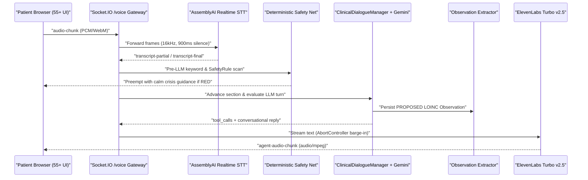

# Companio AI & Voice Systems Overview

## Document Purpose
Provides the unified architectural entry point for Companio's AI-assisted, voice-first wellness check-in subsystem—connecting real-time speech transport, speech-to-text, structured clinical dialogue, LLM conversation & extraction, deterministic safety enforcement, and neural text-to-speech.

## Scope
Covers all runtime components in `server/src/services/voice/`, `server/src/services/dialogue/`, and `server/src/services/observations/`.

## Status
- **Voice Transport & FSM:** `IMPLEMENTED` & `TESTED` (`npm run test:voice`)
- **Structured Dialogue & Observations:** `IMPLEMENTED` & `TESTED` (`npm run test:dialogue`)
- **Live Clinical Deployment:** `BLOCKED` (Vendor BAAs and Clinical Advisory Board validation pending)

## Last Verified Date
`2026-11-12`

## Relevant Source Files
- [server/src/sockets/voiceSession.js](../../server/src/sockets/voiceSession.js)
- [server/src/services/voice/stt/assemblyAISTT.js](../../server/src/services/voice/stt/assemblyAISTT.js)
- [server/src/services/voice/llm/healthConversationAgent.js](../../server/src/services/voice/llm/healthConversationAgent.js)
- [server/src/services/voice/tts/elevenLabsTTS.js](../../server/src/services/voice/tts/elevenLabsTTS.js)
- [server/src/services/dialogue/clinicalDialogueManager.js](../../server/src/services/dialogue/clinicalDialogueManager.js)
- [server/src/services/observations/observationExtractor.js](../../server/src/services/observations/observationExtractor.js)

---

## 1. End-to-End Voice Check-In Pipeline

---

## 2. Core Design Principles for Adults 55+

1. **Senior-Paced Turn Taking:** AssemblyAI `endUtteranceSilenceThreshold` is tuned to `900ms` so older adults can pause mid-thought without premature cutoffs.
2. **Barge-In Interruptibility:** Patient speech cancels in-flight ElevenLabs streams via `AbortController` signals (`TurnManager` + `elevenLabsTTS.js`).
3. **One Question at a Time:** Both `ClinicalDialogueManager` and `HEALTH_AGENT_SYSTEM_PROMPT` restrict turns to a single, plain-language prompt.
4. **Deterministic Read-Back Before Finalization:** Extracted metrics remain `PROPOSED` until the patient explicitly confirms them via `ReadbackSummarizer` + `POST /dialogue-sessions/:id/confirm`.
5. **No Raw Audio Persistence:** `envValidator.js` locks `AUDIO_RETENTION_MODE` to `z.literal('disabled')`.

---

## 3. Navigation Across Voice & AI Specifications

- **Protocol & Transport:** [VOICE_SESSION_LIFECYCLE.md](./VOICE_SESSION_LIFECYCLE.md), [AUDIO_CHUNK_PROTOCOL.md](./AUDIO_CHUNK_PROTOCOL.md), [VOICE_RECOVERY_PROTOCOL.md](./VOICE_RECOVERY_PROTOCOL.md)
- **Providers & Benchmarks:** [SPEECH_TO_TEXT.md](./SPEECH_TO_TEXT.md), [TEXT_TO_SPEECH.md](./TEXT_TO_SPEECH.md), [VOICE_PROVIDER_LIFECYCLE.md](./VOICE_PROVIDER_LIFECYCLE.md), [VOICE_PERFORMANCE_BENCHMARKS.md](./VOICE_PERFORMANCE_BENCHMARKS.md), [AI_PROVIDER_CONFIGURATION.md](./AI_PROVIDER_CONFIGURATION.md)
- **AI Rules & Dialogue:** [AI_AGENT_RULES.md](./AI_AGENT_RULES.md), [AI_GUARDRAILS.md](./AI_GUARDRAILS.md), [CONVERSATION_ENGINE.md](./CONVERSATION_ENGINE.md), [CLINICAL_DIALOGUE.md](./CLINICAL_DIALOGUE.md)
- **Observations & Workflows:** [OBSERVATION_EXTRACTION.md](./OBSERVATION_EXTRACTION.md), [OBSERVATION_QUALITY_RULES.md](./OBSERVATION_QUALITY_RULES.md), [PATIENT_CONFIRMATION_WORKFLOW.md](./PATIENT_CONFIRMATION_WORKFLOW.md), [DAILY_AND_WEEKLY_WORKFLOWS.md](./DAILY_AND_WEEKLY_WORKFLOWS.md)
