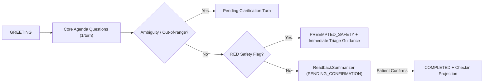

# Companio Conversation & Structured Dialogue Engine

## Document Purpose
Explains how Companio orchestrates multi-turn voice check-ins by combining a server-authoritative Finite State Machine (`VoiceSessionStateMachine`), a structured clinical interview planner (`ClinicalDialogueManager`), turn concurrency control (`TurnManager`), and Gemini dialogue generation.

## Scope
Covers `server/src/services/dialogue/` and `server/src/services/voice/session/` modules.

## Status
- **Implementation Status:** `IMPLEMENTED` & `TESTED` (`npm run test:voice`, `npm run test:dialogue`)

## Last Verified Date
`2026-11-12`

## Relevant Source Files
- [server/src/services/dialogue/clinicalDialogueManager.js](../../server/src/services/dialogue/clinicalDialogueManager.js)
- [server/src/services/dialogue/dialogueAgenda.js](../../server/src/services/dialogue/dialogueAgenda.js)
- [server/src/services/dialogue/questionPlanner.js](../../server/src/services/dialogue/questionPlanner.js)
- [server/src/services/dialogue/readbackSummarizer.js](../../server/src/services/dialogue/readbackSummarizer.js)
- [server/src/services/voice/session/voiceSessionStateMachine.js](../../server/src/services/voice/session/voiceSessionStateMachine.js)
- [server/src/services/voice/session/turnManager.js](../../server/src/services/voice/session/turnManager.js)

---

## 1. Two-Tier Orchestration Architecture

1. **Transport & Audio State (`VoiceSessionStateMachine` + `TurnManager`):**
   - Tracks low-level connection states (`IDLE`, `LISTENING`, `PROCESSING`, `SPEAKING`, `INTERRUPTED`, `PAUSED`, `ENDED`), assigns unique `turnId` identifiers, and issues `AbortController` signals to cancel stale LLM/TTS synthesis immediately when a user barges in.
2. **Clinical Agenda State (`DialogueSession` + `ClinicalDialogueManager`):**
   - Tracks high-level interview progress across `GREETING` -> section questions (`DAILY_WELLNESS_CHECKIN` or `WEEKLY_HEALTH_REVIEW`) -> `PENDING_CONFIRMATION` (spoken/UI read-back) -> `CONFIRMED` / `COMPLETED` -> `Checkin` materialization (or `PREEMPTED_SAFETY` on acute red flags).

---

## 2. Agenda Flow & Preemption

---

## 3. Related Documentation
- [CLINICAL_DIALOGUE.md](./CLINICAL_DIALOGUE.md)
- [VOICE_SESSION_LIFECYCLE.md](./VOICE_SESSION_LIFECYCLE.md)
- [PATIENT_CONFIRMATION_WORKFLOW.md](./PATIENT_CONFIRMATION_WORKFLOW.md)
- [DAILY_AND_WEEKLY_WORKFLOWS.md](./DAILY_AND_WEEKLY_WORKFLOWS.md)
