# Companio Observation Extraction & Validation Pipeline

## Document Purpose
Explains how unstructured senior speech turns become standardized, typed, LOINC-mapped clinical `Observation` documents with full provenance, unit normalization, plausibility bounds, contradiction checks, and read-back verification.

## Scope
Covers `server/src/services/observations/` (`observationExtractor.js`, `observationValidator.js`, `observationQualityEngine.js`, `contradictionDetector.js`).

## Status
- **Implementation Status:** `IMPLEMENTED` & `TESTED` (`npm run test:dialogue`)

## Last Verified Date
`2026-11-12`

## Relevant Source Files
- [server/src/services/observations/observationExtractor.js](../../server/src/services/observations/observationExtractor.js)
- [server/src/services/observations/observationValidator.js](../../server/src/services/observations/observationValidator.js)
- [server/src/services/observations/observationQualityEngine.js](../../server/src/services/observations/observationQualityEngine.js)
- [server/src/services/observations/contradictionDetector.js](../../server/src/services/observations/contradictionDetector.js)
- [OBSERVATION_DATA_MODEL.md](../04_DATABASE/OBSERVATION_DATA_MODEL.md)

---

## 1. Pipeline Stages

```mermaid
flowchart LR
    Turn["Patient Transcript Turn + turnId"] --> Ext["observationExtractor.js"]
    Ext --> LOINC["Map to 13 LOINC Observation Codes"]
    LOINC --> Val["observationValidator.js (Units & Missing Reasons)"]
    Val --> Qual["observationQualityEngine.js (Bounds & Approximations)"]
    Qual --> Contra["contradictionDetector.js (Within-session conflicts)"]
    Contra --> DB["Observation (PROPOSED, UNVERIFIED, sourceQuote)"]
    DB --> RB["Read-Back Confirm or Superseding Amendment"]
```

---

## 2. Core Data Quality Invariants

- **Verbatim Provenance:** Every extracted observation stores `sourceQuote`, `conversationId`, `dialogueSessionId`, `turnId`, `sourceType`, `performerType`, and `extractionMethod`.
- **Approximation & Missing Distinction:** Hedges ("about 6 hours", "around 3 glasses") flag `valueQuantity.isApproximate: true` and `qualityStatus: 'APPROXIMATE'`; unanswered or declined prompts record explicit `missingReason` (`DECLINED`, `NOT_ASKED`, `UNKNOWN`, etc.) rather than zero values.
- **Contradiction Flagging:** Conflicting numeric assertions inside a session flag `qualityStatus: 'CONTRADICTED'` and enqueue clarification prompts in `DialogueSession.pendingClarifications`.
- **Non-Destructive Correction:** Patient read-back disputes or clinician edits create a new `Observation` referencing the prior record via `supersedesObservationId`.

---

## 3. Related Documentation
- [OBSERVATION_QUALITY_RULES.md](./OBSERVATION_QUALITY_RULES.md)
- [PATIENT_CONFIRMATION_WORKFLOW.md](./PATIENT_CONFIRMATION_WORKFLOW.md)
- [OBSERVATION_DATA_MODEL.md](../04_DATABASE/OBSERVATION_DATA_MODEL.md)
