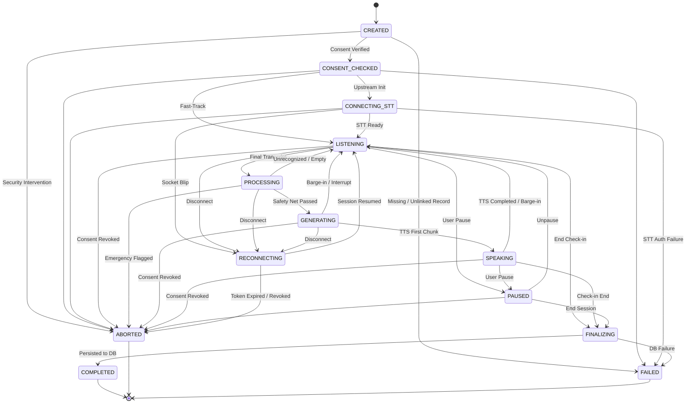

# Voice Session Finite State Machine (FSM)

**Specification Version**: 1.0.0 (Phase 4 Hardening)  
**Authority**: Server-Authoritative  
**Source Implementation**: `server/src/services/voice/session/voiceSessionStateMachine.js`

---

## 1. Overview & Architectural Role

Real-time voice check-ins for adults aged 55+ require strict, deterministic session coordination. Race conditions—such as audio chunks arriving during AI speech synthesis or stale speech transcripts interrupting a newly asked clinician question—cause severe cognitive confusion for older adults.

The **Voice Session State Machine** eliminates race conditions by serving as the central, server-authoritative gatekeeper across AssemblyAI STT, Google Gemini 2.0/3.8 Flash, and ElevenLabs TTS.

---

## 2. The 13 Explicit Session States

| State | Scope | Description | Terminal? |
|---|---|---|---|
| `CREATED` | Initial | Socket connected; session record instantiated; pre-handshake. | No |
| `CONSENT_CHECKED` | Security | Mandatory patient consent (`LIVE_TRANSCRIPTION`, `AI_PROCESSING`) verified. | No |
| `CONNECTING_STT` | Provider | Upstream WebSocket connection to AssemblyAI STT being established. | No |
| `LISTENING` | Active | Microphone streaming active; waiting for user speech or silence. | No |
| `PROCESSING` | Ingestion | Speech endpoint detected; final transcript received; keyword safety net active. | No |
| `GENERATING` | Inference | Gemini LLM generating clinical response and structured tool calls. | No |
| `SPEAKING` | Audio Egress | ElevenLabs TTS audio streaming gaplessly to client Web Audio API player. | No |
| `PAUSED` | User Control | Patient requested a pause; audio processing held. | No |
| `RECONNECTING` | Network | Transient network blip; 5-min resume window opened. | No |
| `FINALIZING` | Wrap-up | Check-in wrapping up; dialogue metrics and Conversation summary persisting. | No |
| `COMPLETED` | Terminal | Session ended normally; all resources and quotas released. | Yes |
| `ABORTED` | Terminal | Session cancelled due to patient consent revocation or emergency intervention. | Yes |
| `FAILED` | Terminal | Unrecoverable pipeline error or cross-tenant rejection. | Yes |

---

## 3. Permitted Transition Topology

---

## 4. Controlled Transition Enforcement

Every state change must invoke `transition(targetState, options)`.

1. **Terminal State Immutability**:
   Once reaching `COMPLETED`, `ABORTED`, or `FAILED`, any further state transition attempt throws an `InvalidStateTransitionError` (HTTP 409 / socket error).
2. **Topology Verification**:
   Attempting an illegal transition (e.g. `CREATED` direct to `SPEAKING`) is strictly rejected, and the existing state is preserved.
3. **Audit Trail**:
   Every transition appends a cryptographically traceable event to `this.history` containing:
   - `transitionId` (UUID)
   - `previousState` & `newState`
   - `turnId` correlation
   - `reason` & caller metadata
   - ISO 8601 UTC timestamp

