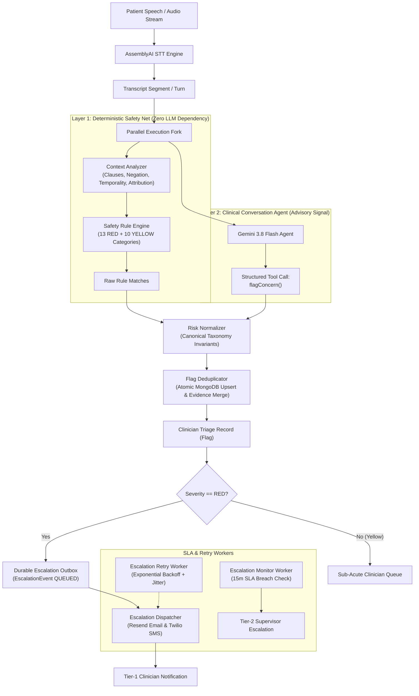

# Companio Clinical Safety Net Architecture

## 1. Executive Summary

Companio is an AI voice-first healthcare platform serving older adults (ages 55+). In geriatric voice check-ins, detecting acute health emergencies (e.g. myocardial infarction, stroke, respiratory failure, suicidal ideation) is a life-critical responsibility. Relying solely on large language models (LLMs) creates non-deterministic vulnerabilities: LLMs can suffer prompt injection, semantic hallucinations, API rate limits (429), gateway timeouts (504), or service outages.

Phase 5 hardens Companio's safety architecture into an **independently operating, deterministic, auditable, and reliable clinical concern detection and escalation engine**.

---

## 2. Core Architectural Pillars

### 2.1 Dual-Channel Parallel Detection
The audio transcript is piped simultaneously to:
1. **Layer 1: The Deterministic Safety Rule Engine**: Executes locally within milliseconds with zero network dependencies. It segments utterances into clauses, parses linguistic context (negation, temporality, attribution, self-correction), and tests against an immutable clinical taxonomy.
2. **Layer 2: The Conversational Health Agent (Gemini)**: Provides empathetic dialogue and issues structured `flagConcern` tool calls.

**Clinical Invariant**: Layer 2 is strictly advisory. Even if the LLM completely fails or is suppressed, Layer 1 guarantees that an acute clinical red flag is created and escalated.

### 2.2 Clause-Level Semantic Segmentation & Context Analysis
Traditional keyword matching fails when statements contain adversative clauses, e.g.:
> *"I had no headache today, but I have severe crushing chest pain right now."*

Naive keyword scanners either:
- Suppress the chest pain because "no" appears in the sentence (False Negative — Fatal).
- Flag the headache even though it was negated (False Positive — Alarm Fatigue).

The `contextAnalyzer` breaks utterances at coordinate conjunctions (`but`, `however`, `although`, `yet`) and boundary punctuation, isolating negation scope to the relevant clause.

### 2.3 Strict Canonical Taxonomy Invariant
Risk severity is locked to the approved clinical taxonomy. If an external model or API attempts to submit a RED condition (such as `stroke_signs` or `chest_pain`) labeled as `yellow`, `RiskNormalizer` automatically enforces `severity: 'red'`. A critical condition can never be downgraded by an AI model.

### 2.4 Durable Outbox Pattern
Provider delivery is completely decoupled from clinical record state:
- When an emergency flag is detected, an `EscalationEvent` is persisted in MongoDB with `status: 'QUEUED'`.
- The dispatcher executes notifications across configured channels (SMS via Twilio, Email via Resend).
- If external providers experience rate limits (429), timeouts, or outages, the event transitions to `RETRY_PENDING` with exponential backoff and jitter.
- **Provider delivery failure never cancels or rolls back the `Flag` document**. The clinician dashboard immediately displays the flag regardless of external carrier delivery status.

### 2.5 Multi-Tier Escalation & SLA Monitoring
- **Tier 1 (Immediate)**: Dispatched to the patient's primary assigned clinician.
- **SLA Clock (15 Minutes for RED, 240 Minutes for YELLOW)**: Tracks time since alert detection.
- **Tier 2 (SLA Breach)**: If an active RED alert remains unacknowledged past the 15-minute window, `escalationMonitorWorker` flags `slaBreached: true`, elevates `escalationTier: 2`, and dispatches an emergency escalation to the organization's on-call clinical supervisor.
