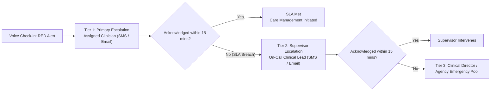

# Clinical Escalation Policy & SLA Specification

## 1. Multi-Tier Escalation Model

Companio enforces a progressive, multi-tiered escalation hierarchy designed to ensure high-acuity patient concerns are reviewed rapidly without causing clinician burnout.



---

## 2. Service Level Agreement (SLA) Targets

| Severity | Default SLA Window | Breach Action | Notification Channels |
| :--- | :--- | :--- | :--- |
| **RED (High Acuity)** | **15 minutes** | Automated Tier-2 escalation to clinical supervisor; `slaBreached: true` badge on dashboard | SMS + Email (24/7/365, overrides quiet hours) |
| **YELLOW (Sub-Acute)** | **240 minutes (4 hours)** | Flag highlighted in daily clinical huddle queue; care coordinator notification | In-App Dashboard + Digest Email |

### 2.1 Acknowledging Alerts
When a clinician clicks **"Acknowledge"** in the Clinician Dashboard or sends a `POST /flags/:flagId/acknowledge` request:
- `flag.acknowledgedAt` is set to the current timestamp.
- `flag.acknowledgedBy` records the clinician's user ID.
- The SLA breach timer halts immediately.
- The alert badge transitions from `⏱ Awaiting Clinician Ack` to `✔ Acknowledged`.

---

## 3. Organization-Level Policy Customization

Organizations can configure custom escalation settings in `organization.settings.escalationPolicy`:

```json
{
  "emailAlerts": true,
  "smsAlerts": true,
  "redSlaMinutes": 10,
  "yellowSlaMinutes": 180,
  "tier1WindowMinutes": 10,
  "supervisorEmail": "lead.supervisor@healthclinic.org",
  "supervisorPhone": "+15550998877",
  "clinicianOnCallPhone": "+15550192834"
}
```

If organization settings are absent, Companio falls back to system defaults (`ESCALATION_DEFAULTS.RED_SLA_MINUTES = 15`).

---

## 4. Background SLA Monitoring Worker

The background worker `escalationMonitorWorker.js` executes periodically:
1. Queries all flags with `status IN ('open', 'escalated')`, `acknowledgedAt: null`, and `slaBreached != true`.
2. Evaluates `elapsed = Date.now() - (flag.escalatedAt || flag.createdAt)`.
3. If `elapsed > slaMinutes * 60 * 1000`:
   - Flags `slaBreached = true` and `slaBreachedAt = new Date()`.
   - Increments `escalationTier = (flag.escalationTier || 1) + 1`.
   - Appends audit entry to `statusHistory`.
   - Calls `dispatchEscalation(flag, { tier: nextTier })` to notify Tier-2 supervisor.
