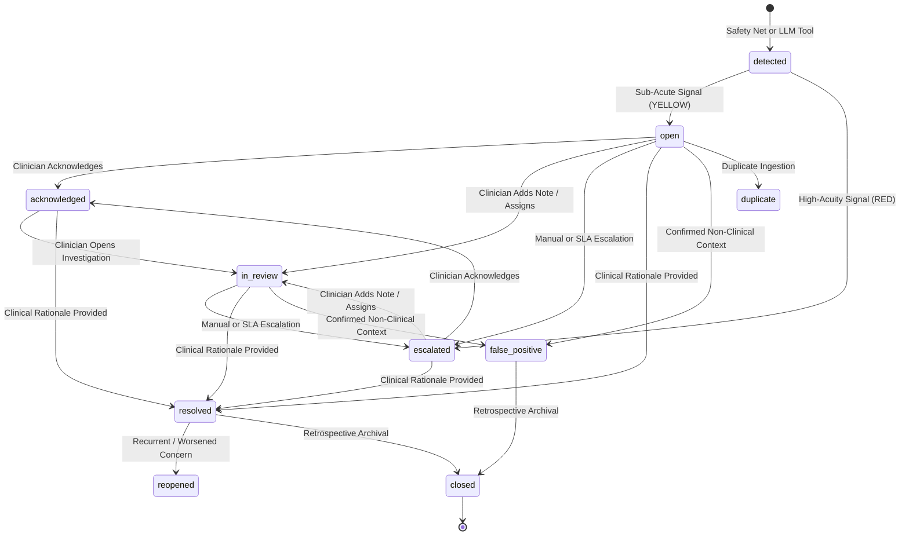

# Clinical Flag Lifecycle & Auditing Specification

## 1. Overview
In Companio, every identified clinical concern is stored as a `Flag` document within MongoDB. The `Flag` model implements a **9-state auditable finite state machine** to ensure compliance with clinical governance, HIPAA audit trail requirements, and patient safety protocols.

---

## 2. State Machine Transitions



### 2.1 Supported Flag Statuses
1. **`detected`**: Initial ingestion state prior to persistence classification.
2. **`open`**: Active clinical concern awaiting clinician acknowledgement or triage.
3. **`escalated`**: High-severity red alert or SLA-breached flag actively routed to clinicians.
4. **`acknowledged`**: Clinician has formally confirmed receipt of the alert, halting the SLA breach countdown clock.
5. **`in_review`**: Clinician has assigned the flag or begun active clinical chart investigation.
6. **`resolved`**: Clinician has contacted the patient, adjusted care, or verified symptom stabilization. **Mandatory clinical rationale required**.
7. **`false_positive`**: Verified by clinician as a misclassification (e.g. talking about a pet, idiom, or movie).
8. **`duplicate`**: Consolidated duplicate concern linked via `duplicateOf` to the canonical flag.
9. **`reopened`**: Re-activated flag when patient reports worsening or recurring symptoms after prior resolution.

---

## 3. Mandatory Audit Trail (`statusHistory`)

Every transition executed via `flag.transitionStatus(newStatus, changedBy, reason, requestId)` atomically appends an immutable record to the `statusHistory` subdocument array:

```json
{
  "_id": "6ae9db273ae088cdae6b2f12",
  "previousStatus": "escalated",
  "newStatus": "acknowledged",
  "changedBy": "507f191e810c19729de860ea",
  "reason": "Clinician acknowledged alert in triage dashboard",
  "requestId": "req-9876-abcd",
  "timestamp": "2026-11-03T18:24:00.000Z"
}
```

---

## 4. Role-Based Access Control (RBAC) Invariants

1. **Patient Prohibition (403 Forbidden)**: Patients may view their own recorded health check-ins and clinical flags via `/flags/patient/:patientId`. However, patients are **strictly prohibited** from altering flag status, acknowledging alerts, adding review notes, or resolving flags.
2. **Clinician Authorization**: Only authenticated users with role `CLINICIAN`, `ADMIN`, `ORG_OWNER`, or `ORG_ADMIN` can transition flags.
3. **Multi-Tenant Isolation**: Every flag is tagged with `organizationId`. A clinician authenticated under Clinic A cannot query, view, acknowledge, or resolve flags belonging to Clinic B. Cross-tenant access returns HTTP 404 (Not Found).
