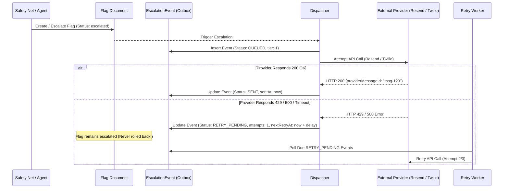

# Durable Notification Delivery & Outbox Specification

## 1. Outbox Pattern Architecture

To guarantee notification delivery across unreliable external telecommunication networks, Companio implements a **Durable Outbox Pattern** via the `EscalationEvent` MongoDB collection.

---

## 2. EscalationEvent Status Machine

- **`QUEUED`**: Record inserted into MongoDB outbox prior to external API dispatch.
- **`ACCEPTED`**: Provider accepted delivery payload for queuing.
- **`SENT`**: Provider confirmed immediate dispatch.
- **`DELIVERED`**: Webhook receipt confirmation received from carrier.
- **`RETRY_PENDING`**: Transient provider failure (HTTP 429, 500, socket timeout); queued for retry.
- **`FAILED`**: Terminal error or exhausted all retry attempts (`attempts >= maxAttempts`).
- **`ACKNOWLEDGED`**: Explicitly acknowledged by receiving clinician.

---

## 3. Exponential Backoff with Jitter

When external providers reject requests due to rate limits or transient errors, Companio applies an exponential backoff formula with random jitter to prevent "thundering herd" retry storms:

$$\text{delay} = \min\left(\text{maxDelay},\, \text{baseDelay} \times 2^{(\text{attempt} - 1)} + \text{jitter}\right)$$

Where:
- $\text{baseDelay} = 1000\text{ ms}$ (1 second)
- $\text{maxDelay} = 60000\text{ ms}$ (60 seconds)
- $\text{jitter} \in [-20\%, +20\%]$

| Attempt | Base Delay | Approximate Delay with Jitter |
| :--- | :--- | :--- |
| **Attempt 1** | 1,000 ms | $800\text{ ms} - 1,200\text{ ms}$ |
| **Attempt 2** | 2,000 ms | $1,600\text{ ms} - 2,400\text{ ms}$ |
| **Attempt 3** | 4,000 ms | $3,200\text{ ms} - 4,800\text{ ms}$ |

---

## 4. Decoupled Clinical Safety Guarantee

**Clinical Invariant**: An external provider outage (e.g. Twilio downtime, Resend outage, expired billing card, or incorrect telephone number) **must never suppress, delay, or roll back a clinical alert in the Companio database**.

If delivery fails:
1. `EscalationEvent.status` is set to `RETRY_PENDING` or `FAILED`.
2. The error message is logged to the event record.
3. The `Flag` document remains firmly in `status: 'escalated'`.
4. The alert is immediately visible on the Clinician Triage Dashboard with an alert banner.
