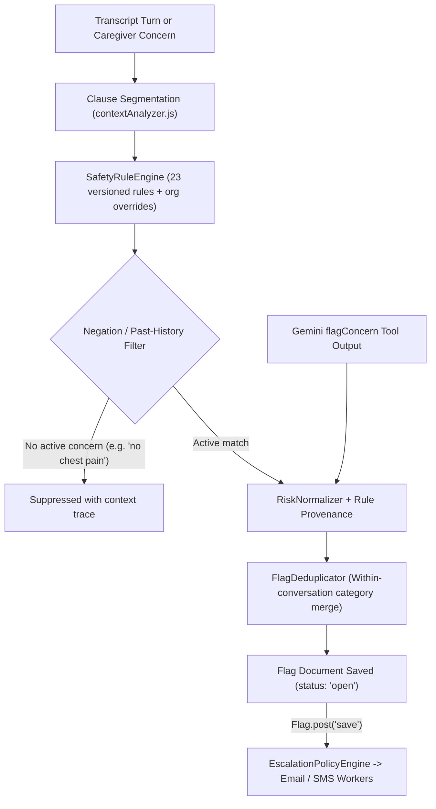

# Companio Clinical Risk Engine Architecture

## Document Purpose
Explains Companio's hybrid safety evaluation pipeline—combining versioned deterministic phrase matching, clause-level context/negation filtering, LLM tool normalization, deduplication, and automatic asynchronous escalation.

## Scope
Covers all modules in `server/src/services/safety/` (`safetyRuleRegistry.js`, `safetyRuleEngine.js`, `contextAnalyzer.js`, `keywordSafetyNet.js`, `riskNormalizer.js`, `flagDeduplicator.js`, `patientSafetyResponse.js`) and the `Flag.post('save')` trigger.

## Status
- **Implementation Status:** `IMPLEMENTED` & `TESTED` (`npm run test:safety`)

## Last Verified Date
`2026-11-12`

## Relevant Source Files
- [server/src/services/safety/safetyRuleEngine.js](../../server/src/services/safety/safetyRuleEngine.js)
- [server/src/services/safety/contextAnalyzer.js](../../server/src/services/safety/contextAnalyzer.js)
- [server/src/services/safety/keywordSafetyNet.js](../../server/src/services/safety/keywordSafetyNet.js)
- [server/src/services/safety/riskNormalizer.js](../../server/src/services/safety/riskNormalizer.js)
- [server/src/services/safety/flagDeduplicator.js](../../server/src/services/safety/flagDeduplicator.js)

---

## 1. Hybrid Evaluation Pipeline

---

## 2. Key Technical Mechanisms

1. **Clause Negation & Temporal Context (`contextAnalyzer.js`):** Prevents false-positive alarms on negative answers (e.g., *"No, I have no chest pain today"* or resolved past events *"I had chest pain three years ago"*).
2. **Organization-Scoped Rule Overrides (`SafetyRule`):** Baseline rules (`organizationId: null`) coexist with tenant-specific `SafetyRule` versions constrained by `(organizationId, ruleId, ruleVersion)` unique index and active effective window (`effectiveFrom`/`effectiveUntil`).
3. **Deduplication (`FlagDeduplicator`):** Prevents repeated utterances of the same symptom category inside one `Conversation` from spamming duplicate escalation pages, merging structured evidence onto the primary `Flag` (`sources`, `evidence`).

---

## 3. Related Documentation
- [CLINICAL_SAFETY_OVERVIEW.md](./CLINICAL_SAFETY_OVERVIEW.md)
- [RED_FLAG_TAXONOMY.md](./RED_FLAG_TAXONOMY.md)
- [YELLOW_FLAG_TAXONOMY.md](./YELLOW_FLAG_TAXONOMY.md)
- [ESCALATION_POLICY.md](./ESCALATION_POLICY.md)
