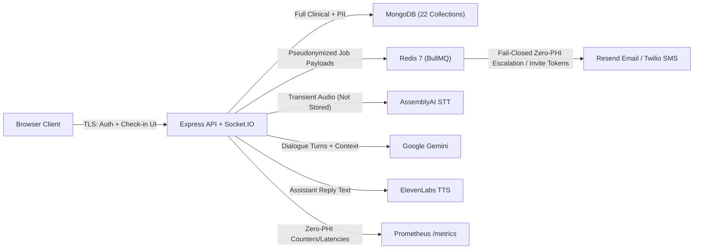

# Companio Data Privacy Map (PHI Egress & Storage Boundaries)

## Document Purpose
Maps exactly where Protected Health Information (PHI) and Personally Identifiable Information (PII) originate, where they reside at rest, and which external channels receive full vs. minimized payloads.

## Scope
Covers browser clients, backend REST/Socket gateway, MongoDB, Redis/BullMQ, logs, telemetry, and all five external providers (AssemblyAI, Google Gemini, ElevenLabs, Twilio, Resend).

## Status
- **Mapping Status:** `VERIFIED` against server services and workers on `2026-11-12`

## Last Verified Date
`2026-11-12`

## Relevant Source Files
- [server/src/sockets/voiceSession.js](../../server/src/sockets/voiceSession.js)
- [server/src/services/escalation/escalationDispatcher.js](../../server/src/services/escalation/escalationDispatcher.js)
- [server/src/services/reporting/reportNarrationService.js](../../server/src/services/reporting/reportNarrationService.js)
- [server/src/services/telemetry/metricsRegistry.js](../../server/src/services/telemetry/metricsRegistry.js)

---

## 1. End-to-End Privacy Boundary Diagram

---

## 2. Boundary Table

| Destination | Direct PII (Name/Email/Phone) | Clinical Transcript / Metrics | Raw Audio | Safeguard Applied |
| :--- | :--- | :--- | :--- | :--- |
| **MongoDB** | Yes (`User`, `Patient`, `Invitation`) | Yes (`Observation`, `Conversation`, `Report`, `Flag`) | **No** (`disabled`) | Org tenant isolation, RBAC/ABAC, immutable ledgers |
| **Redis (BullMQ)** | Clinician/invitee recipient address on transactional mail/SMS jobs; patient PII **excluded** on escalations | De-identified urgency/category on clinical escalations | **No** | `createZeroPhiNotificationPayload` + `auditOutboundPayload` |
| **AssemblyAI** | Minimal session ID | Ephemeral spoken audio -> text | **Streamed** | Requires `LIVE_TRANSCRIPTION` consent; not persisted locally |
| **Google Gemini** | Excluded where not required | Conversational turns (check-in) / aggregated metrics (reports) | **No** | Requires `AI_PROCESSING` consent; deterministic safety net |
| **ElevenLabs** | Excluded | Agent spoken response text only | **Generated** | Streamed in memory (`audio/mpeg`) |
| **Twilio / Resend** | Clinician phone/email destination or password-reset/invite email | De-identified `Patient#<token>` urgency alert (no patient name/quote) | **No** | Fail-closed egress check via `deidentificationService` |
| **Prometheus / Logs** | Scrubbed | Scrubbed | **No** | Zero-PHI telemetry policy + `Logger` pattern redaction |

---

## 3. Related Documentation
- [DEIDENTIFICATION.md](./DEIDENTIFICATION.md)
- [PHI_HANDLING.md](./PHI_HANDLING.md)
- [DATA_CLASSIFICATION.md](../04_DATABASE/DATA_CLASSIFICATION.md)
