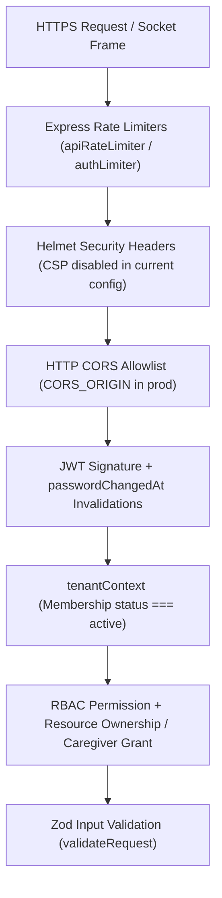

# Companio Application & Infrastructure Security Architecture

## Document Purpose
Provides the comprehensive engineering security reference for Companio (Orvanta Blueprint Prompt 11), covering authentication, authorization, multi-tenant isolation, transport hardening, cryptography, rate limiting, and verified security gaps.

## Scope
Covers Express HTTP middleware, Socket.IO gateway security, JWT/password lifecycle, Redis/MongoDB perimeter assumptions, and container execution posture.

## Status
- **Implemented Controls:** `IMPLEMENTED` (JWT, bcryptjs, Helmet, Zod, tenantContext, RBAC/ABAC, fail-closed redaction)
- **External Security Penetration Test:** `BLOCKED` / `NOT VERIFIED`

## Last Verified Date
`2026-11-12`

## Relevant Source Files
- [server/src/server.js](../../server/src/server.js)
- [server/src/middleware/auth.js](../../server/src/middleware/auth.js)
- [server/src/middleware/tenantContext.js](../../server/src/middleware/tenantContext.js)
- [server/src/middleware/tenantAuthorization.js](../../server/src/middleware/tenantAuthorization.js)
- [server/src/middleware/rateLimiter.js](../../server/src/middleware/rateLimiter.js)
- [server/src/constants/permissions.js](../../server/src/constants/permissions.js)
- [Dockerfile.server](../../Dockerfile.server)

---

## 1. Security Control Layers

---

## 2. Core Controls (Code-Verified)

1. **Passwords & Hashing:** `User.passwordHash` hashed with `bcryptjs`; reset tokens hashed with SHA-256 (`passwordResetTokenHash`) and automatically expire (`passwordResetExpiresAt`); password resets stamp `passwordChangedAt` to invalidate prior JWTs (`auth.js`).
2. **Tenant Isolation & 404 Concealment:** Cross-tenant queries filter strictly by `organizationId` and return `404 Resource Not Found` to avoid confirming whether a foreign patient record exists.
3. **Immutable Audit Trails:** `ConsentRecord` and `CaregiverAccessEvent` attach Mongoose `pre` hooks blocking mutations/deletions.
4. **Non-Root Container Execution:** `Dockerfile.server` runs as unprivileged `USER node`.
5. **Startup Secret Guard (`envValidator.js`):** Production startup fails immediately if `JWT_SECRET` is weak/missing or uses development placeholders.

---

## 3. Verified Code Security Findings & Gaps

| Finding | Source Evidence | Risk Impact | Current Status |
| :--- | :--- | :--- | :--- |
| **Socket.IO Wildcard CORS** | `server/src/server.js:104` declares `cors: { origin: '*' }` | Cross-origin WebSocket connection attempts rely on JWT token verification rather than origin restriction | `NOT VERIFIED` / Open |
| **Helmet CSP Disabled** | `server/src/server.js` configures `helmet({ contentSecurityPolicy: false })` | Browser CSP hardening not enforced at Express response layer | Open |
| **Dual Rate Limiter Divergence** | `rateLimiter.js` defines `authRateLimiter` (15/15m), while `authRoutes.js` mounts inline `authLimiter` (50/15m on `/login` & `/forgot-password`, not `/register`) | Inconsistent brute-force ceilings across auth routes | Open |
| **Default Re-ID Pepper Fallback** | `deidentificationService.js:34` falls back to `'companio_internal_reid_pepper_2026_pilot_safe'` if `REID_SECRET_PEPPER` is unset | Predictable pseudonym tokens if env secret omitted | Requires strict env configuration |
| **Zero External Pentest** | Governance status | No external third-party penetration test or SOC 2 audit completed | `BLOCKED` before production |

---

## 4. Related Documentation
- [THREAT_MODEL.md](./THREAT_MODEL.md)
- [AUTHENTICATION_AND_AUTHORIZATION.md](./AUTHENTICATION_AND_AUTHORIZATION.md)
- [MULTI_TENANCY_SECURITY.md](./MULTI_TENANCY_SECURITY.md)
- [DEIDENTIFICATION.md](./DEIDENTIFICATION.md)
