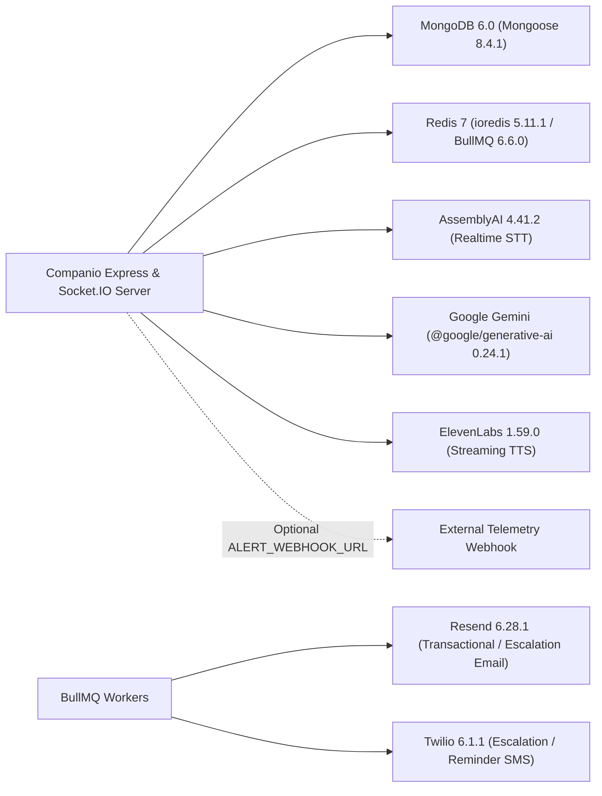

# Companio External Integrations Architecture

## Document Purpose
Provides the master reference for all third-party AI, voice, messaging, and core datastore integrations wired into Companio (Orvanta Blueprint Prompt 13).

## Scope
Covers AssemblyAI (STT), Google Gemini (LLM), ElevenLabs (TTS), Twilio (SMS), Resend (Email), MongoDB, and Redis/BullMQ.

## Status
- **SDK & Worker Integrations:** `IMPLEMENTED` (with verified offline/sandbox fallbacks when dev keys are absent)
- **Production Vendor BAAs:** `BLOCKED` / `PENDING` across all external SaaS vendors

## Last Verified Date
`2026-11-12`

## Relevant Source Files
- [server/package.json](../../server/package.json)
- [PROVIDER_VERIFICATION_MATRIX.md](./PROVIDER_VERIFICATION_MATRIX.md)
- [server/src/config/envValidator.js](../../server/src/config/envValidator.js)

---

## 1. Integration Topology

---

## 2. Integration Matrix

| Integration | Role | SDK / Client (`server/package.json`) | Fallback / Sandbox Mode | Vendor BAA Status |
| :--- | :--- | :--- | :--- | :--- |
| **AssemblyAI** | Real-time STT | `assemblyai` `4.41.2` | `createFallbackSTTStream` | `BLOCKED` / Pending |
| **Google Gemini** | Health check-in LLM + narration | `@google/generative-ai` `0.24.1` | `TEMPLATE_FALLBACK` (reports) & safety net override | `BLOCKED` / Pending |
| **ElevenLabs** | Neural TTS streaming | REST streaming / `elevenlabs` `1.59.0` | `sendFallbackAudioBuffer` | `BLOCKED` / Pending |
| **Twilio** | Clinical escalation & SMS alerts | `twilio` `6.1.1` | `MOCK_SMS_<ts>` when disabled/unconfigured | `BLOCKED` / Pending |
| **Resend** | Clinical escalation & notifications | `resend` `6.28.1` | `MOCK_EMAIL_<ts>` when disabled/unconfigured | `BLOCKED` / Pending |
| **MongoDB** | Primary clinical document DB | `mongoose` `8.4.1` | Required in production; containerized in Docker | Hosting-dependent |
| **Redis** | BullMQ queues & retry coordination | `ioredis` `5.11.1` | `inMemoryQueue.js` allowed when `REDIS_FALLBACK` / non-prod (`ALLOW_IN_MEMORY_FALLBACK`) | Hosting-dependent |

---

## 3. Related Documentation
- [PROVIDER_VERIFICATION_MATRIX.md](./PROVIDER_VERIFICATION_MATRIX.md)
- [PROVIDER_CONTRACT_REGISTER.md](../13_GOVERNANCE_AND_COMPLIANCE/PROVIDER_CONTRACT_REGISTER.md)
- Detailed guides: [ASSEMBLYAI.md](./ASSEMBLYAI.md), [GOOGLE_GEMINI.md](./GOOGLE_GEMINI.md), [ELEVENLABS.md](./ELEVENLABS.md), [TWILIO.md](./TWILIO.md), [RESEND.md](./RESEND.md), [REDIS.md](./REDIS.md), [MONGODB.md](./MONGODB.md)
