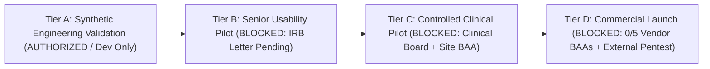

# Companio Clinical & Regulatory Governance Overview

## Document Purpose
Provides the unified executive governance framework separating verified software engineering milestones from mandatory legal, clinical, ethical, and third-party vendor prerequisites that still block human recruitment and production deployment.

## Scope
Synthesizes the Phase 12.1, Phase 12.2, and Phase 12.2.1 governance baseline (`docs/15_PHASE_REPORTS/`). Historical milestone evidence files remain preserved unmodified under `docs/15_PHASE_REPORTS/`.

## Status
- **Tier A (Synthetic Software Validation):** `VERIFIED` / Authorized for engineering testing (`NODE_ENV=development` / synthetic fixtures only)
- **Tier B (Senior Usability Pilot — Human Subjects):** `BLOCKED` (Pending written IRB letter)
- **Tier C (Clinical Pilot):** `BLOCKED` (Pending Tier B, Clinical Advisory Board sign-off, site BAAs)
- **Tier D (Commercial Production Launch):** `BLOCKED` (Pending `0/5` provider BAAs, external pentest, SOC 2 / HIPAA audit)

## Last Verified Date
`2026-11-12`

## Relevant Source Files
- [docs/15_PHASE_REPORTS/PHASE_12_2_FINAL_READINESS_REPORT.md](../15_PHASE_REPORTS/PHASE_12_2_FINAL_READINESS_REPORT.md)
- [docs/15_PHASE_REPORTS/PHASE_12_2_1_PRIVACY_ASSURANCE_REPORT.md](../15_PHASE_REPORTS/PHASE_12_2_1_PRIVACY_ASSURANCE_REPORT.md)
- [RISK_REGISTER.md](./RISK_REGISTER.md)

---

## 1. Four-Tier Governance Gate Architecture

---

## 2. Mandatory Stop Gate Policy

> [!CAUTION]
> **SYNTHETIC DATA MODE ONLY:** Real patient records, human subject enrollment, and live clinical reliance remain **strictly prohibited** until every blocker across [PROVIDER_CONTRACT_REGISTER.md](./PROVIDER_CONTRACT_REGISTER.md), [IRB_APPROVAL_TRACKER.md](./IRB_APPROVAL_TRACKER.md), [CLINICAL_APPROVAL_REGISTER.md](./CLINICAL_APPROVAL_REGISTER.md), and [PRODUCTION_READINESS.md](./PRODUCTION_READINESS.md) is formally closed with signed organizational evidence.

---

## 3. Related Documentation
- [PROVIDER_CONTRACT_REGISTER.md](./PROVIDER_CONTRACT_REGISTER.md)
- [REGULATORY_READINESS.md](./REGULATORY_READINESS.md)
- [CLINICAL_APPROVAL_REGISTER.md](./CLINICAL_APPROVAL_REGISTER.md)
- [IRB_APPROVAL_TRACKER.md](./IRB_APPROVAL_TRACKER.md)
- [HUMAN_FACTORS_STUDY.md](./HUMAN_FACTORS_STUDY.md)
- [PRODUCTION_READINESS.md](./PRODUCTION_READINESS.md)
