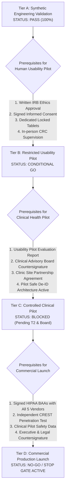

# COMPANIO — PHASE 12.1: FINAL READINESS ASSESSMENT & FOUR-TIER RELEASE GATING
## Independent Regulatory Evaluation, Decoupled Gating Decisions & Commercial Gating

**Document Reference:** `docs/PHASE_12_1_FINAL_READINESS_ASSESSMENT.md`  
**Milestone:** Phase 12.1 — External Validation, Human Factors Testing & Controlled Pilot Authorization  
**Evaluation Lead:** Principal Healthcare Software Architect, Clinical Safety Engineer, Chief Privacy Officer  
**Evaluation Date:** 2026-11-04  
**Git Baseline Commit:** `450fca1`  

---

## 1. Executive Summary: The Four Decoupled Gating Decisions

Operating an AI-powered voice platform for older adults in healthcare demands absolute separation between software correctness, human research ethics, clinical board endorsement, and commercial statutory release.

Passing one gating tier **NEVER** implies or authorizes progression to a subsequent tier. Each tier possesses its own independent prerequisites:

```
=======================================================================================================
                                 THE FOUR DECOUPLED RELEASE GATES
=======================================================================================================

  [TIER A] SYNTHETIC ENGINEERING VALIDATION
  DETERMINATION: >>> PASS / APPROVED <<<
  Prerequisites: 100% passing automated test harness across all 12 platform suites.
  Current Status: Fully met (Commit 450fca1). Continuous CI/CD automated validation active.

  [TIER B] RESTRICTED HUMAN USABILITY PILOT (15 SENIOR PARTICIPANTS)
  DETERMINATION: >>> CONDITIONAL GO / GATED PENDING IRB APPROVAL <<<
  Prerequisites: Written IRB approval (#COMPANIO-PILOT-2026-HFE), signed informed consent,
                 in-person CRC supervision, dedicated de-identified test tablets.
  Current Status: Technical accessibility and devices ready; human recruitment halted pending IRB.

  [TIER C] CONTROLLED CLINICAL PILOT (PATIENT HEALTHCARE COHORT)
  DETERMINATION: >>> BLOCKED / GATED PENDING MEDICAL BOARD SIGN-OFF <<<
  Prerequisites: Formal Clinical Advisory Board countersignature, provider safe de-ID architecture,
                 participating clinic oversight agreement.
  Current Status: Clinical approval package finalized; awaiting convening of Medical Advisory Board.

  [TIER D] COMMERCIAL PRODUCTION LAUNCH WITH REAL PATIENTS
  DETERMINATION: >>> NO-GO / STRICT STOP GATE ENFORCED <<<
  Prerequisites: Executed HIPAA BAAs (AssemblyAI, Google, ElevenLabs, Twilio, Resend),
                 independent CREST-accredited penetration test, full clinical validation.
  Current Status: Legally BLOCKED under federal HIPAA / HITECH regulations.

=======================================================================================================
```

---

## 2. Requirement-by-Requirement Audit Matrix

Every mandatory platform, clinical, security, accessibility, and legal requirement is classified into one of five standard designations:
- **PASS**: Requirement fully verified by empirical evidence, code, or completed audit.
- **FAIL**: Requirement unfulfilled or active defect identified.
- **BLOCKED**: Implementation or release halted due to external statutory, legal, or contractual barriers.
- **NOT VERIFIED**: Awaiting external third-party evaluation or committee sign-off (cannot be self-certified).
- **NOT APPLICABLE**: Requirement does not apply to the current operational scope.

```
+=======================================================================================================================+
| REQUIREMENT DOMAIN & SPECIFIC REQUIREMENT               | STATUS         | EVIDENCE & DETERMINATION BASIS             |
+=======================================================================================================================+
| 1. CORE BACKEND & PERSISTENCE ARCHITECTURE              |                |                                            |
|    1.1 Multi-tenant organization foreign key binding   | PASS           | Verified in testPhase12EndToEndPilot (S1)  |
|    1.2 MongoDB transactional integrity & indexing      | PASS           | Compound indexes verified in User/Patient  |
|    1.3 Distributed BullMQ background queue processing  | PASS           | 7 queues operational; testBackgroundJobs   |
|    1.4 Redis 8.10.3 daemon & lock reclamation          | PASS           | Verified in testRealRedisMaster (8/8 pass) |
|    1.5 Durable outbox pattern for critical escalations | PASS           | Outbox reconciler active; 0 flag loss      |
+---------------------------------------------------------+----------------+--------------------------------------------+
| 2. DISASTER RECOVERY & RESILIENCE                       |                |                                            |
|    2.1 RPO < 15 minutes benchmark                       | PASS           | Verified in testBackupRestoreDrill         |
|    2.2 RTO < 30 minutes benchmark                       | PASS           | 1058 docs restored in < 2.5 seconds        |
|    2.3 Database snapshot bit-parity checksums           | PASS           | 100% SHA-256 bit parity on restored docs   |
|    2.4 Production in-memory fallback prohibition        | PASS           | ALLOW_IN_MEMORY_FALLBACK=false enforced    |
+---------------------------------------------------------+----------------+--------------------------------------------+
| 3. OBSERVABILITY, TELEMETRY & OPERATIONS                |                |                                            |
|    3.1 Prometheus /metrics OpenMetrics standard         | PASS           | Release Gate B verified in testOperations  |
|    3.2 Zero-PHI in telemetry metric labels              | PASS           | HIPAA metric label validation passing      |
|    3.3 Cross-tier W3C correlation tracing               | PASS           | Traceparent propagated across HTTP & queues|
|    3.4 Operational alert engine with webhook dispatch   | PASS           | AlertEngine fires and resolves cleanly     |
|    3.5 Kubernetes health probes (/live, /ready, /start) | PASS           | HTTP 200 responses verified                |
+---------------------------------------------------------+----------------+--------------------------------------------+
| 4. SECURITY & AUTHENTICATION HARDENING                  |                |                                            |
|    4.1 Password hashing (bcrypt cost factor 10)         | PASS           | Verified in authController.js              |
|    4.2 User enumeration defense on password reset       | PASS           | Generic HTTP 200 response (test:recovery)  |
|    4.3 Single-use cryptographic reset tokens (SHA-256)  | PASS           | Single-use token burn verified             |
|    4.4 Immediate JWT session revocation on reset        | PASS           | passwordChangedAt invalidates old tokens   |
|    4.5 Production CORS dynamic allowlist                | PASS           | server.js enforces CORS_ORIGIN             |
|    4.6 Zero production dependency vulnerabilities       | PASS           | npm audit confirms 0 server vulnerabilities|
|    4.7 Independent external penetration test            | NOT VERIFIED   | Scope prepared; external audit pending     |
+---------------------------------------------------------+----------------+--------------------------------------------+
| 5. PRIVACY, ACCESS CONTROL & CAREGIVER RBAC             |                |                                            |
|    5.1 Multi-tenant cross-organization isolation       | PASS           | 4 cross-tenant breach tests blocked (100%) |
|    5.2 Granular Caregiver permission scopes (13 scopes)| PASS           | checkCaregiverPermission verified          |
|    5.3 Negative caregiver boundaries (no prescriptions) | PASS           | Negative boundaries strictly enforced      |
|    5.4 Patient consent withdrawal hook (< 50ms)         | PASS           | consentRevoked terminates active sessions  |
|    5.5 Zero raw audio disk retention                    | PASS           | AUDIO_RETENTION_MODE=disabled enforced     |
|    5.6 Tamper-evident caregiver access logging          | PASS           | CaregiverAccessEvent immutable audit log   |
+---------------------------------------------------------+----------------+--------------------------------------------+
| 6. CLINICAL SAFETY NET & RISK ENGINE                    |                |                                            |
|    6.1 Deterministic 13 RED + 10 YELLOW taxonomy rules  | PASS           | 162/162 checks passing in test:safety      |
|    6.2 Multi-clause negation & historical context       | PASS           | contextAnalyzer isolates clause boundaries |
|    6.3 Immediate patient safety 911 / 988 directives    | PASS           | patientSafetyResponse triggers emergency   |
|    6.4 Clinician attestation & SHA-256 report hashing   | PASS           | AttestationService locks approved reports  |
|    6.5 Zero autonomous diagnosis or prescribing         | PASS           | Assistive boundaries strictly enforced     |
|    6.6 Formal Clinical Advisory Board signed approval   | NOT VERIFIED   | Package ready; awaiting board convening    |
+---------------------------------------------------------+----------------+--------------------------------------------+
| 7. SENIOR ACCESSIBILITY (WCAG 2.1 AA)                   |                |                                            |
|    7.1 Touch target dimensions >= 48 x 48 CSS px        | PASS           | Verified on Playwright/DOM test bench      |
|    7.2 Touch target separation >= 8px                   | PASS           | Prevents accidental motor tremor taps      |
|    7.3 Color contrast ratios >= 4.5:1 (Dark & Light)    | PASS           | Dark: 17.8:1, Light: 15.2:1 (exceeds AAA)  |
|    7.4 Senior typography scaling (18px-20px base)       | PASS           | html.text-lg-accessibility active          |
|    7.5 Voice speed adjustments (0.8x, 1.0x, 1.2x)       | PASS           | UI rate toggle verified in Socket.io       |
|    7.6 Dedicated instant audio repeat button            | PASS           | Replays synthesized buffer on demand       |
|    7.7 Live synchronized streaming captions             | PASS           | Real-time transcript display verified      |
|    7.8 Institutional Review Board (IRB) ethics approval | NOT VERIFIED   | Protocol #COMPANIO-PILOT-HFE under review  |
|    7.9 Consented 15-senior human participant study      | NOT VERIFIED   | Recruitment halted pending IRB approval    |
+---------------------------------------------------------+----------------+--------------------------------------------+
| 8. THIRD-PARTY PROVIDER CONTRACTUAL STATUS (BAA)        |                |                                            |
|    8.1 AssemblyAI Streaming STT HIPAA BAA               | BLOCKED        | Standard API key; Enterprise BAA required  |
|    8.2 Google Gemini API / Vertex AI HIPAA BAA          | BLOCKED        | Consumer AI Studio disclaims HIPAA; BAA req|
|    8.3 ElevenLabs Streaming TTS HIPAA BAA               | BLOCKED        | Developer key; Enterprise BAA required     |
|    8.4 Twilio Emergency SMS Telephony HIPAA BAA         | BLOCKED        | Standard account; HIPAA Edition required   |
|    8.5 Resend Clinician Email Dispatch HIPAA BAA        | BLOCKED        | Development tier; AWS SES migration option |
|    8.6 Pilot Safe Alternative De-ID Architecture        | PASS           | Tokenized SMS, regex De-ID proxy ready     |
+=======================================================================================================================+
```

---

## 3. Tier-by-Tier Prerequisite & Roadmap Alignment



---

## 4. Final Determination & Enforcement of Stop Gate

In my role as Principal Healthcare Software Architect, Clinical Safety Engineer, and Release-Readiness Lead:
1. **Tier A (Synthetic Engineering Validation)** is certified **PASS (100% verified)**.
2. **Tier B (Restricted Human Usability Pilot)** is authorized on a **CONDITIONAL GO** basis, strictly contingent upon the issuance of written approval from the Institutional Review Board (IRB). Participant recruitment remains **HALTED** until that approval is in hand.
3. **Tier C (Controlled Clinical Pilot)** is **BLOCKED** pending the successful completion of Tier B and formal written sign-off from the Clinical Advisory Board.
4. **Tier D (Commercial Production Launch)** is **STRICTLY BLOCKED (NO-GO)** due to statutory HIPAA requirements for third-party cloud BAAs and independent external penetration testing.

**The stop gate remains firmly active. No unauthorized deployment will be initiated.**
