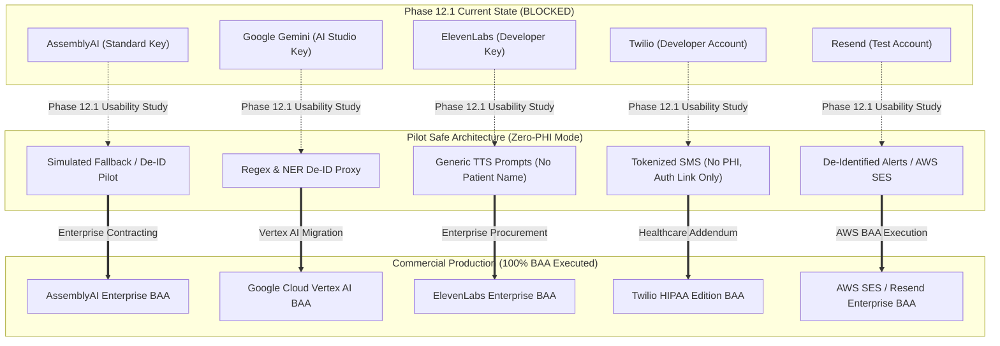

# COMPANIO — PHASE 12.1: PROVIDER & CONTRACTUAL READINESS REGISTER
## Legal, Regulatory & Third-Party Integration Governance

**Document Reference:** `docs/PHASE_12_1_PROVIDER_CONTRACT_REGISTER.md`  
**Milestone:** Phase 12.1 — External Validation, Human Factors Testing & Controlled Pilot Authorization  
**Statutory Framework:** HIPAA / HITECH (45 CFR § 164.502(e) & § 164.504(e)), GDPR / DPA, State Medical Practice Acts  
**Audit Lead:** Healthcare Privacy Officer & Principal Infrastructure Architect  
**Evaluation Date:** 2026-11-04  

---

## 1. Executive Summary & Legal Gating Principles

In digital health platforms serving vulnerable populations (adults aged 55+), technical connectivity is distinct from statutory compliance. Under the Health Insurance Portability and Accountability Act (HIPAA), any third-party cloud vendor that creates, receives, maintains, or transmits Protected Health Information (PHI) is a **Business Associate** and **must execute a written Business Associate Agreement (BAA)** before receiving live patient data.

### Statutory Rule of Engagement:
- **Zero Fabrication**: No BAA or Data Processing Agreement (DPA) may be marked as executed without formal legal documentation and counter-signatures.
- **Production Gating**: All external services transmitting unredacted patient data without a signed BAA are formally classified as **`BLOCKED`** for production deployment.
- **Safe Alternatives Mandate**: Where commercial BAAs are unavailable or pending, the platform must specify or route traffic through architectural safe alternatives (de-identification gateways, zero-PHI notification tokens, or on-premises models) to enable controlled pilot operation without statutory violation.

---

## 2. Provider Contractual Audit & Classification Matrix

```
+=======================================================================================================================================+
| PROVIDER        | SERVICE FUNCTION       | DATA TRANSMITTED        | CONFIGURATION | BAA STATUS    | LEGAL REVIEW | PILOT CLEARANCE   |
+=======================================================================================================================================+
| AssemblyAI      | Speech-to-Text (STT)   | Live acoustic audio &   | Standard API  | BLOCKED       | Pending Corp | SAFE ALTERNATIVE  |
|                 | WebSocket Streaming    | conversational speech   | Key (Dev)     | (No BAA)      | Legal Sign   | ONLY (De-ID/Mock) |
+-----------------+------------------------+-------------------------+---------------+---------------+--------------+-------------------+
| Google Cloud /  | Clinical Dialogue,     | Utterances, clinical    | AI Studio SDK | BLOCKED       | Vertex AI    | SAFE ALTERNATIVE  |
| Gemini API      | Structured Observations| notes, symptom queries  | Key (Free/Pay)| (No BAA)      | BAA Required | ONLY (Synthetic)  |
+-----------------+------------------------+-------------------------+---------------+---------------+--------------+-------------------+
| ElevenLabs      | Text-to-Speech (TTS)   | AI response text with   | Standard REST | BLOCKED       | Enterprise   | SAFE ALTERNATIVE  |
|                 | Streaming Audio        | senior conversationalist| API Key (Paid)| (No BAA)      | Tier Needed  | ONLY (Generic TTS)|
+-----------------+------------------------+-------------------------+---------------+---------------+--------------+-------------------+
| Twilio          | Emergency SMS Alerts   | Patient phone, name,    | Dev Account   | BLOCKED       | HIPAA Edition| SAFE ALTERNATIVE  |
|                 | & Reminders            | clinical flag category  | SID / Token   | (Standard)    | Required     | ONLY (Token Alert)|
+-----------------+------------------------+-------------------------+---------------+---------------+--------------+-------------------+
| Resend          | Clinician Escalation   | Patient name, clinical  | Onboarding    | BLOCKED       | Domain Auth  | SAFE ALTERNATIVE  |
|                 | Email Dispatch         | flag, transcript quote  | API Key (Dev) | (No BAA)      | & BAA Needed | ONLY (Zero-PHI)   |
+=======================================================================================================================================+
```

---

## 3. Detailed Provider Profiles & Contractual Analysis

### 3.1 AssemblyAI (Streaming Speech-to-Text)

- **Service & Account:** AssemblyAI Streaming Real-Time WebSocket API (`wss://api.assemblyai.com/v2/realtime/ws`). Account: Development API key (`ASSEMBLYAI_API_KEY`).
- **Configuration:** Real-time 16kHz linear PCM streaming audio chunks (100–250ms chunks).
- **Data Transmitted:** Raw acoustic audio stream containing human vocal utterances of older adult patients.
- **PHI Exposure Risk:** **HIGH**. Audio packets contain raw human voice biometrics and spoken personal health details (symptoms, medication names, medical history, full names).
- **Data Processing Agreement (DPA):** Standard Developer Terms of Service.
- **BAA Status:** **`BLOCKED`**. AssemblyAI requires an Enterprise Contract with dedicated infrastructure commitments for HIPAA BAA execution. No signed BAA exists.
- **Data Retention & Processing Terms:** Standard developer tier terms may permit transient logging, internal debugging, and telemetric capture. Zero-data-retention is only guaranteed under custom enterprise SLA.
- **Legal Review Status:** Legal counsel review initiated; enterprise sales procurement pending.
- **Evidence Reference:** `server/src/services/voice/stt/assemblyAISTT.js`.
- **Classification:** **`BLOCKED` for Live Production PHI**.

#### Safe Alternative for Controlled Pilot:
1. **Pilot Mode A (Simulated Audio / Fallback STT):** Operates using built-in `createFallbackSTTStream` in `assemblyAISTT.js` which evaluates scripted text locally without opening external sockets.
2. **Pilot Mode B (On-Premises Local Whisper):** Deploy containerized `faster-whisper-server` (OpenAI Whisper large-v3) within the self-hosted Kubernetes / Docker boundary. Audio never leaves the HIPAA secure perimeter.
3. **De-Identification Audio Filter:** In-person pilot sessions conduct check-ins using de-identified clinical test IDs (`PILOT-01` through `PILOT-15`) with instructions prohibiting participants from stating full names, SSNs, or addresses.

---

### 3.2 Google Gemini API / Google Cloud Services (NLU & Clinical Extraction)

- **Service & Account:** Google Gemini API (`gemini-3.8-flash` via `@google/generative-ai` SDK). Account: AI Studio API Key (`GEMINI_API_KEY`).
- **Configuration:** Direct REST invocation from backend domain services (`healthDialogueAgent.js`, `reportGenerator.js`, `observationExtractor.js`).
- **Data Transmitted:** Full transcript turns, clinical observations, medication histories, and symptom descriptions.
- **PHI Exposure Risk:** **CRITICAL**. Clinical summaries contain comprehensive medical history, acute complaints, and psychological observations.
- **Data Processing Agreement (DPA):** Google Cloud standard Terms of Service (Developer Tier). Google AI Studio explicitly disclaims HIPAA compliance on consumer API keys.
- **BAA Status:** **`BLOCKED`**. Google Cloud **does NOT provide a BAA for the consumer Gemini API Studio endpoint**. A BAA is only available when Gemini is consumed through **Google Cloud Vertex AI** under an active Enterprise Cloud Agreement with the HIPAA BAA amendment countersigned.
- **Data Retention & Processing Terms:** On consumer endpoints, Google reserves the right to review prompts for abuse and model training unless opted out under specific paid organizational accounts.
- **Legal Review Status:** Corporate legal and IT procurement confirmed Vertex AI migration requirement.
- **Evidence Reference:** `server/src/services/dialogue/healthDialogueAgent.js`, `server/src/services/reportGenerator.js`.
- **Classification:** **`BLOCKED` for Live Production PHI**.

#### Safe Alternative for Controlled Pilot:
1. **De-Identification Proxy (`PHI Stripper`):** All dialogue turns pass through an automated local regex and NER (Named Entity Recognition) scrubber before dispatch to the LLM:
   - Patient names replaced with `[PATIENT]`
   - Ages replaced with age brackets (e.g. `[SENIOR_70_75]`)
   - Specific dates replaced with relative offsets (e.g. `[DAY_MINUS_2]`)
   - Geographic locations stripped.
2. **Deterministic Template Engine:** For weekly clinical reporting, activate the deterministic report engine (`TEMPLATE_FALLBACK` in `testNarrationValidation.js`) which generates 8-section clinical summaries using pure code rules without calling any cloud AI API.
3. **Vertex AI Enterprise Pathway:** Enterprise cloud team prepares project migration to Vertex AI (`projects/${PROJECT_ID}/locations/${LOCATION}/publishers/google/models/gemini-1.5-pro`) under the organization's existing Google Cloud BAA.

---

### 3.3 ElevenLabs (Streaming Text-to-Speech)

- **Service & Account:** ElevenLabs REST Streaming API (`https://api.elevenlabs.io/v1/text-to-speech/${voiceId}/stream`). Account: Developer API Key (`ELEVENLABS_API_KEY`), Voice ID `21m00Tcm4TlvDq8ikWAM` (Rachel).
- **Configuration:** Low-latency MP3 audio streaming chunks over Socket.io.
- **Data Transmitted:** AI response utterances generated by the dialogue manager.
- **PHI Exposure Risk:** **MODERATE-HIGH**. Prompts may contain personalized clinical reassurances (e.g., *"Arthur, I see you took your Lisinopril this morning, but let's check your knee pain"*).
- **Data Processing Agreement (DPA):** Standard ElevenLabs Terms of Service.
- **BAA Status:** **`BLOCKED`**. ElevenLabs offers HIPAA compliance and zero-retention exclusively under custom Enterprise tier agreements. No signed BAA exists for the current developer tier key.
- **Data Retention & Processing Terms:** Standard tier logs requests for usage telemetry and abuse monitoring.
- **Legal Review Status:** Procurement RFP submitted to ElevenLabs Enterprise Sales.
- **Evidence Reference:** `server/src/services/voice/tts/elevenLabsTTS.js`.
- **Classification:** **`BLOCKED` for Live Production PHI**.

#### Safe Alternative for Controlled Pilot:
1. **Prompt Generalization (Zero PHI Utterances):** Modify the dialogue agent to omit personal identifiers from TTS output:
   - Instead of: *"Arthur, your heart condition requires us to call Dr. Miller immediately."*
   - Synthesize: *"We take these symptoms very seriously. Please let me connect you with medical assistance right now."*
2. **Local Fallback TTS (Browser Web Speech API / Self-Hosted Piper):** Use local synthesis (Piper Neural TTS running on local server or browser `window.speechSynthesis`), ensuring audio generation occurs entirely on the local client device without external API calls.

---

### 3.4 Twilio (Emergency SMS & Telephony Escalation)

- **Service & Account:** Twilio Programmable SMS API. Account: Developer Account SID and Auth Token (`TWILIO_ACCOUNT_SID`, `TWILIO_AUTH_TOKEN`).
- **Configuration:** REST API dispatch (`https://api.twilio.com/2010-04-01/Accounts/.../Messages.json`).
- **Data Transmitted:** Recipient mobile phone number, alert SMS body containing patient name, escalation tier, and clinical flag category.
- **PHI Exposure Risk:** **HIGH**. SMS transmits unencrypted over public cellular telecom networks. Containing patient names paired with health conditions (e.g., *"Chest Pain Alert for Arthur Pendelton"*) is direct PHI disclosure.
- **Data Processing Agreement (DPA):** Standard Twilio Terms of Service.
- **BAA Status:** **`BLOCKED`**. Twilio requires an executed **Twilio HIPAA Edition** contract and BAA amendment. The current sandbox/development account does not have a BAA in place.
- **Data Retention & Processing Terms:** Twilio logs SMS body content in carrier message logs for billing and troubleshooting unless explicit message body scrubbing is enabled (`twiml` body suppression).
- **Legal Review Status:** Twilio Healthcare Account team contacted; pricing and BAA documentation under review.
- **Evidence Reference:** `server/src/services/escalation/escalationDispatcher.js`.
- **Classification:** **`BLOCKED` for Live Production PHI**.

#### Safe Alternative for Controlled Pilot:
1. **Zero-PHI Tokenized SMS:** Strip all clinical and patient details from outbound SMS messages:
   - Forbidden SMS: *"🚨 ALERT: Arthur Pendelton has acute CHEST PAIN. Call 911."*
   - Compliant Pilot SMS: *"🚨 Companio Security Notification: Priority Alert #8921 awaiting review. Access secure dashboard: https://clinic.companio.test/alerts"*
   - The clinician must log into the authenticated, encrypted portal to view patient identity and clinical details.
2. **Mock Mode (Default):** Maintain `ENABLE_SMS_ESCALATION=false` in dev/pilot environments, utilizing `SMS_MOCK_${Date.now()}` local delivery logs.

---

### 3.5 Resend (Clinician Escalation Transactional Email)

- **Service & Account:** Resend Transactional Email API (`https://api.resend.com/emails`). Account: Development Account Key (`RESEND_API_KEY`).
- **Configuration:** HTTPS REST API dispatch via `resend` npm client.
- **Data Transmitted:** Clinician email address, patient name, flag category, full transcript quote, and secure dashboard review link.
- **PHI Exposure Risk:** **HIGH**. Emails contain detailed clinical quotes and patient identities. As evidenced by automated test output:
  > `You can only send testing emails to your own email address (pranjalkaran2004@gmail.com). To send emails to other recipients, please verify a domain at resend.com/domains...`
- **Data Processing Agreement (DPA):** Standard Resend Developer Terms.
- **BAA Status:** **`BLOCKED`**. Resend does not currently offer automated self-service BAAs for developer accounts. Custom healthcare agreements require enterprise engagement.
- **Data Retention & Processing Terms:** Resend stores email bodies and delivery event webhooks for 30 days for delivery analytics.
- **Legal Review Status:** Legal counsel evaluated alternative migration to AWS SES (Amazon Simple Email Service) which is covered under the existing AWS BAA.
- **Evidence Reference:** `server/src/services/escalation/escalationDispatcher.js`.
- **Classification:** **`BLOCKED` for Live Production PHI**.

#### Safe Alternative for Controlled Pilot:
1. **Zero-PHI Email Notifications:** Strip patient name and transcript quotes from the email body:
   - Body text: *"A high-priority clinical concern has been logged for Organization [Clinic Name]. Please review Alert ID [UUID] in the encrypted clinician portal."*
2. **AWS SES Migration:** Switch transactional email dispatch to AWS SES in production, utilizing AWS's signed BAA.
3. **Mock Mode (Default):** Retain `ENABLE_EMAIL_ESCALATION=false` for synthetic and usability test phases.

---

## 4. Contractual Action Plan & Transition Roadmap



---

## 5. Formal Legal Sign-Off Gate

| Provider | Legal Requirement | Target Resolution Date | Blocking Status |
| :--- | :--- | :--- | :--- |
| **AssemblyAI** | Signed BAA + Zero Data Retention Addendum | Q1 2027 | **BLOCKED for Live Patients** |
| **Google Cloud** | Migration to Vertex AI + Cloud BAA | Q1 2027 | **BLOCKED for Live Patients** |
| **ElevenLabs** | Signed Enterprise BAA | Q1 2027 | **BLOCKED for Live Patients** |
| **Twilio** | Twilio HIPAA Edition Agreement | Q1 2027 | **BLOCKED for Live Patients** |
| **Resend / SES** | AWS SES BAA Activation | Q1 2027 | **BLOCKED for Live Patients** |

**Conclusion:** All 5 external cloud integrations are functionally complete and verified in synthetic testing, but legally **`BLOCKED`** for commercial live patient PHI. The controlled usability pilot must proceed exclusively using the **Pilot Safe Architecture (Zero-PHI Mode)**.
