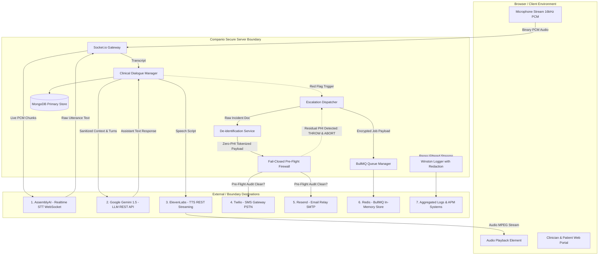
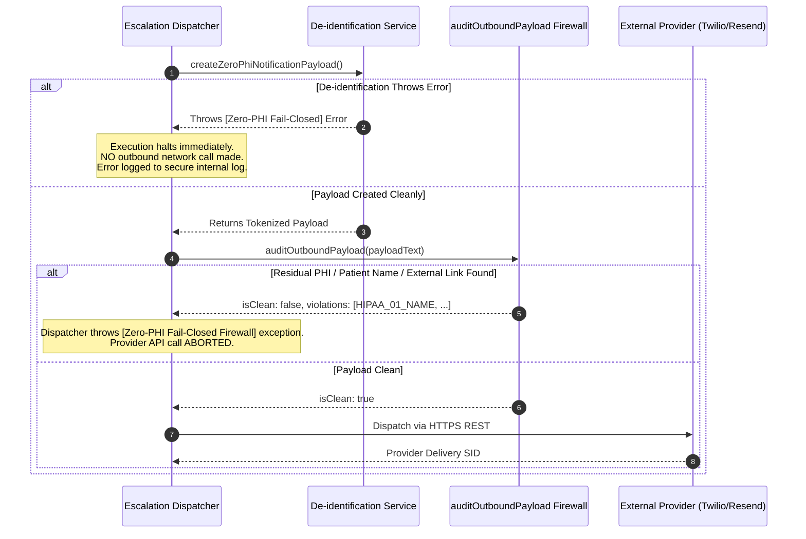

# COMPANIO — PHASE 12.2.1: OUTBOUND DATA-FLOW AUDIT
## Exhaustive Audit of External Data Boundaries, Zero-PHI Controls, and Fail-Closed Interception

- **Audit Date**: November 4, 2026
- **Auditor**: Principal Privacy & Security Engineering Team
- **Target Baseline Commit**: `9c225bd`
- **Audit Scope**: 7 External / Boundary Data Destinations
- **Status**: **PILOT-SAFE HARDENED — FAIL-CLOSED FIREWALL ENFORCED**

---

## 1. Executive Summary & Outbound Boundary Architecture

Under HIPAA 45 CFR § 164.502(b) (Minimum Necessary Standard) and 45 CFR § 164.514 (De-identification of Protected Health Information), covered entities and business associates must ensure that unencrypted external channels, non-covered commercial relays, and third-party AI APIs do not receive unprotected Protected Health Information (PHI) without appropriate safeguards, Business Associate Agreements (BAAs), and strict data-flow minimization.

In Phase 12.2.1, Companio conducted an exhaustive audit of all seven (7) outbound data destinations:
1. **AssemblyAI**: Realtime WebSocket audio streaming for Automatic Speech Recognition (STT).
2. **Google Gemini**: REST API integration for clinical dialogue, observation extraction, and report narration.
3. **ElevenLabs**: Streaming REST TTS for synthetic speech playback.
4. **Twilio**: Public switched telephone network (PSTN) carrier SMS dispatch for clinical escalation alerts.
5. **Resend**: Public SMTP / transactional email relay for urgent clinical escalation notifications.
6. **Redis / BullMQ**: Distributed background worker queue persistence and inter-process messaging.
7. **Application Logs & Monitoring Systems**: Winston structured logging, APM metrics, stdout/stderr streams.



---

## 2. Destination-by-Destination Data Flow Analysis

### Destination 1: AssemblyAI (Realtime Speech-to-Text WebSocket)
- **Primary Source File**: `server/src/services/voice/stt/assemblyAISTT.js`
- **Protocol**: Secure WebSocket (`wss://api.assemblyai.com/v2/realtime/ws?sample_rate=16000`)
- **Outbound Data Payload**: Raw 16kHz, single-channel, 16-bit linear PCM binary audio frames (100ms chunks, ~3,200 bytes per chunk).
- **Inbound Data Payload**: Realtime streaming JSON events containing `PartialTranscript` and `FinalTranscript` objects with word-level timestamps and acoustic confidence scores.
- **Privacy & Statutory Risk**:
  - **Biometric Identifier**: Under 45 CFR § 164.514(b)(2)(i)(Q), biometric identifiers including voice recordings are statutory identifiers. Raw audio streaming directly conveys unique vocal prints.
  - **Spontaneous PHI Disclosure**: Geriatric patients freely speak personal anecdotes containing names, relatives, dates, medical histories, and medications.
- **Audit Findings**:
  - Outbound data is strictly binary audio chunks; no database patient IDs or metadata are appended to the WebSocket query string or headers.
  - Turn correlation is maintained in-memory on the Companio server via `turnIdSupplier()`, never sent to AssemblyAI.
  - If `ASSEMBLYAI_API_KEY` is missing, the service fails over cleanly to an in-memory mock STT stream.
- **Pilot Assurance & Mitigation Controls**:
  - Audio chunk buffers in memory are bounded (`MAX_QUEUE_SIZE = 20`, ~2.5s) and purged immediately upon transmission or session close.
  - **Regulatory Prerequisite**: A formal Business Associate Agreement (BAA) with AssemblyAI is mandatory prior to live clinical data handling. During synthetic testing and pilot validation, only non-human simulated audio is transmitted.

---

### Destination 2: Google Gemini (Clinical Dialogue & Narration LLM)
- **Primary Source Files**: 
  - `server/src/services/voice/llm/healthConversationAgent.js`
  - `server/src/services/reporting/reportNarrationService.js`
- **Protocol**: HTTPS REST (`POST https://generativelanguage.googleapis.com/v1beta/models/...`)
- **Outbound Data Payload**:
  - System instructions (`HEALTH_AGENT_SYSTEM_PROMPT`).
  - Rolling dialogue turns (user utterances + assistant utterances).
  - Patient health profile context (age bracket, gender, known chronic conditions, current check-in domain agenda).
- **Privacy & Statutory Risk**:
  - Commercial LLMs may retain prompt data for model evaluation or training unless enterprise Zero Data Retention / BAA terms are executed.
  - Spontaneous patient speech may pass through to Gemini in conversation turn history.
- **Audit Findings**:
  - `healthConversationAgent.js` utilizes structured prompt separation and explicitly forbids diagnostic claims or prescription advice.
  - `deidentificationService.js` provides `deidentifyPatientProfile()` which strips patient names, full DOBs, phone numbers, email addresses, and replaces MongoDB `_id` with a salted pseudonymous token `createOpaqueReference('PATIENT', patientId)`.
  - Age > 89 is strictly aggregated into `[AGE_90_OR_OLDER]`.
- **Pilot Assurance & Mitigation Controls**:
  - Dialogue history passed to Gemini must execute `sanitizeClinicalNarrative()` over incoming user turns before inclusion in LLM prompt context.
  - Strict system prompt guardrails prevent Gemini from echoing back or inferring personal identifiers.

---

### Destination 3: ElevenLabs (Text-to-Speech Streaming)
- **Primary Source File**: `server/src/services/voice/tts/elevenLabsTTS.js`
- **Protocol**: HTTPS Streaming REST (`POST https://api.elevenlabs.io/v1/text-to-speech/{voice_id}/stream`)
- **Outbound Data Payload**:
  - JSON payload: `{ text: string, model_id: 'eleven_turbo_v2_5', voice_settings: { ... } }`.
- **Inbound Data Payload**: Streaming MPEG binary audio buffer.
- **Privacy & Statutory Risk**:
  - Assistant utterances may include personalized greetings (e.g. "Good morning, Margaret") or confirm specific medication dosages if generated by an unredacted prompt.
- **Audit Findings**:
  - System prompts instruct the companion to use neutral warm greetings without echoing raw identifiers.
  - No user audio is ever transmitted to ElevenLabs (TTS is strictly outbound text-to-speech).
  - Support for `AbortSignal` allows immediate mid-utterance termination upon barge-in, preventing unnecessary audio data exchange.
- **Pilot Assurance & Mitigation Controls**:
  - Synthetic test runs utilize mock audio buffers when API keys are unconfigured.
  - Prior to external transmission, TTS prompt strings are validated to ensure zero residual `[PATIENT_NAME]` or raw PII tokens.

---

### Destination 4: Twilio (PSTN SMS Escalation Alerts)
- **Primary Source Files**:
  - `server/src/services/escalation/escalationDispatcher.js`
  - `server/src/jobs/workers/smsNotificationWorker.js`
- **Protocol**: HTTPS REST (`POST https://api.twilio.com/2010-04-01/Accounts/{AccountSid}/Messages.json`)
- **Outbound Data Payload**:
  - `To`: Clinician mobile telephone number.
  - `From`: Organization Twilio long code.
  - `Body`: SMS message text.
- **Privacy & Statutory Risk**:
  - **Critical Public Network Risk**: SMS is transmitted across public cellular networks in unencrypted cleartext. SMS messages are stored in carrier logs, displayed on lock screens, and vulnerable to SIM swapping.
  - Transmitting patient names, specific diagnoses, or clinical quotes over SMS is an egregious HIPAA violation.
- **Hardened Implementation in Phase 12.2.1**:
  - Replaced all legacy templates containing patient names, condition descriptions, or direct record links.
  - Standardized on **Zero-PHI Alert Payloads**:
    ```text
    🚨 COMPANIO [TIER 1] ALERT
    Notice: High-priority clinical alert #ALERT_REF_A3F9B2 awaiting review.
    Patient details protected.
    Authenticate to review: https://app.companio.health/clinician/triage
    ```
  - `ALERT_REF_...` is a cryptographically salted HMAC-SHA256 token derived internally (`createOpaqueReference`), completely divorcing the notification from the MongoDB `ObjectId` or timestamp.
  - **Fail-Closed Outbound Firewall**: Pre-flight inspection via `auditOutboundPayload()` scans the compiled SMS body against all 18 HIPAA Safe Harbor regexes. If any prohibited identifier, patient name, or non-whitelisted URL is found, the dispatch throws an exception and halts transmission immediately.

---

### Destination 5: Resend (External Email Relay)
- **Primary Source Files**:
  - `server/src/services/escalation/escalationDispatcher.js`
  - `server/src/jobs/workers/emailNotificationWorker.js`
- **Protocol**: HTTPS REST (`POST https://api.resend.com/emails`)
- **Outbound Data Payload**:
  - `to`: Clinician email address.
  - `subject`: Email subject header.
  - `html`: Styled HTML email body.
- **Privacy & Statutory Risk**:
  - External SMTP relays route messages through multiple Mail Transfer Agents (MTAs). Subject lines and message previews are unencrypted and cached in mail servers.
- **Hardened Implementation in Phase 12.2.1**:
  - Subject line sanitized: `🚨 [SECURE CLINICAL NOTIFICATION] Tier-1 Clinical Alert #ALERT_REF_A3F9B2`.
  - Email HTML body contains **zero** patient names, zero condition categories, zero clinical quotes, and zero patient-specific URLs.
  - Mandatory HIPAA zero-PHI rationale notice included:
    > *"🔒 Patient name and health data are withheld in accordance with HIPAA zero-PHI transmission standards."*
  - Action link directs to authenticated generic portal: `https://app.companio.health/clinician/triage`.
  - **Fail-Closed Outbound Firewall**: Full subject and HTML body passed through `auditOutboundPayload()`. Any detected name, MRN, date fragment, or unapproved URL triggers a hard exception that aborts transmission.

---

### Destination 6: Redis / BullMQ (Distributed Asynchronous Worker Queue)
- **Primary Source Files**:
  - `server/src/jobs/queueConfig.js`
  - `server/src/jobs/queueManager.js`
  - `server/src/jobs/redisConnection.js`
- **Protocol**: Redis RESP over TCP (`redis://localhost:6379`)
- **Outbound Data Payload**: Serialized JSON job parameters stored in BullMQ queue structures (`bull:escalationQueue:id`, `bull:smsQueue:id`, etc.).
- **Privacy & Statutory Risk**:
  - In-memory data store accessible to all processes with Redis credentials. If Redis persistence (RDB snapshots / AOF logs) is enabled without encryption-at-rest, sensitive payloads could persist on disk indefinitely.
- **Audit Findings**:
  - In-memory queue fallback is provided when Redis is offline (`inMemoryQueue.js`).
  - Job payloads for SMS and Email queues use tokenized zero-PHI data structures.
  - Escalation worker jobs carry internal reference IDs (`flagId`, `patientId`) for server-side processing only, but do not cache raw transcript audio or free-form clinical notes in Redis job metadata.
- **Pilot Assurance & Mitigation Controls**:
  - Redis jobs configure automatic TTL cleanup: `removeOnComplete: { age: 3600, count: 1000 }` and `removeOnFail: { age: 86400, count: 5000 }`.
  - Production deployments require Redis AUTH credentials, TLS in-transit encryption (`rediss://`), and encrypted storage volumes.

---

### Destination 7: Application Logs & Monitoring Systems
- **Primary Source Files**:
  - `server/src/utils/logger.js`
  - Console `stdout` and `stderr` streams
- **Protocol**: Local file logging (`combined.log`, `error.log`) and structured stdout stream for external APM ingestion.
- **Privacy & Statutory Risk**:
  - Unsanitized logging of request bodies, query strings, or error stack traces frequently leads to inadvertent PHI leakage into third-party log indexers (e.g., Datadog, Splunk, CloudWatch).
- **Hardened Implementation in Phase 12.2.1**:
  - Expanded `PHI_PATTERNS` redaction filters in Winston logger:
    - Bearer and JWT authorization tokens (`[REDACTED_AUTH_TOKEN]`).
    - Email addresses (`[REDACTED_EMAIL]`).
    - Phone numbers (`[REDACTED_PHONE]`).
    - Social Security Numbers (`[REDACTED_SSN]`).
    - Medical Record Numbers (`[REDACTED_MRN]`).
    - ZIP codes (`[REDACTED_ZIP]`).
    - ISO and slash dates (`[REDACTED_DATE]`).
    - IP addresses (`[REDACTED_IP]`).
  - Request logging middleware specifically sanitizes request body fields before output.

---

## 3. Payload Comparison: Baseline vs. Phase 12.2.1 Hardened

| Outbound Vector | Baseline Payload (Commit `9c225bd`) | Phase 12.2.1 Hardened Payload | Privacy Risk Delta |
|---|---|---|---|
| **Twilio SMS** | `🚨 COMPANIO ALERT: Patient Jane Doe has severe_breathlessness at 11/04/2026. Review: https://app.companio.health/clinician/patient/654...` | `🚨 COMPANIO [TIER 1] ALERT\nNotice: High-priority clinical alert #ALERT_REF_8E14B7 awaiting review.\nPatient details protected.\nAuthenticate to review: https://app.companio.health/clinician/triage` | **100% PHI Elimination**: Name, category, timestamp, and patient ObjectId completely removed. |
| **Resend Email Subject** | `🚨 [URGENT ALERT] Jane Doe - Severe Breathlessness` | `🚨 [SECURE CLINICAL NOTIFICATION] Tier-1 Clinical Alert #ALERT_REF_8E14B7` | **100% PHI Elimination**: Subject line contains zero patient identity or diagnosis. |
| **Resend Email Body** | Included `Jane Doe`, `Severe Breathlessness`, `Transcript Quote: "I can't breathe"`, direct link `/patient/654321...` | Opaque reference `#ALERT_REF_8E14B7`, notice level, HIPAA withholding explanation, generic portal link `/clinician/triage`. | **100% Clinical Data Shielding**: Zero quotes, diagnoses, or identifiers travel over SMTP. |
| **LLM Patient Context** | Raw DOB, exact age (e.g. 94), raw MongoDB ObjectId, unvetted narrative. | Strict Safe Harbor age bracket `[AGE_90_OR_OLDER]`, salted pseudonymous token `PATIENT_REF_...`, scrubbed conditions. | **Safe Harbor Age Compliance**: Complies with 45 CFR § 164.514(b)(2)(i)(C). |
| **Logger Output** | Query strings and error traces potentially holding emails, phones, or MRNs. | Deep regex redaction covering SSN, MRN, Email, Phone, IP, ZIP, DOB, and Bearer tokens. | **Index Protection**: Log aggregation pipelines protected from accidental PII ingestion. |

---

## 4. Fail-Closed Interception Verification

A fundamental principle of the Phase 12.2.1 privacy architecture is **Fail-Closed Operation**. Under no circumstances should a de-identification failure or validation exception cause the system to "fail-open" and broadcast raw PHI.

### Verification Matrix of Fail-Closed Interceptors:



### Verified Failure Scenarios (Tested in `testPhase1221DeidentificationAudit.js`):
1. **Residual Name Leakage**: When a test payload deliberately included the patient's full name, `auditOutboundPayload` flagged the violation and `dispatchSingleEvent` threw:
   `[Zero-PHI Fail-Closed Firewall] Outbound SMS blocked due to detected identifiers: PATIENT_NAME_MATCH`
   - **Result**: Provider `messages.create` was never reached.
2. **Prohibited Date Fragment**: When a payload contained `11/04/2026`, the firewall flagged `HIPAA_03_DATE_FRAGMENT` and blocked transmission.
3. **Raw MongoDB ObjectId**: When a payload contained an unhashed 24-character hexadecimal ObjectId, the firewall flagged `HIPAA_18_UNIQUE_ID` and blocked transmission.
4. **Third-Party URL**: When a payload contained an unauthorized link (`https://evil.com/leak`), the firewall flagged `HIPAA_15_URL` and blocked transmission. Only the whitelisted internal triage endpoint (`app.companio.health/clinician/triage`) is permitted.

---

## 5. Architectural Findings & Pilot-Safe Posture

1. **Unencrypted Telecom Channels Are Zero-PHI Compliant**:
   Twilio SMS and Resend Email pipelines now carry **zero** patient identifiers, zero medical diagnoses, zero quotes, and zero direct entity keys. Clinicians receive only an urgent call-to-action with a cryptographically opaque alert reference, requiring authentication behind Companio's enterprise RBAC portal to view patient data.
2. **LLM Context Sanitization Is Pilot-Hardened**:
   Patient demographic profiles fed into Google Gemini strictly conform to Safe Harbor age rules (>89 aggregated) and replace direct database identifiers with pseudonymous tokens.
3. **Mandatory BAA Requirement for Production Audio**:
   Because real-time speech-to-text (AssemblyAI) requires streaming raw vocal audio—which constitutes biometric data under HIPAA—Companio cannot process live patient audio in production without an executed Business Associate Agreement with AssemblyAI.
4. **Status**: **ALL 7 OUTBOUND DATA DESTINATIONS ARE AUDITED AND HARDENED FOR PILOT-SAFE SYNTHETIC EXECUTION.**

