# COMPANIO — PHASE 12.2: FINAL PRODUCTION READINESS ASSESSMENT & FOUR-TIER AUTHORIZATION
## Comprehensive Release Gate Audit, Decoupled Tier Determinations & Statutory Governance Roadmap

**Document Reference:** `docs/PHASE_12_2_FINAL_READINESS_REPORT.md`  
**Milestone:** Phase 12.2 — External Evidence Closure & Pilot Authorization  
**Author:** Principal Healthcare Software Architect, Chief Information Security Officer & Medical Director  
**Evaluation Date:** 2026-11-04  
**Git Baseline:** `673fe7c` (Verified Clean Working Tree)  
**Test Harness Status:** 13 Master Suites Active (100% Automated Pass Rate)  

---

## 1. Executive Summary & Four-Tier Release Architecture

Companio is an AI-powered, voice-first healthcare and wellness platform designed for adults aged 55 and above. Because healthcare software impacts patient physical safety and processes legally protected health information, release readiness cannot be evaluated as a monolithic binary flag.

In Phase 12.2, Companio establishes a **strictly decoupled Four-Tier Release Authorization Architecture**:

```mermaid
flowchart TD
    subgraph Tier A [TIER A: SYNTHETIC VALIDATION]
        A1[13 Master Test Suites] --> A2[Synthetic Personas]
        A2 --> A3{Result: 100% PASS}
        A3 --> A4[STATUS: AUTHORIZED / GO]
    end

    subgraph Tier B [TIER B: SENIOR USABILITY PILOT]
        B1[Bench Accessibility: PASS] --> B2[Zero-PHI Engine: PASS]
        B2 --> B3{IRB Written Approval?}
        B3 -->|Pending Letter| B4[STATUS: CONDITIONAL GO]
        B4 --> B5[Recruitment Gated]
    end

    subgraph Tier C [TIER C: CLINICAL PILOT]
        C1[Tier B Usability Success] --> C2[13 RED / 10 YELLOW Rules]
        C2 --> C3{Board Sign-off Signed?}
        C3 -->|Pending Signatures| C4[STATUS: BLOCKED / NO-GO]
    end

    subgraph Tier D [TIER D: COMMERCIAL LAUNCH]
        D1[Tier C Clinical Success] --> D2{5 Provider BAAs?}
        D2 -->|0/5 Executed| D4[STATUS: BLOCKED / NO-GO]
        D3{External Pentest?} -->|Pending Execution| D4
    end
```



---

## 2. Decoupled Tier Determinations & Gate Matrices

### Tier A: Synthetic Engineering Validation
- **Scope & Purpose:** Verification of codebase integrity, microservices, database schemas, cryptographic signatures, voice pipeline state machines, disaster recovery drills, and security mitigations using synthetic test data. Zero real patient data; zero human subjects.
- **Gate Criteria:**
  1. All automated test suites passing 100% without mocks in primary pipelines.
  2. Disaster recovery RPO < 15m and RTO < 30m verified with bit-level parity.
  3. Cryptographic token hashing and session revocation verified.
  4. Release Gates A–E, Prometheus telemetry, and distributed tracing functional.
  5. Pilot-safe de-identification and zero-PHI notification engine passing all assertions.
- **Verification Evidence:**
  - `npm run test:deid` (12/12 checks PASS)
  - `npm run test:pilot` (11 stages, 43 assertions PASS)
  - `npm run test:recovery` (10/10 security checks PASS)
  - `npm run test:drill` (1058 documents, 100% bit parity PASS)
  - `npm run test:operations` (Release Gates A–E PASS)
  - `npm run test:redis` (8 scenarios PASS)
  - `npm run test:jobs` (7 workers, DLQ PASS)
  - `npm run test:caregivers` (15 APIs PASS)
  - `npm run test:reporting` (30 criteria PASS)
  - `npm run test:dialogue` (77/77 checks PASS)
  - `npm run test:safety` (162/162 checks PASS)
  - `npm run test:voice` (40/40 checks PASS)
  - `npm run build:client` (Production build verified)
- **Concrete Blockers:** None.
- **Formal Decision:** **AUTHORIZED / PASS (GO)**.

---

### Tier B: Restricted Senior Usability Pilot
- **Scope & Purpose:** Controlled human factors usability evaluation on Android tablet hardware with older adults (55+) and authorized family caregivers to measure acoustic clarity, touch target ergonomics, speech rate comprehension, and task completion.
- **Gate Criteria:**
  1. Laboratory bench accessibility compliance (WCAG 2.1 AA/AAA contrast >= 7:1, touch targets >= 48px, speech rate 0.85x, scalable typography).
  2. Pilot-Safe De-Identification & Zero-PHI notification architecture actively implemented and tested in code (`server/src/services/privacy/deidentificationService.js`).
  3. Formal written Institutional Review Board (IRB) ethics approval letter for Protocol `COMPANIO-PILOT-2026-HFE`.
  4. Approved Plain-English informed consent documents (Patient ICF, Caregiver ICF).
  5. Certified Clinical Research Coordinator (CCRC) assigned for on-site session oversight.
- **Current Evidence Status:**
  - Criteria 1 & 2: **PASSED (100% verified in bench lab and automated test suite `test:deid`)**.
  - Criteria 3 & 4: **PENDING WRITTEN APPROVAL** (Protocol submitted; formal review in progress).
  - Criterion 5: **READY** (Lead CRC assigned).
- **Concrete Blockers:**
  - **Blocker B-1:** Receipt of formal written IRB approval letter (`IRB-DET-2026-01`). Federal regulations (45 CFR § 46) strictly prohibit participant recruitment, screening, or enrollment until this letter is received.
- **Formal Decision:** **CONDITIONAL GO (BENCH AUTHORIZED / HUMAN RECRUITMENT GATED)**.
  - *Operational Rule:* Laboratory bench hardware testing and synthetic preparation are authorized to proceed. **Zero human participants may be contacted, consented, or tested until Blocker B-1 is formally resolved.**

---

### Tier C: Controlled Clinical Pilot
- **Scope & Purpose:** Monitored prospective clinical trial evaluating health outcomes, symptom progression detection, and clinician attestation workflows in an ambulatory care cohort.
- **Gate Criteria:**
  1. Successful completion and analysis of Tier B Usability Pilot.
  2. Formal written, signed approval of 13 RED and 10 YELLOW clinical trigger rules by the Multidisciplinary Clinical Safety Review Board.
  3. Integration of emergency on-call clinician paging pathways and institutional clinical site agreements.
  4. Clinical research site BAA execution.
- **Current Evidence Status:**
  - Criteria 1: Blocked by Tier B human completion.
  - Criteria 2: Clinical review protocols cataloged and reviewed by identified specialists (`docs/PHASE_12_2_CLINICAL_SIGNOFF_TRACKER.md`); formal board convene and signed certificates pending.
  - Criteria 3 & 4: In institutional review.
- **Concrete Blockers:**
  - **Blocker C-1:** Tier B Usability Pilot not yet executed with human subjects.
  - **Blocker C-2:** Physical/electronic signatures from Dr. Elena Vance and Dr. Robert Thorne on clinical rule packages pending board convene.
  - **Blocker C-3:** Clinical site BAAs unexecuted.
- **Formal Decision:** **BLOCKED / NO-GO**.

---

### Tier D: Commercial Production Launch
- **Scope & Purpose:** General commercial availability as a SaaS healthcare platform serving healthcare systems, Medicare Advantage organizations, and independent senior living facilities.
- **Gate Criteria:**
  1. Legally executed HIPAA Business Associate Agreements (BAAs) with all 5 third-party cloud service providers (AssemblyAI, Google Cloud Vertex AI, ElevenLabs, Twilio, Resend).
  2. Independent third-party penetration testing across all 12 attack surfaces conducted by an accredited CREST/SOC 2 cybersecurity firm with zero open Critical/High findings.
  3. Formal sign-off and clinical safety certification from Medical Advisory Board.
  4. Institutional SOC 2 Type II and HIPAA Security Rule compliance audit attestation.
- **Current Evidence Status:**
  - Criteria 1: **0 / 5 BAAs executed** (Standard developer/pro tiers active; PHI strictly prohibited).
  - Criteria 2: **PENDING EXTERNAL EXECUTION** (Scope and RFP defined in `docs/PHASE_12_2_PENETRATION_TEST_TRACKER.md`; assessment not yet performed).
  - Criteria 3: Pending formal board convene.
  - Criteria 4: Staged for post-pentest compliance audit.
- **Concrete Blockers:**
  - **Blocker D-1:** Zero executed provider BAAs (processing live PHI constitutes a Tier 3/4 HIPAA willful neglect violation).
  - **Blocker D-2:** Absence of certified external third-party penetration test.
  - **Blocker D-3:** Clinical board signatures pending.
- **Formal Decision:** **BLOCKED / STRICT NO-GO**.

---

## 3. Comprehensive Remediation Roadmap for Non-Passing Tiers

```
┌────────────────────────────────────────────────────────────────────────────────────────┐
│                        COMPANIO PRODUCTION AUTHORIZATION ROADMAP                      │
├────────────────────────────────────────────────────────────────────────────────────────┤
│ Q4 2026                 Q1 2027                                    Q2 2027             │
│ [Phase 12.2 Closure] ──> [IRB Determination] ──> [Tier B Usability] ─> [Tier C Pilot] │
│ • Zero-PHI Engine Active • Receive IRB-DET-01     • 20 Seniors Tested   • Site BAA     │
│ • Bench HW Staged        • Open Enrollment        • SUS > 80 Target     • 100 Patients │
│ • 13 Suites Passing      • CRC Mobilized                                               │
│                                                                                        │
│                          [Commercial Track]                                            │
│                          • Execute 5 BAAs (Google, AssemblyAI, Twilio)                 │
│                          • Third-Party Pentest (12 surfaces) ───> [Tier D Launch]      │
└────────────────────────────────────────────────────────────────────────────────────────┘
```

| Action Item | Milestone / Target | Responsible Lead | Target Completion | Unblocks |
| :--- | :--- | :--- | :--- | :--- |
| **Action 1: Secure IRB Determination Letter** | Receive and log written approval letter `IRB-DET-2026-01` | Dr. Robert Thorne / PI | December 2026 | Unblocks Tier B Human Recruitment |
| **Action 2: Execute Human Usability Sessions** | Conduct 20 senior usability sessions with CRC oversight | Human Factors Lead | January 2027 | Tier B Completion |
| **Action 3: Convene Clinical Safety Board** | Obtain signed certifications on 23 clinical rules | Medical Director | January 2027 | Unblocks Tier C & D Clinical Gates |
| **Action 4: Contract Enterprise Cloud BAAs** | Execute BAAs with Google Cloud, AssemblyAI, Twilio, Resend | Legal Counsel / CTO | February 2027 | Unblocks Tier D Commercial PHI |
| **Action 5: Execute External Penetration Test** | 10-day evaluation by CREST firm; retest all findings | CISO / DevSecOps | February 2027 | Unblocks Tier D Commercial Launch |
| **Action 6: Clinical Site Pilot Onboarding** | Deploy monitored pilot with ambulatory geriatric clinic | Clinical Operations | March 2027 | Tier C Execution |

---

## 4. Statutory Stop Gate Enforcement

> [!CAUTION]
> **COMPLIANCE STOP GATE ENFORCED:**
> In accordance with Phase 12.2 project specifications:
> - Software engineering validation is 100% complete and passing.
> - The Pilot-Safe Zero-PHI Architecture is implemented, tested, and operational in code.
> - **Human recruitment, live clinical deployment, and commercial release are formally LOCKED.**
> - The engineering team must STOP and await explicit user instruction and external authorization before initiating human trials or external deployments.
