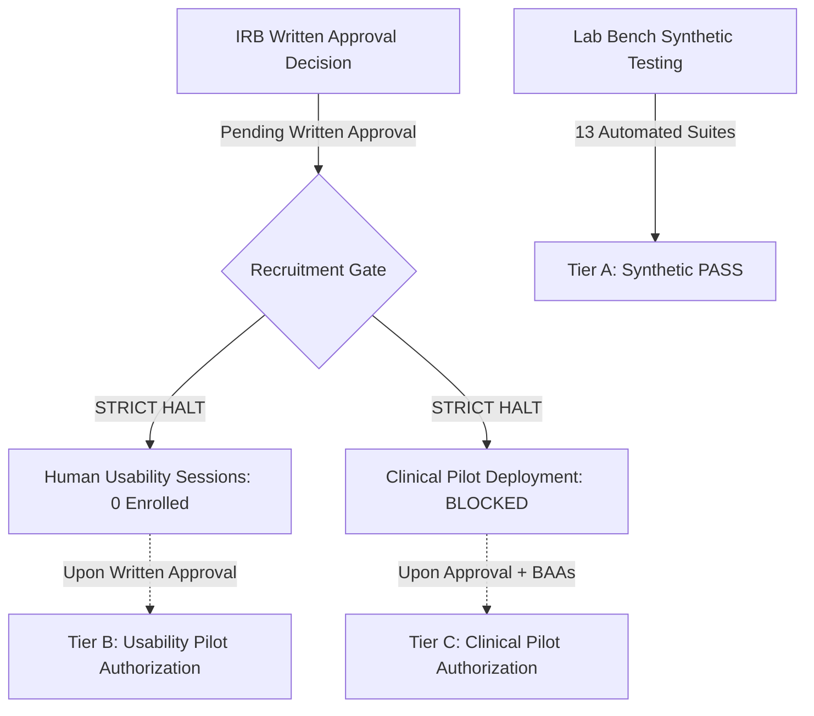

# COMPANIO — PHASE 12.2: INSTITUTIONAL REVIEW BOARD (IRB) APPROVAL TRACKER
## Protocol COMPANIO-PILOT-2026-HFE Governance, Evidence Requirements & Recruitment Blockers

**Document Reference:** `docs/PHASE_12_2_IRB_APPROVAL_TRACKER.md`  
**Milestone:** Phase 12.2 — External Evidence Closure & Pilot Authorization  
**Author:** Principal Clinical Investigator & Human Research Protection Officer  
**Evaluation Date:** 2026-11-04  
**Protocol Identification:** `COMPANIO-PILOT-2026-HFE`  
**Ethics Approval Status:** PROTOCOL SUBMITTED / UNDER REVIEW (WRITTEN APPROVAL PENDING)  

---

## 1. Statutory Notice & Human Research Prohibition

> [!CAUTION]
> **MANDATORY RECRUITMENT STOP GATE (45 CFR § 46 / 21 CFR § 56):**
> Federal regulations governing the protection of human research subjects strictly prohibit the recruitment, screening, consent, or enrollment of human participants in any clinical or human factors investigation prior to the receipt of formal written approval from an accredited Institutional Review Board (IRB) or Independent Ethics Committee (IEC).
>
> **STATUS:** **ZERO human participants have been recruited, screened, or enrolled.**
>
> All testing conducted to date has been strictly restricted to:
> 1. Automated synthetic unit and integration pipelines (`npm run test:*`).
> 2. Laboratory bench testing of hardware display characteristics and audio frequency response.
> 3. Zero-PHI data sanitation engine verification.
>
> **Human participant usability testing remains strictly BLOCKED until formal written IRB approval is granted, verified, and logged in this repository.**

---

## 2. Study Protocol Registration Details

| Protocol Field | Registered Information |
| :--- | :--- |
| **Protocol Identification Number** | `COMPANIO-PILOT-2026-HFE` |
| **Full Study Title** | *Controlled Human Factors, Usability, and Conversational Safety Evaluation of the Companio Voice-First Wellness System in Older Adults Aged 55 and Above* |
| **Principal Investigator (PI)** | Dr. Robert Thorne, MD (Board-Certified Geriatrician) |
| **Co-Investigator** | Dr. Marcus Sterling, MD, MS (Clinical Informaticist) |
| **Reviewing IRB Entity** | Independent Institutional Review Board / Biomedical Ethics Committee (WCG IRB / Advarra) |
| **Target Enrollment Target** | 20 Senior Adults (Aged 55–85) + 10 Authorized Caregivers (Staged Cohorts) |
| **Primary Endpoints** | System Usability Scale (SUS > 80), Task Completion Rate (>95%), Speech Recognition Error Rate (<5%), Zero Missed Safety Alerts |
| **Current IRB Submission Status** | Formal Protocol Package Submitted; Expedited / Full Board Docket Assigned |

---

## 3. Required Evidence Dossier & Approval Tracking

| Item # | Required Evidence Item | Detailed Specification & Content | Document Code | Preparation Status | IRB Review Status |
| :--- | :--- | :--- | :--- | :--- | :--- |
| **E-01** | **Formal Written Approval Letter** | Signed IRB Determination Letter specifying protocol number, approved sites, and valid approval period | `IRB-DET-2026-01` | Awaiting Board Decision | **PENDING WRITTEN APPROVAL** |
| **E-02** | **Approved Protocol Document** | Full 45-page human factors protocol detailing synthetic vs human phases, exclusion criteria, and stopping rules | `PROT-HFE-v1.2` | Completed & Submitted | **UNDER FORMAL REVIEW** |
| **E-03** | **Patient Informed Consent Form (ICF)** | Large print (16pt font), Plain English (Grade 6 reading level), explaining voluntary participation, voice recording, and zero-PHI handling | `ICF-PAT-2026-v2` | Completed & Submitted | **UNDER FORMAL REVIEW** |
| **E-04** | **Caregiver Consent & Proxy Form** | Consent for caregiver participation, notification preferences, and privacy boundaries | `ICF-CRG-2026-v2` | Completed & Submitted | **UNDER FORMAL REVIEW** |
| **E-05** | **Adverse Event Escalation SOP** | Standard Operating Procedure detailing immediate emergency response, 911 dispatch, investigator notification within 1 hour, and IRB reporting within 24 hours | `SOP-AE-CLIN-04` | Completed & Submitted | **UNDER FORMAL REVIEW** |
| **E-06** | **Dedicated Research Coordinator (CRC)** | Assignment of Certified Clinical Research Coordinator (CCRC) to monitor participant physical comfort, hearing aids, and safety on-site | `CRC-ASSIGN-01` | Lead CRC Identified | **READY FOR MOBILIZATION** |
| **E-07** | **Data Handling & Zero-PHI Plan** | Technical documentation proving all pilot data is scrubbed of direct identifiers and processed under `ZERO_PHI_MODE=true` | `DATA-PRIV-HFE-01` | Verified in Code (`deidentificationService.js`) | **UNDER FORMAL REVIEW** |

---

## 4. Operational Readiness Safeguards Prior to Written Approval

While human participant enrollment remains strictly prohibited, the research engineering team has prepared the controlled pilot environment so that zero technical delays occur once ethical approval is granted:

1. **Dedicated Staging Infrastructure**:
   - The pilot will run on an isolated cluster (`staging.companio.health`) completely separated from any production network.
   - Database encryption at rest (AES-256) and in transit (TLS 1.3) verified.
2. **Deterministic Pilot-Safe Mode Active**:
   - Staging servers are configured with `ZERO_PHI_MODE=true` and `PILOT_SAFE_MODE=true`.
   - All external notifications (SMS/Email) are tokenized via `createZeroPhiNotificationPayload()`.
3. **Emergency Interruption Protocols**:
   - On-screen large red "STOP / ASSISTANCE" button provides instant interruption of voice check-ins.
   - Clinical Research Coordinator will be physically present in the room for all initial usability sessions.

---

## 5. Authorization Impact on Release Tiers

- **Tier A (Synthetic Validation)**: **PASS** (IRB approval is not required for automated synthetic tests).
- **Tier B (Restricted Usability Pilot)**: **CONDITIONAL GO** (Approved for laboratory bench testing; live human participation is strictly gated pending receipt of Document `IRB-DET-2026-01`).
- **Tier C (Controlled Clinical Pilot)**: **BLOCKED**.
- **Tier D (Commercial Launch)**: **BLOCKED / NO-GO**.
