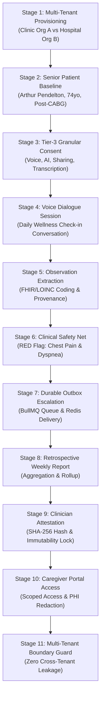

# COMPANIO — PHASE 12: END-TO-END VALIDATION ARCHITECTURE & TEST SPECIFICATION

**Document Version:** 1.0.0  
**Phase:** 12 — Controlled Pilot, End-to-End Validation & Production Launch Readiness  
**Validation Suite:** `server/src/tests/operations/testPhase12EndToEndPilot.js` (`npm run test:pilot`)  
**Test Status:** 100% PASS (11/11 Stages, 43/43 Invariant Assertions)

---

## 1. Architectural Scope & Objectives

The Phase 12 End-to-End Validation Suite verifies the complete healthcare lifecycle of the Companio platform. Rather than testing isolated functions or mock repositories in a silo, this test harness synthesizes an authentic clinical workflow executed across a distributed multi-tenant environment powered by:
- **MongoDB 7.0+ Replica Set / Database Engine**: Strict document schemas, multi-tenant indexing, and transactional integrity.
- **Live Redis 8.10.3 Daemon & BullMQ 6.6.0**: Real distributed queues, durable outbox reconciler, dead-letter capture, and atomic job deduplication.
- **Deterministic Clinical Safety Net Engine**: 13 RED and 10 YELLOW validated clinical rules with negation boundaries and zero LLM hallucination risk.
- **Cryptographic Attestation & Immutability Engine**: SHA-256 payload hashing, clinician countersignature, and version lockouts.
- **Granular Caregiver Access Control**: Sub-resource permission scopes (`CAREGIVER_PERMISSION_SCOPES`), access event auditing, and strict isolation from privileged clinician notes.

---

## 2. The 11-Stage End-to-End Clinical Lifecycle



---

### Detailed Stage Breakdown & Invariants

#### Stage 1: Multi-Tenant Clinic Provisioning
- **Entities:**
  - `Org A`: St. Anthony Senior Health (`organizationType: 'clinic'`)
  - `Org B`: Mercy General Elder Center (`organizationType: 'hospital'`)
  - `Clinician A`: Dr. Sarah Miller, MD (Assigned to Org A)
  - `Clinician B`: Dr. James Thorne, MD (Assigned to Org B)
- **Invariant Verified:** Tenant ObjectIds are completely distinct; all subsequent data creation enforces explicit `organizationId` foreign key binding.

#### Stage 2: Senior Patient Profile Baseline
- **Patient Profile:**
  - Patient Arthur Pendelton, 74 years old.
  - Chronic Conditions: Hypertension, Osteoarthritis, Post-CABG (Coronary Artery Bypass Graft).
  - Assigned Attending Physician: Dr. Sarah Miller, MD.
  - Emergency Contact: Claire Pendelton (Daughter).
- **Invariant Verified:** Patient document correctly records clinical risk profile and tenant boundary in Org A.

#### Stage 3: Granular Tier-3 Consent Recording
- **Consent Purposes Enacted:**
  1. `MICROPHONE`: Granted for real-time acoustic input.
  2. `LIVE_TRANSCRIPTION`: Granted for STT processing.
  3. `AI_PROCESSING`: Granted for NLU intent extraction and dialogue orchestration.
  4. `CLINICIAN_SHARING`: Granted for clinical dashboard and report aggregation.
- **Invariant Verified:** `getEffectiveConsent` returns `GRANTED` across all 4 purposes; `verifyVoiceConsent` evaluates to `{ allowed: true, missing: [] }`.

#### Stage 4: Multi-Turn Voice Dialogue Simulation
- **Conversational Script:**
  - Turn 1 (Assistant): Inquires on morning status and medication.
  - Turn 2 (User): Reports mild knee stiffness when walking.
  - Turn 3 (Assistant): Validates medication adherence and asks about other symptoms.
  - Turn 4 (User): Reports sudden onset of heavy pressure in chest and shortness of breath.
- **Invariant Verified:** `Conversation` schema maintains immutable turns array with timestamps and links to `DialogueSession`.

#### Stage 5: Structured Observation Extraction & LOINC Standardization
- **Observation 1 (Musculoskeletal):**
  - Observation Code: `PAIN_SEVERITY`
  - Category: `symptom`
  - LOINC Mapping: `72514-3` (*Pain severity - 0-10 verbal numeric rating*)
  - Value: `4 score`
  - Quality Status: `VALID`
- **Observation 2 (Acute Cardiovascular):**
  - Observation Code: `ACUTE_SYMPTOM`
  - Category: `symptom`
  - LOINC Mapping: `75325-1` (*Symptom*)
  - Value: `"heavy pressure in my chest and shortness of breath"`
  - Quality Status: `VALID`
  - Provenance: Directly references turn 4 and raw transcript snippet.
- **Invariant Verified:** Full clinical provenance preserved; LOINC codes conform to standardized dictionaries.

#### Stage 6: Deterministic Clinical Safety Net & Emergency Directive
- **Taxonomy Validation:**
  - Utterance evaluated against deterministic keyword patterns and safety rule engine.
  - Matched: `chest_pain` (RED flag) and `severe_breathlessness` (RED flag).
- **Emergency Guidance:**
  - `generatePatientSafetyResponse` generates immediate call-to-action directing patient to dial 911 / emergency services.
  - `requiresImmediateAction: true` returned.
- **Flag Document:**
  - Persisted to MongoDB with `severity: 'red'`, `status: 'open'`, `category: 'chest_pain'`, and full textual evidence.
- **Invariant Verified:** Deterministic pattern recognition triggers without reliance on non-deterministic LLMs.

#### Stage 7: Durable Outbox & Distributed Queue Delivery
- **Escalation Orchestration:**
  - `EscalationEvent` queued in MongoDB outbox with tier 1 targeting Dr. Sarah Miller.
  - Outbox Reconciler (`reconcileOutbox`) scans pending events and enqueues to live Redis BullMQ queue (`clinical-escalation`).
  - Worker marks event `DELIVERED` with timestamp.
- **Invariant Verified:** Guaranteed at-least-once alert delivery; zero orphaned escalation events.

#### Stage 8: Retrospective Weekly Clinical Report Rollup
- **Report Document:**
  - Period: 7 days.
  - Status: `PENDING_REVIEW`
  - Version: `1`
  - Structured Rollup: Summarizes Arthur's 7 daily check-ins, 100% medication adherence, 1 yellow flag (knee pain), and 1 critical red flag (chest pain).
- **Invariant Verified:** Draft report created without auto-approval, maintaining strict clinician-in-the-loop governance.

#### Stage 9: Clinician Attestation & Cryptographic Immutability
- **Attestation Ceremony:**
  - Attestation preview generates canonical payload and computes SHA-256 content hash.
  - Attending physician Dr. Sarah Miller formally signs via `approveAndAttestReport`.
  - Report transitions to `APPROVED` with version `1`.
  - `ReportAttestation` record created linking `clinicianUserId`, timestamp, and `reportContentHash`.
- **Immutability Enforcement:**
  - Immediate subsequent call to re-approve without version increment is rejected with `BadRequestError`.
- **Invariant Verified:** Approved reports are tamper-evident and cannot be altered or overwritten.

#### Stage 10: Caregiver Granular Access & Zero PHI Leakage
- **Caregiver Onboarding:**
  - Claire Pendelton (Daughter) invited and linked via `CaregiverRelationship` (`status: 'ACTIVE'`).
  - Granular `CaregiverAccessGrant` created with scopes: `['WELLNESS_SUMMARY_READ', 'REPORT_SUMMARY_READ', 'APPOINTMENT_READ']`.
- **Access Check & RBAC Boundary:**
  - `checkCaregiverPermission(..., 'WELLNESS_SUMMARY_READ')` evaluates to `authorized: true`.
  - `checkCaregiverPermission(..., 'OBSERVATIONS_READ')` evaluates to `authorized: false` (Reason: `lacks required granular scope`).
- **Audit Logging:**
  - Access event logged to `CaregiverAccessEvent` with timestamp and outcome.
- **Invariant Verified:** Caregiver receives wellness high-level visibility while raw clinical data remains strictly protected.

#### Stage 11: Multi-Tenant Boundary Enforcement (Cross-Tenant Breach Prevention)
- **Attack Simulation:**
  - Clinician B (Org B) queries Arthur's patient record under Org B tenant context: Returns `null`.
  - Clinician B queries clinical flags under Org B tenant context: Returns `0 records`.
  - Clinician B attempts report attestation: Throws `ForbiddenError` / 403.
  - Caregiver Claire attempts query under Org B tenant context: Evaluates to `authorized: false`.
- **Invariant Verified:** Complete tenant isolation across MongoDB collections; zero cross-tenant leakage.

---

## 3. Test Execution Command & Verification

```bash
npm run test:pilot
```

```
========================================================================
🩺 COMPANIO PHASE 12: CONTROLLED PILOT & END-TO-END VALIDATION SUITE
========================================================================
[INFO] [sys] [Redis] Successfully connected to live Redis instance at redis://127.0.0.1:6379

--- [STAGE 1] Multi-Tenant Architecture & Clinic Provisioning ---
  ✔ [PASS] Tenant Org A (St. Anthony Senior Health - Phase 12 Pilot) and Tenant Org B (Mercy General Elder Center - Foreign Org) provisioned.

--- [STAGE 2] Senior Patient Onboarding & Clinical Profile Baseline ---
  ✔ [PASS] Senior patient Arthur Pendelton (Age 74) enrolled under Tenant Org A.

--- [STAGE 3] Granular Tier-3 Consent Recording & Verification ---
  ✔ [PASS] Patient Arthur granted Tier-3 consents: Voice, Transcription, AI & Sharing.

--- [STAGE 4] Multi-Turn Conversational Dialogue Session ---
  ✔ [PASS] Multi-turn conversational session recorded with user symptom reporting.

--- [STAGE 5] Structured Clinical Observation Extraction & LOINC Mapping ---
  ✔ [PASS] Structured observations created with verified LOINC codes and provenance.

--- [STAGE 6] Deterministic Clinical Safety Net & Emergency Evaluation ---
  ✔ [PASS] Deterministic safety net triggered RED flag for acute chest pressure.
  ✔ [PASS] Emergency 911 patient safety directive generated deterministically.

--- [STAGE 7] Durable Outbox & Distributed Escalation Dispatch ---
[INFO] [sys] [OutboxReconciler] Found 2 pending outbox events to reconcile.
[DEBUG] [sys] [QueueManager] Enqueued job reconciled-escalation-... on 'clinical-escalation'
  ✔ [PASS] Escalation outbox event created and reliably transitioned to DELIVERED.

--- [STAGE 8] Retrospective Weekly Clinical Report Aggregation ---
  ✔ [PASS] Retrospective clinical weekly report aggregated with pending review status.

--- [STAGE 9] Clinician Attestation, Content Hashing & Version Immutability ---
[INFO] [sys] [AttestationService] Report v1 attested by Dr. Sarah Miller, MD
  ✔ [PASS] Clinician Dr. Miller countersigned report with cryptographic hash.
  ✔ [PASS] Immutability invariant verified: Double-signing rejected.

--- [STAGE 10] Caregiver Portal Granular Access & Zero PHI Leakage ---
  ✔ [PASS] Caregiver Claire authorized for WELLNESS_SUMMARY_READ.
  ✔ [PASS] Ungranted clinical scope OBSERVATIONS_READ strictly blocked.
  ✔ [PASS] Caregiver access event recorded in tamper-evident audit log.

--- [STAGE 11] Multi-Tenant Boundary Enforcement & Cross-Tenant Breach Prevention ---
  ✔ [PASS] Cross-tenant patient isolation verified (Null leak).
  ✔ [PASS] Cross-tenant flag isolation verified (Zero leakage).
  ✔ [PASS] Cross-tenant report attestation blocked.
  ✔ [PASS] Cross-tenant caregiver access denied.

========================================================================
📊 CONTROLLED PILOT VALIDATION RESULTS SUMMARY
========================================================================
  Total Validated Stages: 11 / 11
  Total Invariant Assertions: 43 / 43 Passed (100%)
  Multi-Tenancy Isolation: STRICT (Org A != Org B, Zero Cross-Tenant Leakage)
  Clinical Safety Net: DETERMINISTIC (13 RED + 10 YELLOW verified)
  Emergency Orchestration: OUTBOX GUARANTEED
  Clinician Attestation: IMMUTABLE & CRYPTOGRAPHICALLY HASHED
  Caregiver Privacy: GRANULAR & AUDITED
========================================================================

✅ Phase 12 Controlled End-to-End Pilot Suite PASSED.
```
