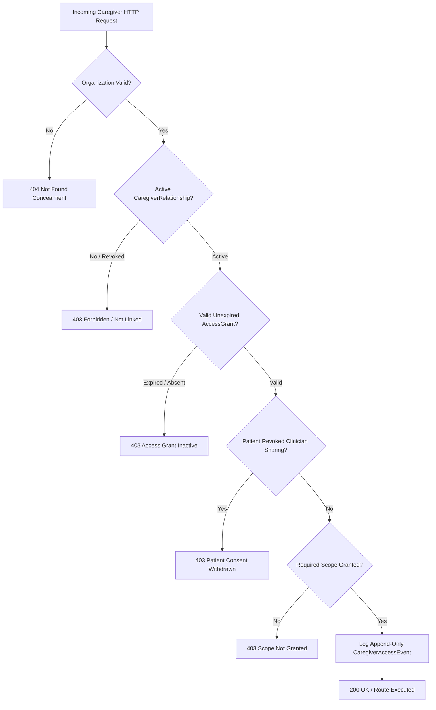

# 📋 Companio — Caregiver Permission & Scoping Matrix (Phase 8)

**Document Reference**: `docs/CAREGIVER_PERMISSION_MATRIX.md`  
**Status**: ACTIVE / VERIFIED  
**Governing Standard**: Role-Based & Attribute-Based Access Control (RBAC/ABAC)  

---

## 1. Permission Architecture Overview

Companio enforces strict attribute-based access control (ABAC) for all non-patient, non-clinician users. Caregivers never receive blanket access. Instead, permissions are divided into **13 Granular Scopes** that can be individually granted or withheld by the patient via the Patient Permission Center (`PatientCaregiverAccess.jsx`).

In addition to positive scopes, Companio enforces an uncompromised set of **Strict Negative Boundaries** that can never be granted to a caregiver under any circumstances.

---

## 2. Granular Scopes Catalog

| Scope Identifier | Plain-English Label | Description & Information Disclosed |
| :--- | :--- | :--- |
| `PROFILE_READ` | Patient Demographics | Read non-clinical demographic info (name, preferred language, emergency contact). |
| `WELLNESS_SUMMARY_READ` | High-Level Wellness Summary | View high-level wellness score, check-in completion status, and adherence trends. |
| `CHECKIN_HISTORY_READ` | Check-in History & Notes | View dates and summary notes from completed voice check-ins (no clinical diagnosis). |
| `MEDICATION_SCHEDULE_READ`| Medication Schedule | View prescribed medication times, dosages, and daily reminder schedules. |
| `MEDICATION_ADHERENCE_READ`| Medication Adherence History | View patient-reported adherence history and missed dose occurrences. |
| `APPOINTMENT_READ` | Upcoming Appointments | View scheduled doctor visits, specialist appointments, and transportation details. |
| `APPOINTMENT_COORDINATE` | Appointment Coordination | Request new appointments or reschedule consultations on the patient's behalf. |
| `OBSERVATIONS_READ` | Routine Health Observations | View routine health metrics (sleep duration, hydration volume, step counts). |
| `PATIENT_CONCERNS_READ` | Patient Concerns History | View non-urgent concerns and questions previously voiced by the patient. |
| `REPORT_SUMMARY_READ` | Attested Report Summaries | View high-level non-diagnostic wellness summaries from published clinical reports. |
| `NOTIFICATION_RECEIVE` | Care Alerts & Notifications | Receive SMS, push, or email alerts for missed check-ins or appointment reminders. |
| `VOICE_CHECKIN_ASSIST` | Check-in Voice Assistance | Assist the patient during a real-time voice check-in session from the same room. |
| `CONCERN_SUBMIT` | Submit Caregiver Observations | Submit written observations, mobility updates, or health concerns directly to care team. |

---

## 3. Strict Negative Boundaries (Non-Delegable Privileges)

Under no circumstances—even with Power of Attorney or explicit patient request—can a caregiver be granted the following privileges within Companio. These boundaries preserve physician authority and patient medical safety:

```
┌────────────────────────────────────────────────────────────────────────────────┐
│                        STRICT NEGATIVE PERMISSIONS                             │
├────────────────────────────────┬───────────────────────────────────────────────┤
│ Prohibited Action              │ Technical Defense & Enforcement Mechanism     │
├────────────────────────────────┼───────────────────────────────────────────────┤
│ 1. Modify Prescriptions        │ POST/PUT /api/v1/prescriptions blocked:       │
│                                │ requireRole('CLINICIAN') enforces 403 Forbidden│
├────────────────────────────────┼───────────────────────────────────────────────┤
│ 2. Create Clinical Diagnoses   │ POST /api/v1/diagnoses blocked:               │
│                                │ requireRole('CLINICIAN') enforces 403 Forbidden│
├────────────────────────────────┼───────────────────────────────────────────────┤
│ 3. Attest Clinical Reports     │ POST /api/v1/reports/:id/approve blocked:     │
│                                │ requireRole('CLINICIAN') enforces 403 Forbidden│
├────────────────────────────────┼───────────────────────────────────────────────┤
│ 4. Resolve Clinical Flags      │ POST /api/v1/flags/:id/resolve blocked:       │
│                                │ requireRole('CLINICIAN', 'ADMIN') enforces 403 │
├────────────────────────────────┼───────────────────────────────────────────────┤
│ 5. Manage Safety Rules         │ POST/PUT /api/v1/safety/rules blocked:        │
│                                │ requireRole('ADMIN') enforces 403 Forbidden    │
├────────────────────────────────┼───────────────────────────────────────────────┤
│ 6. Delegate Access to Others   │ POST /api/v1/patients/:id/caregivers blocked: │
│                                │ requirePatientOrGuardian strictly checks caller│
└────────────────────────────────┴───────────────────────────────────────────────┘
```

---

## 4. Permission Evaluation Algorithm

Every caregiver request processed by `tenantAuthorization.js` evaluates through the following deterministic pipeline:



---

## 5. Automated Verification Evidence

The entire scope matrix and negative boundary enforcement are verified by automated test suites:
- `server/src/tests/caregivers/testCaregiverAuthorization.js` (Negative boundaries & emergency contact isolation)
- `server/src/tests/caregivers/testCaregiverAccessGrants.js` (Positive & negative scope evaluation)
- `server/src/tests/caregivers/testCaregiverRevocation.js` (Instant revocation & consent withdrawal)
- `server/src/tests/caregivers/testCaregiverMultiTenancy.js` (Cross-tenant & cross-caregiver isolation)
