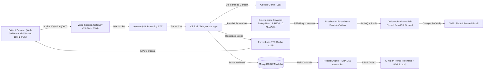

# Companio — Project Overview

**Document Purpose:** High-level technical and product orientation for Companio across all roles, systems, and governance constraints.  
**Scope:** Full Companio monorepo (`client/`, `server/`, `docs/`, container infrastructure).  
**Status:** `IMPLEMENTED / VERIFIED (SYNTHETIC DATA MODE ONLY)`  
**Owner Category:** Product & Engineering  
**Last Verified Date:** 2026-11-12  
**Relevant Source Files:** [`package.json`](../package.json), [`server/src/server.js`](../server/src/server.js), [`client/src/App.jsx`](../client/src/App.jsx), [`server/src/models/index.js`](../server/src/models/index.js)

---

## 1. Mission & Identity

Companio is an AI-assisted, voice-first healthcare and wellness support platform built specifically for **adults aged 55+** and post-discharge remote wellness monitoring. Rather than forcing older adults to navigate multi-page forms or tiny keyboards, Companio conducts guided, warm spoken check-ins, translates natural responses into LOINC-mapped clinical observations, triggers deterministic safety rules on concerning symptoms, and prepares evidence-linked retrospective clinical summaries for physicians.

> [!IMPORTANT]
> Companio is strictly a **clinician-support tool**. It never diagnoses disease, recommends treatments, modifies medication dosages, or dispatches emergency medical services.

---

## 2. Core User Portals

| Portal | Layout Component | Core Workflows | Primary Users |
| :--- | :--- | :--- | :--- |
| **Patient Portal** | [`PatientLayout`](../client/src/components/layout/PatientLayout.jsx) | Daily/weekly 16-state `VoiceOrb` check-ins, read-back confirmation, longitudinal timeline/trends, labs, prescribed vs reported medications, care team, consent center, caregiver access | Older adults (55+) |
| **Clinician Portal** | [`ClinicianLayout`](../client/src/components/layout/ClinicianLayout.jsx) | Urgency-sorted triage queue, unacknowledged RED-flag banner, patient chart tabs, observation drawer, flag escalation/resolution, versioned reports with PDF export & SHA-256 attestation | Physicians, Nurses, Care Coordinators |
| **Caregiver Portal** | [`CaregiverLayout`](../client/src/components/layout/CaregiverLayout.jsx) | Linked-patient switcher, scoped wellness overview, check-in/appointment visibility, `CAREGIVER_REPORTED` concern submission, assisted voice check-ins, immutable access audit | Authorized family members / advocates |
| **Organization Admin** | [`OrganizationAdminLayout`](../client/src/components/layout/OrganizationAdminLayout.jsx) | Tenant overview, member invitations & suspension, clinical teams, RBAC visibility, queue/alert operational telemetry, explicit governance gap tracking | Clinic Admins, Org Owners, Auditors |

---

## 3. End-to-End Platform Architecture

---

## 4. Security & Privacy Posture

- **Multi-Tenant Isolation:** Every organization record carries `organizationId`, enforced server-side via [`tenantContext.js`](../server/src/middleware/tenantContext.js).
- **Audio Ephemerality:** `AUDIO_RETENTION_MODE` is Zod-locked to `'disabled'` in [`envValidator.js`](../server/src/config/envValidator.js).
- **Heuristic De-Identification & Zero-PHI Firewall:** Outbound escalation alerts contain **zero** patient names, diagnoses, clinical quotes, or raw database ObjectIds (`ALERT_REF_...` HMAC-SHA256 tokens instead). Failed scrubbing aborts external transmission.
- **Compliance Boundary:** Companio's de-identification module is a defense-in-depth data minimization layer, **not** certified HIPAA Safe Harbor or Expert Determination. Live patient deployment remains **BLOCKED**.

---

## 5. Related Documentation

- [Project Status & Readiness](PROJECT_STATUS.md)
- [Domain Glossary](GLOSSARY.md)
- [Documentation Index](DOCUMENTATION_INDEX.md)
- [Product Requirements Document (PRD)](01_PRODUCT/PRD.md)
- [System Architecture](03_ARCHITECTURE/ARCHITECTURE.md)
