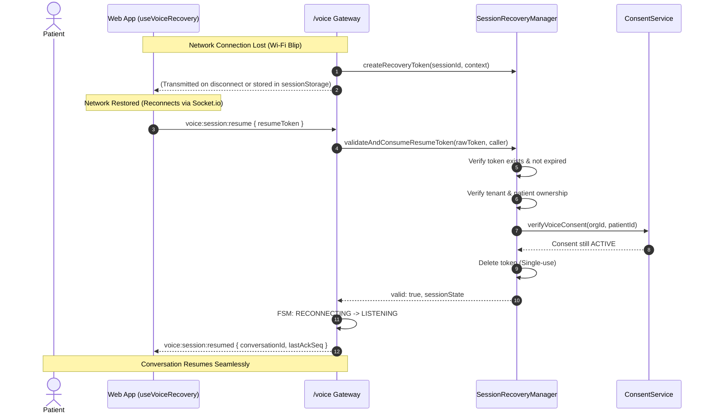

# Voice Session Network Interruption & Session Recovery Protocol

**Protocol Version**: 1.0.0 (Phase 4 Hardening)  
**Backend Manager**: `server/src/services/voice/session/sessionRecoveryManager.js`  
**Client Hook**: `client/src/hooks/useVoiceRecovery.js`

---

## 1. Problem Statement

Older adults conducting health check-ins often move between Wi-Fi and mobile data or experience temporary signal drops. A standard WebRTC or WebSocket teardown discards conversation history and forces the senior to restart their check-in from the beginning—causing frustration and loss of clinical data.

The **Session Recovery Protocol** allows seamless reconnection within a 5-minute window without violating HIPAA privacy or multi-tenant authorization boundaries.

---

## 2. Cryptographic Resume Tokens

1. **Token Generation**:
   When a client unexpectedly disconnects (FSM enters `RECONNECTING`), the server generates a 32-byte cryptographically random hex token:
   `rawToken = crypto.randomBytes(32).toString('hex')` (64 characters).
2. **Storage**:
   The token is SHA-256 hashed and stored in memory:
   `recoveryRecords.set(sha256(rawToken), record)`.
3. **Time-To-Live (TTL)**:
   Strict 5-minute expiry (`RESUME_TOKEN_TTL_MS = 300,000`). Expired tokens are purged by garbage collection.
4. **Single-Use Replay Protection**:
   The token is consumed and immediately deleted upon first validation. Any replay attempt is rejected.

---

## 3. Resume Handshake Sequence

---

## 4. Multi-Tenant & Security Verification

A resume request is strictly rejected if:
- The token is missing, expired (>5 min), or already used.
- The calling user's tenant organization does not match the session's organization (`Cross-tenant rejected`).
- The patient ID does not match (`Cross-patient rejected`).
- The patient's consent for `LIVE_TRANSCRIPTION` or `AI_PROCESSING` was revoked while disconnected.
- The patient's organization membership has been suspended or terminated.
